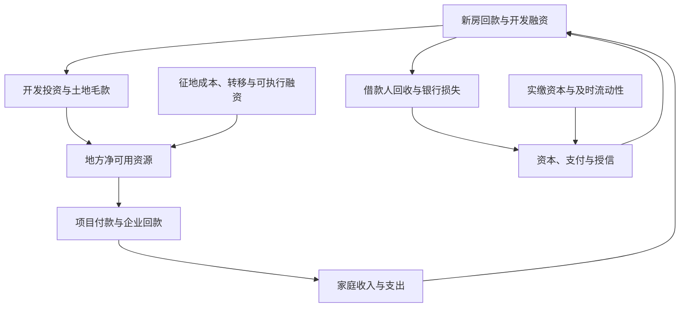

# 中国危机研究首轮报告

## 已在发生的调整，2027年的窗口，与家庭现在该做什么

**作者：boss 1｜工作区：work/boss 1｜研究截点：2026年11月27日（America/Los_Angeles）**

本文给出经济裁决。工程验收和发布是否完成，另见同版本`research/acceptance.json`与`research/final_review.md`；不能用报告已写成代替离线操作和独立验收。

## 一、核心裁决

**中国当前已经处于一场房地产、地方财政和部分私人部门相互传导的长期调整中。最可能的未来路径，是在政策滚续、项目交付、局部重组和补资本支持下继续分摊损失，同时制造、出口和部分服务业保持增长。家庭面对的首要风险是收入与资产变现速度跟不上合同付款，2027年全国银行同时崩溃并非本报告的主判断。**

| 核心问题 | 本轮明确判断 | 机制、窗口和行动 |
|---|---|---|
| 当前是不是危机 | 地产开发与融资、土地财政和部分家庭企业已经经历实质损失。全国实际产出和居民平均实际收入仍增长；不能将部门危机改写为所有部门同步衰退。 | 风险已存在，不能等待一个统一的“爆发日”才核现金流。 |
| 最可能怎样发展 | 首位为渐进承损与结构分化；次位为外需、地方付款和弱银行同时恶化的急性信用收缩；有效收入修复为能够改变主路径的分支，可来自有效政策，也可来自私人部门持续的自主改善。 | 未来12—24个月看实际到账、私人投资与银行资本；未来3—5年看旧收入模式能否被替代。没有给三条路径编概率。 |
| 2027年是否必爆 | **不支持必爆。2027是值得集中复核的政策、融资与资本窗口。** | 专门置换安排、平台退出名录、工行附加资本、新购特定首套住房贷款贴息的受理安排各有时间，不能相加成全国到期墙。 |
| 十年假说是否成立 | **从2021年地产高位起算，调整拖到约2030年前后，是应准备的长路径。**从2026年再追加整整十年全面停滞，证据不足。 | 时间取决于损失承担、真实收入与新税基形成，不由日本或某个作者的年份决定。 |
| 是否意味着A股十年必熊 | **否。拒绝这一推论。** | 股票收益另受起始估值、上市企业利润、股息、币种与持有窗口影响。近年必需开支的钱不能依赖反弹，现金充足者也无须因一句“十年危机”清空全部长期资产。 |

支持主判断的关键事实是：地产融资仍明显收缩，住户贷款净减少，民间非房地产投资偏弱，小微需求和回款压力较大；同时工业利润、出口、居民实际平均收入、法定地方债再融资和部分银行利润在改善。**这些抵消力量解释了为何可以长期承压而不立即全面失灵，也说明恢复并非没有政策和产业基础。**[NBS活动MA002](https://www.stats.gov.cn/sj/zxfb/202611/t20261116_1965844.html)、[收入MA003](https://www.stats.gov.cn/sj/zxfbhjd/202610/t20261019_1965612.html)、[PBC官方转载MA004](https://jrj.sh.gov.cn/SCGK194/20261116/00d09e641a1148d5bdee81e3f0f483de.html)、[地方债PF027](https://zwgls.mof.gov.cn/tjsj/202611/t20261127_4005532.htm)。

## 二、危机已经发生在哪里

### 1. 新房开发规模明显缩小，住房市场内部也在变化

按各年首次发布的水平，2021—2025年新建商品房合同销售额下降约53.9%、面积下降50.9%、新开工面积下降70.5%，开发商到位资金减少53.7%。它们是不同年份发布版本的水平比较，不能伪装成同一修订版本的连续可比增速。[2021原发布PF003](https://www.stats.gov.cn/xxgk/sjfb/zxfb2020/202201/t20220117_1826440.html)、[2025原发布PF007](https://www.stats.gov.cn/sj/zxfb/202601/t20260119_1962324.html)；复算输入、脚本及结果见地产专题。

到2026年前十个月，新房销售面积按官方可比口径同比下降13.7%，销售额下降14.3%，投资下降21.6%，新开工下降24.4%，开发商资金下降21.9%，其中国内贷款下降33.4%。与此同时，二手房网签面积增长11.4%。这表明存量住房流通可以改善，而新增开发现金流仍困难。旧房卖家收到钱后，可能还贷、留存、消费或换新房；不能把二手交易额全算成开发商回款。[NBS地产PF009](https://www.stats.gov.cn/sj/zxfb/202611/t20261116_1965840.html)。

10月70城二手住宅同比有68城下跌，等权平均约−4.36%；新房63城下跌，等权平均约−2.73%。上海新房/二手同比约+2.7%/+2.2%，昆明约−4.3%/−6.5%。这些是城市指数和等权复算，不是全国成交量加权指数，更不能代替用户某套房子的可成交价。某一套房能否变现，仍要看城市、片区、房龄、租约、产权与银行解押条件。[70城原表PF010](https://www.stats.gov.cn/zwfwck/sjfb/202611/t20261116_1965836.html)。

**主路径的机制**是开发商先受到销售回款、旧项目交付及新增融资的共同约束，随后压缩拿地和开工。施工、材料、代理、地方土地款和相关就业因此受到影响。这里没有把房价跌幅直接改成银行坏账率，也没有把投资降幅直接从GDP增速扣除。

缓解已经发生：政策披露累计交付750多万套困难住房，白名单机制累计审批贷款超过8.4万亿元。但交付套数、授信审批和实际放款是三个不同变量，审批额度不能全额记为施工和家庭实际收到的钱。[保交付PF037](https://www.mohurd.gov.cn/xinwen/jsyw/art/2025/art_09d559f5409e45aeaa9e874af395d2d5.html)、[国务院金融工作报告PF029](https://jrj.wuhan.gov.cn/ynzx_57/xwzx/202611/t20261105_2874511.shtml)。

2026年8月的新销售规则也会改变开发现金顺序：适用新规的项目要满足相应施工进度与预售资金监管要求，已取得相应规划许可的旧项目保留原安排，现售受到鼓励。不能把新项目规则倒套全部旧项目。它有助于降低新的交付风险，但也提高销售前建设资金的要求，不能仅据制度出台就宣布开发量会快速反弹。[住建部等PF028](https://www.mohurd.gov.cn/gongkai/zc/wjk/art/2026/art_45644612a7064289bdc0d5b1427a25d8.html)。

### 2. 地方财政的关键是净可用现金与付款顺序

土地出让毛收入从2021年的87051亿元降至2025年的41518亿元，下降52.3%。但地方征地、拆迁、开发等支出也会变化，上级转移、发债、结转和资金用途还会改变可用资源。**“少卖一元地，就少一元可自由花的钱”这一机械模型被本轮实际核算否定。**[财政历年原发布PF012—PF021，见来源索引]。

前十月的对账很直观：

| 2026前十月相对2025同期 | 变化，亿元 | 能说明什么 |
|---|---:|---|
| 土地出让毛收入 | −6456 | 毛款显著收缩 |
| 土地相关支出 | −5833 | 成本、开发与相关项目支出同时减少 |
| 上述收支差额变化 | −623 | 仅为两条宽口径线的差额变化，不能直接叫净自由现金损失 |
| 地方本级一般公共预算收入 | +3001 | 经常性财政收入没有与土地同方向下降 |
| 地方本级基金收入 | −6289 | 土地相关账本承压 |
| 地方一般公共预算支出 | +336 | 一般预算获得了缓冲 |
| 地方基金支出 | −6811 | 项目和土地相关支出收缩更明显 |

来源：[2025同期PF017](https://gks.mof.gov.cn/tongjishuju/202511/t20251117_3976517.htm)、[2026同期PF018](https://app.mof.gov.cn/mofmobile2026/czxw/202611/t20261120_4005120.htm)。全国财政收入、地方本级收入与政府基金收入的范围不同，不能交替使用来强化同一个结论。

地方个案还构成了重要反证。定南县土地毛收入下降，但因一项征地支出降得更多，扣两项已观察成本后的余额反而增加；这不是全部土地成本，也不是全国估计。云南基金收入的增长含部分城市一次性收入，不能外推所有县区或昆明住宅家庭。这些例子说明需要逐地追“谁已经收到钱、谁必须付款”，不能用全国比例替代地方现金表。[PF034—PF036；`tasks/property_fiscal/analysis_fiscal.md`]。

因此，本报告选择有条件的财政传导：**高土地依赖、缺少可调用转移和营运现金、又不能及时融资的市县，更容易先缩项目、延结算或拖供应商；拥有可用资金和优质税基的地方可以缓冲。**供应商只有实际收到清欠款，再支付工资、还贷或采购后，政策才进入家庭现金流。

### 3. 居民和小微的压力，不能被平均增长遮掉，也不能被全部抹黑

前三季度全国人均可支配收入34230元，实际增长4.4%，消费实际增长2.7%；城镇实际收入与消费分别增长3.6%和2.1%。收入中位数名义增速4.6%，低于均值5.3%。这支持收入仍增长、支出更谨慎和群体差异，并不支持“全体家庭收入崩塌”。调查收入还包括非银行到账及实物成分，不能直接拿来算月供覆盖。[NBS收入MA003](https://www.stats.gov.cn/sj/zxfbhjd/202610/t20261019_1965612.html)。

前十月住户贷款减少1.46万亿元、存款增加8.47万亿元，企业贷款增加12.39万亿元。净偿贷与存款增长支持部分家庭在修复资产负债表，但存款人与还贷人可能不同，住户贷款也包含个体经营，不能据此断言每家都在主动还贷，或全国问题全由信贷需求造成。[PBC原稿的政府转载MA004](https://jrj.sh.gov.cn/SCGK194/20261116/00d09e641a1148d5bdee81e3f0f483de.html)。

北大小微调查2026Q3原机构摘要显示平均营收同比下降19.5%、环比增长8.2%，净利润率4.2%，无外部融资需求的占45.6%，现金不足以维持经营的占11.7%。当季7848份有效问卷来自支付宝活跃经营者调查框，公司6%、注册个体39%、未注册55%，服务业84%。本轮读取原机构摘要与索引中的方法段，直接PDF读取受限，没有声称逐页读过全文，也不将该样本代表为所有中国企业。[MA008原机构](https://cer.gsm.pku.edu.cn/info/1013/1341.htm)。

与之相比，规模以上工业前十月利润增长16.0%、营收增长6.7%，但应收账款增长10.5%、平均回收期延长至72.2天。电子行业利润与汽车、非金属行业方向不同。**利润、订单与钱是否到账，必须分别判断。**同一个企业甚至可以报利润增长，又因应收占用而减少招聘。[NBS利润MA001](https://www.stats.gov.cn/zwfwck/sjfb/202611/t20261127_1965949.html)。

家庭的实际分组因此比一句总量判断更有用：地产及地方项目家庭重点查客户回款和奖金；小微经营家庭查实际经营净现金；出口家庭查订单、汇率与客户集中；固定收入且低债家庭重点查通胀、必要支出和长期资金期限。夫妻在同一行业、同一地方客户链工作，不自动等于两份独立保险。

## 三、银行：资本压力与挤兑不是同一张表

**个别银行风险已经兑现。**国务院金融工作报告明确披露依法对众邦银行实施接管。银行危机不必等到全国所有机构停摆才算风险。本轮的进一步裁决是：现有分组和样本公开数据，更支持局部信用损失与资本补充，并未证明全国系统性银行困境已经形成。[PF029](https://jrj.wuhan.gov.cn/ynzx_57/xwzx/202611/t20261105_2874511.shtml)。

监管原附件显示，截至2026Q3，大行、股份行、城商行、农商行的不良率分别为1.21%、1.24%、1.95%、2.90%，拨备覆盖与资本余量也明显不同。前三季城商行利润总量增长，农商行利润明显下降；全行业净息差低位与某些银行息差小幅回升可以同时发生。[BK001、BK002、BK010—BK013；原xls及770个数字提取见银行专题]。

本轮选工行和兰州银行，目的在比较差异，而非抽样推算全国多少银行会出险。两行的半年和三季报分别核了净贷款、准备、资产负债表、监管资本、逾期与流动性，四份真实输入均通过统一`compute plan/run`运行。

### 1. 一份可以复算的资本比较

| 2026年9月末，单位亿元 | 工行 | 兰州银行 |
|---|---:|---:|
| 账面权益 | 44001.65 | 369.91 |
| 核心一级资本净额CET1 | 39828.91 | 311.68 |
| 风险加权资产RWA | 304782.78 | 3533.13 |
| 实际CET1比率 | 13.07% | 8.82% |
| 本文公开资本参考线 | 2027年9.5% | 7.5% |
| 固定RWA、无新留存时静态余量 | 10874.55 | 46.70 |

来源：[工行三季报BK003](https://v.icbc.com.cn/userfiles/resources/icbcltd/download/2026/Announce20261030_4.pdf)、[兰州三季报BK004](https://static.cninfo.com.cn/finalpage/2026-10-29/1225637615.PDF)、[监管资本办法BK007](https://www.nfra.gov.cn/cn/view/pages/rulesDetail.html?docId=1134197&itemId=4214)。7.5%为5%最低要求加2.5%储备；个别第二支柱要求没有公开纳入。跌入储备区间与资不抵债不同。

把两行前三季实际贷款计提年化，作为“再增加一倍或两倍信用费用”的条件量尺，假设未来没有新留存、注资和税盾，监管调整差额固定：

| 条件压力 | 工行CET1 | 兰州CET1 | 含义 |
|---|---:|---:|---|
| 额外一倍年化费用，RWA不变 | 12.41% | 7.81% | 地方银行缓冲更薄 |
| 额外两倍，RWA不变 | 11.75% | 6.79% | 兰州相对7.5%参照缺约25.1亿元，仍高于裸最低5% |
| 额外一倍，RWA再增5% | 11.82% | 7.43% | 兰州相对参照缺约2.4亿元 |

这些数字说明哪类联合条件会压住扩表和分红，**不是对未来坏账的预测或发生概率**。实际留存、实缴资本、风险资产变化和回收率会改变结果。会计模型原生的权益/RWA不能冒充CET1；已从贷款净额扣过的准备不能再次抵扣权益。全部桥接见`bank_accounts.py`与`capital_and_liquidity_results.json`。

### 2. 为何既不能说银行无事，也不能直接推全国挤兑

兰州银行关注占比由上年末5.64%升至9月底7.46%；6月底逾期占5.37%，其中多数为三个月以内。早逾期、重组、不良、核销和回收有交叠，不能相加。9月底存款较年末增加1.77%、LCR为138.20%，又说明信用质量承压不等于当季已经发生客户全面外流。[BK004](https://static.cninfo.com.cn/finalpage/2026-10-29/1225637615.PDF)、[BK006](https://disc.static.szse.cn/download/disc/disk03/finalpage/2026-08-29/3c00e14f-653d-472a-984f-b07e40b90082.PDF)。

行业LCR155.67%、NSFR128.89%只汇总资产规模在2000亿元以上的银行，不是所有小银行都安全的证明。全国拨备和资本也不能随时转给任何地方机构。流动性借款可以补当期支付资金，却同时增加负债；真正的普通股实缴或可计入留存，才补核心资本。[BK002、BK008]。

工行拟增发募资不超过1000亿元、财政部拟认购700亿元，后续审核进展是政策承接证据；它们不能提前计入9月底资本。[发行方案BK014](https://static.cninfo.com.cn/finalpage/2026-09-07/1225550283.PDF)、BK009。房地产开发贷款、按揭与地方平台也不能按地理关系随意相加：甘肃省法定债到期额不等于兰州银行持仓，行业“建筑”“租赁和商务服务”不等于平台名单。

独立原表复核还保留费用口径差别：工行三季使用披露的总贷款信用费用，兰州三季量尺为摊余成本贷款费用，另有少量OCI计提。两家按自身费用年化的倍数是条件压力单位，不能当同口径经验违约率，也不用于跨行加权估计。详细桥接在 `research/model_results.md` 与独立银行核算记录。

本报告会在以下情况下升级为系统性银行危机判断：跨地区机构出现广泛重大财务困境与重大应急干预，实际资本承接赶不上信贷或支付功能损伤；或独立发生跨行外流、批发融资冻结及支付受阻，即使财报资本尚未及时反映。单家接管、资本规则提高或一条不良率，都不能单独完成这一裁决。

## 四、2027年的四个窗口

| 窗口 | 已核实的安排 | 真正要查的量 | 本轮判断 |
|---|---|---|---|
| 2027年初预算与置换接续 | 每年2万亿元的专门置换安排覆盖2024—2026，累计6万亿至2026年9月发行98.3%；另有2024—2028每年8000亿元安排，性质不同 | 尚待置换存量、实际续借、可用财政现金、净新增支出 | 工具新增额变化值得关注，不能当作同额2027现金缺口或信用损失 |
| 2027年6月底前后平台退出 | 地方执行说明与政策研究涉及退出政府融资职能名录 | 同一法律主体的债权、保证、经营现金与下一次续贷条件 | 名录变化不是全部债务同时到期，也不是债务消失 |
| 2027年1月1日大行资本要求 | 工行G-SIB附加要求从1.5%升至2.0% | 真实RWA、留存和实缴资本 | 按9月RWA增加约1524亿元资本要求，但仍有公开缓冲；不能推出当日银行危机 |
| 部分首套购房贴息政策窗口 | 2026年10月起政策暂定一年，符合条件贴息期限可达五年 | 新增资格、实际抵扣/财政支付、延续安排 | 受理期与存量支持期限不同，不对所有家庭自动减月供 |

来源：[PF025](https://www.mof.gov.cn/zhengwuxinxi/caizhengxinwen/202503/t20250324_3960464.htm)、[PF026/MA011](https://www.mof.gov.cn/zhengwuxinxi/caizhengxinwen/202610/t20261023_4003429.htm)、[南充地方执行PF030](https://www.nanchong.gov.cn/gzw/xwdt/bmxx/202607/t20260729_2350716.html)、BK003。平台中央文件未取得完整可公开原件，证据边界保留，不把地方执行片段扩大为全国借贷禁令。

实际到期表直接削弱了“2027全国统一到期墙”：按2025年底存量，福建2027年到期本金低于2026和2028；甘肃2027到期本息也低于2026。两省统计对象和本金/本息口径不同，不能相加或代表全国，但足以说明行政年份不能替代合同梯度。[福建PF032](https://czt.fujian.gov.cn/zwgk/tjsj/yjsbg/202608/P020260812552317055209.pdf)、[甘肃PF033](https://static.sse.com.cn/disclosure/bond/announcement/local/c/new/2026-05-26/0000_20260526_WTJT.pdf)。

前十月法定地方债到期本金32770亿元，其中28243亿元由再融资债偿还，比例86.19%。这是一项已执行的缓冲；利息13337亿元及其他来源偿还本金4527亿元仍需资金。**主判断是滚续继续，但弱主体的价、期限与承接方式更重要。**若多个省份同季出现大量不能续借的本金，并与已确认拖欠、银行融资冻结同步，2027风险才从窗口升级为事件。[PF027](https://zwgls.mof.gov.cn/tjsj/202611/t20261127_4005532.htm)。

## 五、十年假说：接受长调整，拒绝日历宿命

十年必须先明确起点和对象。中国2021是新房合同销售与开发规模高位；日本1991是本轮JST房价代理的局部峰，美国2007是同库另一房价代理的年频局部峰。日本这段代理测城市住宅用地评估，美国使用不同的住宅价格体系，中国又是销售/开发规模，三者不能当同一商品、同一峰值定义。

本轮在冻结JST R6真实数据上独立复算了峰后路径：

| 各自局部峰后十年 | 日本，1991→2001 | 美国，2007→2017 |
|---|---:|---:|
| 名义住房价格代理 | 约−23.9% | 约+11.3% |
| CPI折实住房价格代理 | 约−27.0% | 约−6.1% |
| 名义工资指数 | 约+3.2% | 约+24.4% |
| 实际人均GDP | 约+6.0% | 约+6.0% |
| 本币、含股息、CPI折实宽基股权总回报 | 约−32.5% | 约+72.0% |

来源：JST原数据及方法附录，完整选窗、逐年数表、代码、哈希和结果在`research/tasks/history_framework_review/`。这是历史描述，既不识别政策因果效应，也不给中国回报定参数。日本资产修复缓慢的同时产出仍可增长；美国住房实际价格十年仍低于所选峰，股票总回报却为正。两例共同否定“地产弱等于一切资产每年都跌”。

中国市场也要分清两个命题：“十年累计实际回报为负”和“十年每年都跌”完全不同。MSCI China A Onshore的2016—2025年历**美元、含股息毛总回报**连乘为约+24.21%、年化约2.19%，其中四年为负；截至2026-10-30滚动十年年化2.74%又是不同窗口。这不是人民币回报、税费后回报或CPI折实回报，不证明未来十年必正。它连同历史案例，只反对由地产调整机械推出所有年份必跌；未来某段十年实际回报为负仍是投资者应承受和检验的可能结果。[MSCI官方MA009](https://www.msci.com/documents/10199/dee20d77-051f-45d9-af6a-80f2b9911147)。

进一步用人民币同口径复算：MSCI China A Onshore的2016—2025年历NET含股息回报累计约+30.98%，用OECD全国月度CPI及NBS2025年12月同比衔接折实，累计约+13.78%，实际年化约1.30%。这里NET仅指指数约定的股息税处理，不是某家庭全部税费后；月均CPI近似年末购买力，结果只报约数。它说明A股历史上存在这样的人民币实际正回报窗口，不据此预测下一段十年。原值和公式见 `models/equity_real_return_input.json`、`equity_real_return.py`。[MSCI人民币NET原表EQ001](https://www.msci.com/documents/10199/255599/msci-china-a-onshore-index-cny-net.pdf)、[OECD经FRED的CPI EQ002](https://fred.stlouisfed.org/data/CHNCPIALLMINMEI)、[NBS2025年末CPI EQ003](https://www.stats.gov.cn/xxgk/sjfb/zxfb2020/202601/t20260119_1962330.html)。

日本JST银行危机起点为1997，美国为2007，距上述峰值分别六年与当年。更广的峰后筛选也没有固定六年规律。筛选用到了事后跌幅，含全球共同冲击、国家相关性及历史数据修订，不能把案例频率变成中国2027概率。IMF历史数据库的日本1997—2001危机区间还受到最多五年记录规则影响，不能把2001当作所有银行问题完全修复的日期。[IMF WP26/94](https://www.imf.org/-/media/files/publications/wp/2026/english/wpiea2026094-source-pdf.pdf)。

韩国1997的短期外币债务滚续中断，提供的是币种和剩余期限约束，而不是“中国某年一定重演”。中国的本币融资、国内债权人与行政承接能力改变了急性触发方式，但不消除低回报投资和损失分配。中国2015年的实际地方置换又表明，转换债权人、利率和期限能够显著减轻当期利息，却不把旧项目本金变成新增居民收入；本轮沿用这一可核算动作，而不照搬年份。

因此我接受的十年假说是：**从2021起的地产、财政收入模式和私人资产负债表重构，可能跨越接近十年的时间尺度，准备到约2030年前后仍合理。**这不是到2030一定结束的计时器，更不是未来十年实际GDP零增长的预测。若真实损失更早确认、居民可支配现金改善、地方新税基替代土地和私人投资持续恢复，调整可以缩短；若损失被不断滚动但收入没有改善，压力也可能更久。

## 六、作者框架如何改变本轮判断

本轮保留的不是作者的情绪或永久立场，而是能执行、能反驳的分析动作。阅读范围和未读部分在`framework_cards.md`与历史独立复核中列明。

| 框架 | 采用的动作 | 本轮反证与修正 |
|---|---|---|
| Pettis | 看资产负债表两侧，追损失最终由政府、银行、企业或家庭承担 | 他2015文章把日本概括成没有金融危机，与1997银行危机记录冲突；本轮拒绝这一历史命题。会计约束也不能直接算出恢复年限。 |
| Koo | 区分借款人修复与银行不放贷；降息未必创造新增私人支出 | 中国实际收入、出口与工业增长不支持全体私人部门统一收缩。需要分组，不能贴一个标签就结束调查。 |
| Sufi | 追住房、家庭债务与消费的接口，再看建设资源错配 | 原文对严重金融危机的判断是相对可能性而非排除；中国住房取得制度差异也使统一财富弹性不可靠。 |
| Batson | 查制度惯性、预售现金顺序及生产端政策偏好 | 2023年销售/房地产增长乐观判断接受后续实际数据反证；2026新旧项目规则不同，不能永久照搬2022制度。 |
| Setser | 区分中央融资能力、或有损失和地方当期现金 | 国家资产不等于随时可花的现金。其30%债务率、3%赤字、3%—4%名义增长“不增加债务”的一句算术不成立。 |
| Wright | 查财政净资源、银行回报、信用工具的边际作用 | 不能将全国非税变化全归地方，不把土地毛降幅当净支出，不把旧文章的全面通缩叙述套到2026新价格读数。 |
| 张斌 | 查政府支出是否转为供应商和居民实际收入，是否阻断收入—支出收缩 | 政策建议不等于支付已执行；钱只用来换旧债、还贷或留存时，工资与消费传导需要另核。 |

Setser的例子可直接验算：若期初债务率30%，总赤字为当期GDP的3%，名义增长3%—4%，无其他存量调整，则下一期债务率为`0.30/(1+g)+0.03`，约31.85%—32.13%，而非不增。若3%指初级赤字，还须另计利息。这个错误不消灭中央承接能力，但取消了“一句利率低于增速就自动稳定债务”的推断。[Setser原文FW006](https://www.cfr.org/articles/beijing-still-has-fiscal-space)。

作者原文包括：[Pettis2015](https://carnegieendowment.org/china-financial-markets/2015/09/if-we-dont-understand-both-sides-of-chinas-balance-sheet-we-understand-neither)、[Koo2014](https://cepr.org/voxeu/columns/balance-sheet-recession-reason-secular-stagnation)、[Sufi2023大学研究页](https://bfi.uchicago.edu/insight/research-summary/housing-household-debt-and-the-business-cycle-an-application-to-china-and-korea/)、[Batson2023](https://andrewbatson.com/2023/05/18/beijing-qa-on-growth-and-security/)、[Wright2026](https://rhg.com/research/chinas-financial-and-fiscal-decay/)、[张斌2026](https://www.cf40.org.cn/article/1/289274)。

## 七、数量模型实跑了什么，哪些被拒绝

全部模型在本地CPU运行，使用仓库统一入口，保留输入、模型输出、代码和环境哈希、切分及预算账本。没有用合成例冒充中国经济估计，也没有把回溯面板称为实时历史。新目录恢复又发现纠错实验的CSV路径指向旧目录；修复为仓库相对路径后，原始数据、面板、模型参数与全部数值输出保持相同。原失败记录和可移植复演均保留，这次重复计算不增加一份独立经济验证。

| 方法与真实目标 | 实际结果 | 用途裁决 |
|---|---|---|
| JST历史银行危机预警，固定训练/校准/测试 | 原版保留；修正35未知标签及3全特征缺失训练行后，训练1188/校准223/测试187，13个测试事件；logit校准Brier0.1703对基准0.1759、检出3漏10；HGB校准0.1854、检出1漏12 | 拒绝该校准HGB作主预警，logit仅比较；均不给中国危机概率 |
| 中国PMI桥接单季实际GDP同比，长样本 | 31个评价季度，MAE2.00百分点对滞后基线2.30 | 平均略好但疫情和版本拼接影响大 |
| 同GDP发布版本敏感性 | 11个评价季度，桥接MAE0.64，基线0.35 | 稳健改善失败，拒绝精确GDP预测 |
| 混频末端信息更新 | 读数3.59→3.52，news勾稽正确，但比实际Q3的4.5低约0.98百分点 | 算术归因可用，单次诊断不给预测权限 |
| 四份真实银行报表的损失会计 | 资产负债、净贷款/准备和CET1桥接可复算 | 采用条件压力与敏感性，不估全国概率 |
| 地产财政、历史与股票描述核算 | 直接用原表重算水平、期限、差额和复利 | 用来排除错量纲、错时间与机械推断 |

独立复核发现并修复了一个实质数据错误：35行未知危机标签曾被当成负例，另3行没有任何宏观特征。原实验保留，纠错另建输入和作业，未改时间切分、模型或阈值预算。**纠错后未校准HGB**的Brier为0.15651、AUC为0.731、检出7漏6，校准后只检出1次并误报43/148个非事件年份。旧版raw检出8漏5、校准版检出0漏13，完整新旧表均可复算。独立执行者还确认类别顺序无误，负校准斜率由独立二项似然再次复现；小校准段仅223行、9次事件，向其他时期和中国迁移均不成立。被拒的是本轮校准链及中国概率用途，不是宣布HGB算法无效。JST最终测试已经被看到，本次只是审计纠错，不能事后改选未校准输出或在同一段继续调参后宣布“重新验证成功”。模型的差成绩取消的是数值预测权限，**不取消经济裁决责任**。本轮主判断来自可核事实、明确现金与承损机制、最强竞争解释及可观察改判条件。

### 可修改的机制图

本轮以联合前提记录地产回款、地方净资源、家庭支出、银行资本、流动性和政策到账。每条边均有条件、反证、时滞与证伪条件，并保留真实提案历史。它不是已经训练好的神经网络，也不把“图中有引用”当作因果识别。

图中每个箭头都受联合条件限制。例如房价跌但无需出售、现金收入稳定的家庭，不会因估值变动立即少一笔现金；土地毛款下降但成本省得更多、转移及时到账的地方，不一定产生同额支付缺口；央行提供现金也不自动抹平银行资本损失。正式ALL边和修改回执在研究状态中。

## 八、最强竞争解释与改判条件

**竞争解释一：制造出口与政策已经足以快速完成恢复。**它最强的证据是工业利润、外需、服务活动和实际居民收入增长。本轮承认这些是实际缓冲。之所以未把全面恢复列首位，是私人非房地产投资、住户净偿贷、小微回款与地产融资尚未同步改善。只有增长持续转成工资、居民现金与私人新增投资，才能升级。财政主导的恢复须核实际支付；如果外需、生产率和私人现金流自主持续改善，也可独立带来恢复，新增财政转移不是所有恢复的必要条件。

**竞争解释二：政策工具已全部失效，全面崩溃只差日期。**这一解释难以容纳实际交付、法定债大比例再融资、工业增长、大行盈利与中央资本承接能力。滚续可能延长调整，却真实减轻当期本金支付。它不能证明所有旧项目有回报，同样也不能被说成完全无效。

**竞争解释三：2027恰是日本式第六年，因此危机会出现。**历史数据中不同事件间隔、房价代理与制度均不同。国内具体政策节点需要实际现金梯度和支付证据，而非数字类比。年度本身不能提供因果机制。

未来按以下顺序更新判断，阈值为透明的复核安排，未包装成校准的危机触发概率：

| 观察窗口 | 优先读什么 | 如何改判 |
|---|---|---|
| 未来3个月 | 新房真实回款、地方年度付款、雇主工资/奖金、银行融资和资本实缴 | 只宣布额度不升级恢复；实际支付受阻先上调现金风险 |
| 未来6个月 | 2027预算、置换接续、弱平台下一次续贷、企业应收账龄 | 若未续本金与欠款跨地区共振，上调严重路径 |
| 未来12个月 | 居民实际收入与消费、私人非地产投资、银行迁徙/核销扣回收 | 多个季度共同恢复，才把有效修复升为首位 |
| 3—5年 | 地方新税基、住宅库存/交付、实际家庭收入、银行真实承损 | 决定是否摆脱滚续而收入不增的困局 |
| 到约2030及十年家庭期限 | 资产负债表完成修复的程度、长期必要支出与可用资产 | 不设保证结束日；家庭按自己的合同期限重算 |

## 九、家庭行动：先守住付款能力，再比较收益

本轮没有收到用户家庭的真实资产、城市、工资与合同，因此没有替用户捏造资产配置或“安全概率”。交付的HTML初始家庭金额为空，显式载入才显示合成示例。这个信息缺口不妨碍给出清楚的行动次序。

### 现在至30天

1. **建立现金日历。**逐项列税后工资、确定奖金、经营实际回款、存款到期、必要生活、教育医疗养老、贷款本息及一次性到期款。应收收入与房产估值不算可用现金。
2. **核合同而非看政策标题。**填剩余本金、利率、重定价日、已确认的提前还款许可、全清授权、费用、单次及周期额度、本周期已用额度与下一次重置日、改供/缩期权限、预约/限制、是否允许带押过户、解押与到账顺序。未知合同条件不能默认为允许、无限额度或零费用。政策降息不会让所有贷款当月立刻降供。
3. **确认每项资产什么时候能用。**自住房、闲置房、出租房、必要通勤车、受限存款和集中持仓分别处理。卖房净款必须扣交易成本、债务结清和替代居住，延迟到账的月份不能先花。

### 30—90天

把不行动基准与卖出闲置资产、调整出租、分批减仓、削减可选支出、不同提前还款方式放在相同三条外生路径下比较。先看首次资金失败月、缺多少、资产能否在此前合法到账，再看省息与十年净值。**提前还贷不是统一的第一步**：它可能降未来月供，也可能先耗掉应对失业的现金。

若没有任何策略能在严重情景下履约，就明确补资缺口、可削减支出和最早需处置日期；不能因为“净资产仍为正”判安全。若有闲置房但预计变现要一年，应在现金耗尽前留够执行时间，不能等余额将尽再把挂牌当成现金。

### 半年至一年

每次工资、经营、贷款合同或交易条件发生明显变化就复算。家庭可以按现金阈值预设挂牌、减仓或削减开支动作，但执行只能读取当时能看到的信息，不能事后挑最好的价格。稳定收入、低债且长期现金充裕的家庭，可以保留分散长期投资；避免把全部资金押在某个宏观年份，也避免把近期刚性支出交给高波动资产兑现。

没有统一的黄金比例、统一的12个月储备或40%偿债比在本报告中被当作科学安全线。储备目标由用户选择，最终以自身120个月合同与压力路径是否失约检验。

## 十、计算器怎样把上述判断变成可检查的账

`calculator.html`为中文单文件，CSS和JavaScript内嵌，无CDN和后台；正式情景在`scenarios.json`。情景名称按研究排序，**具体幅度都是明示可编辑的压力假设**，不是全国预测。一次性冲击只施加一次，年率按月递推，金融资产未实现收益不当现金，总回报不再重复加股息。

每月按“期初现金＋真实到账收入/净租金/净处置款/可用利息−必要支出/合同本息/费用/提前偿付”递推。资产、债务和现金分账；售房在成交到账月才入账，关联债务结清一次。可选消费预算不足与合同本息未付分别标明；资金不足且来不及处置时记录首次失败、未付金额并截断，之后十年净值为空，不混入正常履约排名。

策略保留不行动基准，按真实资产数量与合同产生组合，比较最低现金、失败、债务、名义/实际净值、回撤和机会成本。规则数与产生不同现金资产轨迹的结果数分别披露。Pareto和后悔值使用明确目标与同一可行集，不把量纲不同的指标相加成“最优分”。组合过大时显示实际覆盖，不能声称找到全局最优；通过几个情景的比例不是现实安全概率。

独立数值验证、实际界面操作及当前环境限制均以同版本审计记录为准。复核未通过的项保持未通过，不用“按钮存在”替代操作证据。源文件、合成例、测试脚本和恢复命令随报告一起保存。

## 十一、这版研究的实质边界与下一次最值得补的资料

全国逐平台合同到期净缺口、逐地块完整成本、银行逐借款人敞口及用户家庭合同尚不齐全。因此本轮不给全国2027违约百分比、每个城市的确定卖房年限或个人存款损失参数。以上缺口已用于拒绝不具备识别条件的数值用途，未被用来回避主判断。

下一轮价值最高的工作是：固定一组重点城市/县区与实际雇主，获取同口径财政实付、供应商已确权欠款、银行续借与项目回款；补用户家庭合同和真实成交时长；追2027预算及资本实际到账。沿用本工作区，在新的研究任务授权下进入增量周期，保留现有提案和拒用历史。

**最终经济裁决保持明确：危机的核心部分已经发生；未来以渐进承损、地区分化和结构增长并存为首位。2027是应集中核验的窗口，尚不是有证据支持的全国必爆年份。从2021起的长期地产财政调整可能延续到约2030前后，不能据此断言未来十年所有增长与股票收益都消失。家庭现在就应把真实现金、合同期限与可执行变现摆在收益判断之前。**
