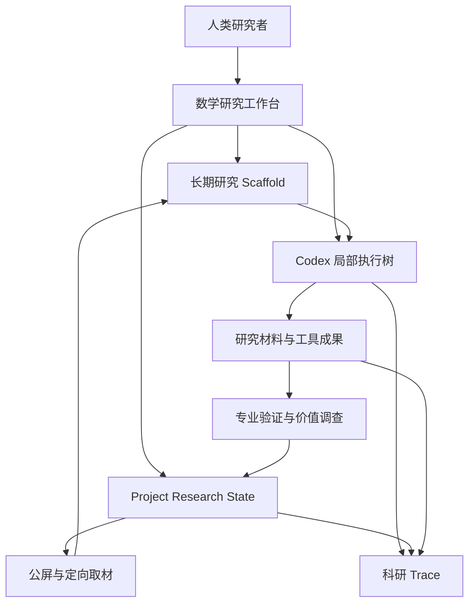

# AI Co-Mathematician 数学研究工作台：全量设计总稿

> 本文汇总此前讨论形成的产品、数学研究机制、Agent 协作、人类控制、知识与文献、界面、开发工具及开源拼接设计。以用户最后一次明确裁决为准；已被推翻的旧说法不再作为现行设计。
>
> 本文是一份**当前有效设计的完整整理**，不是“所有微观细节已经完成”的声明。它既保存已经确定的意图，也标出仍须补齐的合同与工程接缝，供继续设计和本地 Codex 施工使用。

## 阅读约定与目录

全文使用以下状态，避免把助手建议写成用户决定：

| 标记 | 含义 |
|---|---|
| **已确认** | 用户明确提出、选择、同意，或在后续纠正中明确裁决 |
| **设计展开** | 对已确认意图的整理、职责拆解或流程解释；不代表字段、算法和异常行为已经逐项获确认 |
| **候选** | 讨论过但尚未完成源码比较、实验或最终选择 |
| **未决** | 会影响施工，当前尚无充分决定；不能由施工 AI 静默补成产品规则 |
| **已覆盖** | 曾经讨论，但已被后续裁决取代，仅在末尾决策账本中说明 |

“冻结”在本文中只表示某次审查、交接或控制操作锚定一个版本快照，不表示数学对象、研究方向和分类从此不能变化。

- [产品目标与研究方式](#产品目标与研究方式)
- [整体架构与状态所有权](#整体架构与状态所有权)
- [Project、研究存档与研究行动](#project研究存档与研究行动)
- [探索空间与研究纲领](#探索空间与研究纲领)
- [Research State 与开放超图](#research-state-与开放超图)
- [版本、修正、分叉与冲突](#版本修正分叉与冲突)
- [Agent 职责与权威边界](#agent-职责与权威边界)
- [Human Proxy 与自然语言控制](#human-proxy-与自然语言控制)
- [Codex 与长期 Scaffold](#codex-与长期-scaffold)
- [并发流、房间与工作区](#并发流房间与工作区)
- [动态协作与群聊](#动态协作与群聊)
- [暂停、注入、取消与恢复](#暂停注入取消与恢复)
- [数学验证与条件性依赖](#数学验证与条件性依赖)
- [数学价值与研究准入](#数学价值与研究准入)
- [文献调查、完整提取与材料路线图](#文献调查完整提取与材料路线图)
- [专家库与抗上下文压缩](#专家库与抗上下文压缩)
- [公屏与定向消息](#公屏与定向消息)
- [星探、重复仲裁与等价整合](#星探重复仲裁与等价整合)
- [监察与明确受阻](#监察与明确受阻)
- [拾荒者与失败研究](#拾荒者与失败研究)
- [科研 Trace 与阶段收尾](#科研-trace-与阶段收尾)
- [低价值材料整理与硬删除](#低价值材料整理与硬删除)
- [界面与本地使用体验](#界面与本地使用体验)
- [开发 skills 与工程连续性](#开发-skills-与工程连续性)
- [开源供体与拼接边界](#开源供体与拼接边界)
- [端到端场景与验收](#端到端场景与验收)
- [尚未闭合的设计与施工交接](#尚未闭合的设计与施工交接)
- [最新裁决与旧案覆盖账本](#最新裁决与旧案覆盖账本)
- [外部能力核对与资料入口](#外部能力核对与资料入口)

## 产品目标与研究方式

**已确认：最终产品是人类数学家与 AI 长期共同工作的数学研究工作台。**

它应接受直觉、口语、公式、图形、怀疑、局部计算、失败尝试和未成形观察，帮助研究者把它们推进成可研究的问题、实验、猜想、机制、证明、反例和新的研究方向。

研究过程可以从任何位置开始，并反复返回：观察、直觉、多种解释、猜想、实验、结构归纳、理论、证明、新问题。它没有唯一“母问题”，也没有必须依次执行的固定流水线。

人类可以开一个档，放入材料，说“我想从这里尝试这个方向”，系统就应组织研究现场。最终评价是研究推进了什么，而不只是原始命题是否彻底解决。

AI 应补足人类暂时没想到的研究路径。例如“聚点形状像圆”可以引出形状真实性、算子分类、步长机制、谱结构、动力系统、逆向恢复、不变量、群或半群、反例边界和已有文献。这个例子表达的是研究展开能力，不预先断言任何具体数学结论成立。

产品的长期资产是数学研究的工作设计：研究状态、价值标准、验证规则、协作隔离、失败利用、取材与来源、人类处处介入、可追溯科研历程。模型与开源 Agent 技术持续变化，不能迫使这些产品意图每次重做。

## 整体架构与状态所有权

**已确认：充分复用开源工程，但数学语义、状态权威和人类控制由本产品定义。**

三张核心图必须区分：

| 核心结构 | 表达什么 | 不能被误当成什么 |
|---|---|---|
| 长期 Research Scaffold | 存档、研究行动、路线、团队、房间、阶段及人类编排 | Codex 一次调用的临时执行计划 |
| Codex 执行树 | 实际 Agent、Sub-Agent、会话、委派、CLI、工具与当前执行关系 | 数学正确性的证据图 |
| Research State | 数学对象、版本、证据、反证、依赖、冲突、Frontier 与使用关系 | 所有聊天和工作流 checkpoint 的集合 |

它们通过稳定 ID 和版本相互引用。工作流画布上的连接不自动成为数学推理关系；Agent 父子关系也不等于命题依赖关系。

| 信息 | 权威来源与职责 |
|---|---|
| 产品需求、设计与验收规则 | 规格文档及用户裁决账本 |
| 工程任务状态 | Beads；不能再让多个工具各自维护一份任务真相 |
| 代码与合并结果 | Git |
| Project 数学研究状态 | Research State 的唯一提交边界 |
| Agent 执行与控制 | Codex 运行记录及工作台控制记录 |
| 论文、证明、实验、原始输出 | Artifact 与不可变版本引用 |
| 可复用领域知识 | 专家库，独立于当前 Project 事实 |
| 公屏、图、卡片、概览 | 上述信息的投影及操作入口 |

“唯一提交边界”是应用服务或事务权威，不要求新增一个会自行判断数学的万能 Agent。Worker、前端、图编辑器和外部框架只能提出状态变更，不能各自写出互相矛盾的正式事实。

## Project、研究存档与研究行动

### Project

**已确认：一个 Project 有共享数据库和共享 Research State，并包含多个研究存档。**

Project 内可同时存在完全不同、异步推进的研究方向。不同存档不必相关，也不应为了“统一规划”强制汇合。

Project 负责组织共同研究空间、对象身份、公开成果、权限、跨存档联系和共享知识入口。一个 Project 的公开数学状态，不等于把各存档的全部私有对话公开给所有角色。

### 研究存档

**已确认：正式使用 Research Save／研究存档／档，不再使用易混淆的 Archive 作为核心名称。**

存档类似 Minecraft 的存档，也是一个长期研究实验室。它保有原始材料、研究意图、对话、白板、路线、Frontier、Agent 房间、群聊、局部草稿、实验、成果、失败、运行位置和科研 Trace。

支持的创建与组织方式包括空白创建、从 idea 创建、复制、从 checkpoint 分叉、建立新世界线、Agent 自主创建有来源标记的新档，以及人类操作的归档和回收。

共享一个数学对象并不意味着合并两个存档。两档可以引用同一对象 ID，同时保留不同的意图、方法、材料、上下文和研究过程。

**未决：**历史快照存档与 Project 最新共享 State 如何并存，哪些新成果自动可见、哪些必须显式吸收、旧世界线怎样接收失效通知，尚需具体版本协议。不能把“共用数据库”当作这个问题已经解决。

### 研究线与 Campaign

研究线是在档内从已有问题、结论、方法、障碍、实验或人类建议派生的方向，可以分叉、会合、改路、独立验证或转入新档。

Campaign 若保留这个工程名，只表示一次有组织的研究行动，例如独立重证、反例攻障、文献调查、重大成果验证；不要求每个普通小任务都多套一层对象。

一轮行动结束不等于存档结束，更不等于原始数学问题已解决。系统不得因长时间没有活动就自行归档一个研究存档。归档的界面和恢复细节仍需继续设计。

### 跨 Project

**已确认：**同一论文原件与经过核验的基础材料包可以跨 Project 复用；“这篇论文如何作用于当前问题”的数学解释仍属于各自 Project。

跨 Project 的研究协作、共享对象与控制事务需要显式边界。不能因为允许复用文献缓存，就开放整个 Project 的对话、盲审材料或数据库。

## 探索空间与研究纲领

Exploration Field 保存“还不是可靠知识，但可能重要”的信号，例如观察、类比、疑问、机制猜测、意外结构、失败现象和可能的研究价值。原话先保存，分类后补；不能要求研究者先把想法写成严格 Conjecture 才能输入。

**已确认：**同一口语输入可以有多个解释，主要解释和可能路线应向人类展示。数学 Agent 可以继续补充，不能把最早一个解释当成唯一意图。

研究纲领展开应说明当前观察、可能机制、值得测试的条件、已有知识、证伪机会和后续潜力，并展示哪些方向已研究、尚未覆盖或暂缓。这里的 Coverage Map 是可扩展的研究视图，不是固定学科标签表。

完整的无人 Auto 产品模式曾明确暂缓；这不取消研究范围内 Agent 自主分线、查文献、开团队、建立新档和寻求人类帮助的能力。不能把“暂缓 Auto”误解成“每开一个普通子任务都问人”。

新研究线开始前必须检查相关旧线、Project Research State、专家库和外部文献。简单例子、定义整理和廉价反例测试可以帮助澄清问题；它们不能成为绕过已有工作调查、大规模重复研究的理由。

## Research State 与开放超图

### 数学档案而非封闭分类

**已确认：**Research State 保存当前研究中有价值的新数学状态，包括未验证猜想、Frontier、已审查结果、条件性结果、障碍、冲突和失效关系；它不是只装“最终定理”的数据库。

数学对象以完整研究档案为主体，能够容纳原始表述、数学表达、定义、量词、条件、范围、解释、命题、证明、反例、实验、来源、依赖、冲突、Artifact、价值判断、后续路线及版本。字段按对象与阶段适用，不要求每个新想法已有证明、反例和实验才能保存；最小创建要求与不同准入阶段的必填项仍需具体定义。

对象可以是定义、例子、猜想、引理、定理、不变量、机制、方法、证明义务、失败、障碍、边界或文献贡献，也允许出现尚未预设的新类型。

标签只是检索和界面视图。数学含义必须用完整表达和证据传递，不能用一个 `HighValue`、`Verified` 或 `same_as` 标签代替解释。

### 开放式超边

**已确认：**关系可以连接任意数量的对象，为每个参与对象声明角色；关系本身还可以参与其他关系。

例如某个结果同时依赖定义、条件、局部引理、文献定理和实验，不能被强行压成没有角色的几根箭头。

| 超边信息 | 需要表达的内容 |
|---|---|
| 参与对象 | 稳定对象 ID 与精确 revision |
| 对象角色 | 假设、结论、构造、反例、证据、方法、适用对象等开放角色 |
| 数学含义 | 自然语言、公式、显式映射及适用范围 |
| 条件与量词 | 关系成立所需的完整前提 |
| 证据 | 证明、文献、工具、审查或实验入口 |
| 反对证据 | 已发现差异、反例、少数意见与未解决义务 |
| 来源与版本 | 谁提出、何时审核、当时依据哪些材料 |

工程状态可以有限枚举；数学对象、角色、关系和价值类型不能被有限枚举锁死。未知关系可以先完整描述为候选，经专业关系审查后再正式传播。

### 状态与过程分开

Research Activity Record／研究活动记录只记录发生过什么：人类输入、Agent 提交、工具返回、版本产生、暂停、恢复、分叉、控制执行等。它不自行裁决数学真假。

活动记录、控制记录、运行记录、Artifact、状态变更提案和审查报告相互关联，但不能全部混成聊天记录。公屏也不成为第二套 State。

## 版本、修正、分叉与冲突

**已确认：所有数学修改采用追加 revision 与当前有效头，不能静默覆盖。**

| 情况 | 现行规则 |
|---|---|
| “我写错了，应该是有界” | 创建修正版；定位旧条件依赖，撤销旧运行的提交资格并重新检查 |
| “如果改成有界呢” | 保留原路线，创建条件变体或分叉 |
| 两个存档提出不兼容修订 | 两个版本并存，显式冲突，建立仲裁，不采用最后写入者覆盖 |
| 条件、量词或定义变化 | 旧证明可作参考；不能无条件继承旧版验证结论 |
| 结果被可靠反例推翻 | 失效相关支持路径，通知依赖者，交拾荒者分析 |
| 只有某条证明失败 | 记录该证明路线的问题，不把命题判假 |
| 某结果有其他独立有效证明 | 只撤销受影响的支持路径，重新核对剩余依据，不机械删除整个结论 |

影响传播沿真实数学依赖与材料使用关系进行，不能只遍历 Agent 父子树，也不能用固定 `2-hop` 代替依赖闭包。`2-hop` 只可作为一种有限邻域取材方式。

旧 revision、来源和未被专项删除规则覆盖的研究记录继续可追溯。低价值材料硬删除是单独的清理制度，不是任意修改数学版本历史的借口。

## Agent 职责与权威边界

**已确认：数学研究、研究组织、界面操作、专业检查和程序执行必须分工。**角色是一种职责，不意味着每个名词都要新增一个永远推理的模型进程。

| 角色或能力 | 职责 | 关键边界 |
|---|---|---|
| 人类研究者 | 提供意图、材料、直觉、选择与最高控制 | 数学主张仍须与证据地位区分 |
| Human Proxy | 把人类自然语言转换成精确工作台操作并执行 | 不规划数学、不汇总结果、不验收、不查新、不判断价值 |
| Project Director | 向适当专业角色询问方案，按返回方案组织研究 | 不自行发明数学方案，不阅读全项目私有聊天 |
| 研究规划团队 | 理解问题、比较方法、返回研究路线建议 | 建议需有材料和理由，不直接创造正式事实 |
| Mathematical Lead／数学研究者 | 研究、证明、构造、归纳、选择局部方法，自主决定分线 | 保持对象版本、条件与来源明确 |
| 证明者／反例研究者／实验设计者 | 针对数学任务开展专业工作 | 不以自信、搜索次数或工具成功代替数学证据 |
| 文献数学比较者 | 比较定义、条件、量词、结论、机制与贡献 | 关键词检索与摘要不等于数学比较 |
| Reviewer／对抗 Reviewer | 独立检查、找错、攻击假设和证明 | 保持盲审材料边界，保留少数意见 |
| Synthesis Coordinator／综合者 | 收集正式交付物，生成独立综合报告 | 不覆盖子组原报告，不吞下所有聊天 |
| Synthesis Auditor | 检查综合是否漏掉反对意见、条件差异、失败和缺口 | 不以“多数同意”代替证据 |
| Verification Designer | 为具体声明设计相应验证路线 | 属于专业职责，不塞给 Proxy |
| Verification Coordinator | 跟踪专业检查、版本与报告是否齐备 | 不自行代替数学 Reviewer 下结论 |
| 价值与新颖性调查团队 | 判断贡献、覆盖、非平凡性与后续研究潜力 | 不能把难度、复杂度或没搜到当价值证据 |
| 重复性／冲突仲裁团队 | 比较等价、覆盖、真实冲突与贡献差异 | 不靠相似度或单个标签裁决 |
| Observer／监察组 | 监察数学过程、运行、隔离、通信与进展，必要时保护性暂停 | 不包办研究、价值判断和正式事实裁决 |
| 星探团队 | 寻找真实联系并组织精确比较 | 潜在线索不直接成为正式关系 |
| 拾荒者团队 | 分析失败本质，回收可靠数学，提出新方向 | 不是对话摘要器 |
| Trace Engine／Recorder | 从真实事件维护科研图与索引 | 不替研究者编造“漂亮故事” |
| Trace Curator | 解释转折、整理可读摘要并链接证据 | 文本只能概括已有记录 |
| 程序与工具执行能力 | 检索、PDF/OCR、文件、CAS、数值、SMT 等精确任务 | 数学歧义返回数学角色，不擅自更改问题 |

这些名字主要标识责任；除已明确要求常驻的角色外，具体数量、是否合并成一个协调实例、唤醒频率仍需微观设计。

### Project Director 的最终语义

**已确认：总领导者的方案是问来的。**

它从 Research State、公屏成果和警报了解问题，判断应询问谁；向规划、比较、文献、对抗或仲裁团队提出问题；接收正式建议；有冲突继续请专业角色比较；存在研究偏好分歧时交人类选择。

Director 不能自己提出“改用谱方法”或拼出一个数学折中方案。为组织动作保存建议来源，是设计展开；具体 `recommendation_id` 合同尚未完成。

**已确认：**Director 只读取 Research State、公屏成果和警报，避免积累每个存档的完整上下文。它不是所有 Agent 的共同父节点。

**未决：**每个存档是否另设长期组织负责人没有确认。此前提出“每个 Archive 固定 Program Agent”已撤回，不可在施工中默认创建。

## Human Proxy 与自然语言控制

**已确认：每个 Project 一个 Human Proxy。它是操作者，不是管理评审者。**

人类可以直接点按钮，也可以说“暂停第二条证明线，把这份新定义发给反例组，实验线继续”。Proxy 识别目标与作用域，生成结构化操作，调用控制接口，逐项返回成功、失败或歧义回执。

Proxy 可以执行创建、复制、分叉、暂停、恢复、取消、重挂、注入、路由文件和批量操作；数学内容送给对应数学角色。它只检查操作目标是否存在、作用域是否明确、接口是否执行成功。

它不负责收集结论、综合成果、确认验证齐备、评价重大成果、生成科研 Trace 或决定研究方向。此前“Human Proxy 可以依据严格门槛确认重大成果”的说法，被后来的职责纠正覆盖；具体接收专业报告并形成确认结论的角色仍需补齐。

### 输入与作用范围

**已确认：**Project、存档、研究行动、Scaffold 节点、Agent、Sub-Agent、群聊、CLI、工具、数学对象和公屏都应有人类输入入口。默认在 Agent 窗口中的原始消息只进入当前 Agent。

“仅此 Agent”不等于影响永远不传播。若这句话改变共享前提，专业影响分析与控制层必须沿依赖通知受影响节点。父节点也应知道叶子任务接受过人类介入，但不因此拿到全部私密内容。

输入框应让作用范围可见，允许选择当前节点、子树、房间、研究行动、存档或 Project；具体控件与歧义处理为设计展开。

一句话同时含数学意见与操作时，保存同一原始来源，分别路由数学内容与控制操作。控制命令不成为数学事实，数学猜想不被 Proxy 擅自解释成“已成立”。

### 操作回执

需要逐项展示计划、执行、成功、失败及实际生效范围。批量操作部分成功、撤回、补偿与跨 Project 执行仍属未决，不能只返回一个笼统的“已完成”。

人类有最高控制权；人工接受、强制覆盖、研究偏好与专业数学验证必须分别记录，不能把“人类点了同意”伪装成已有独立证明。

## Codex 与长期 Scaffold

### 已选定的技术方向

**已确认：Codex 是局部 Agent、动态 Sub-Agent、会话、工具和运行控制的技术主干，采用其开源技术并按本产品需要改造。**具体 Fork 哪些层、哪些代码直接复用、哪些仅通过已有接口接入，要依据源码 PoC 决定，不能把改造方向当成已经锁定的文件级方案。

当前不做多 Runtime 兼容框架，不把 Grok、LangGraph、MAF 与 Codex 都放在同一条调度主链上，也不另造一个功能重复的局部 Sub-Agent 引擎。

同时，跨阶段、跨存档、可人工编辑、长期保留的 Scaffold 需要另外选择合适开源图搭建与工作区供体。不是让 Codex 的一次局部拆解承担整个研究工作台。

| 层 | 目标 |
|---|---|
| 长期组织层 | 保留研究路线、团队、房间、阶段、人工编排与恢复入口 |
| Codex 局部执行层 | 动态委派、消息、等待、子 Agent、thread、turn、工具和局部改向 |
| 数学权威层 | Research State、版本、条件依赖、验证和准入 |
| 可视化控制层 | 将每个执行单元显示成可进入、可操作的小房间 |

图搭建供体不能再启动第二套不受控 Agent Runtime。真正 Agent 执行必须回到 Codex，数学事实必须回到唯一 State 提交边界。

### 长期图供体的当前状态

**候选：**Sim、Langflow；React Flow／Rete.js 等作为底层图编辑后备。此前曾倾向先测 Sim、再对照 Langflow，但没有完成最终源码 PoC，不能写成已选中。

需要实证的接缝是：Codex 动态创建 Sub-Agent 后，长期图自动出现节点和房间；人类能进入、暂停、注入、改向和重挂；操作准确传回 Codex；重启后图、房间、上下文与材料位置仍在。

选择标准不是节点图是否漂亮，而是动态生长、持久化、人类介入、隔离、多房间、事件捕获、改造范围及许可证能否满足本产品。

### 常驻的含义

**已确认：保留常驻角色，不因新模型更强就删掉。**

常驻首先指身份、职责、房间、记忆、订阅和恢复入口长期存在；不要求永远占用一次模型输出。部分监察、星探、拾荒与研究组织能力允许主动巡视，具体主动范围和频率未完成。

模型升级在产品层视为更换模型接口与配置，不额外制造每次升级都要由人类处理的“身份迁移仪式”。保存运行实际来源用于科研追溯，是另一个问题，不应阻碍换模型。

## 并发流、房间与工作区

### 七个的准确含义

**已确认：七个是用户当前连接下，全工作台同时正在生成并返回模型内容的 OpenAI 对话流上限。**这是本产品按用户使用条件执行的限制，不是对 OpenAI 所有产品和账户的通用限额声明。

它不按 Project、存档、团队或任务树分别计算，也不是“一个主 Agent 加六个子 Agent”的固定组织结构。

| 活动 | 是否占用模型并发流名额 |
|---|---|
| OpenAI 模型正在生成并返回内容 | 占用 |
| Agent 房间打开但没有生成 | 不占用 |
| 等待人类、论文、其他成果或流名额 | 不占用 |
| 长期保留 CLI 身份与上下文 | 不占用 |
| 本地数值、CAS、SMT、PDF/OCR、数据库和 Trace 工作 | 不占用；如果其中又发起模型生成，则那次请求占用 |
| 本地暂停、杀工具、保存现场 | 不应等待模型流许可 |

每次模型生成申请许可，结束、中断或失败后归还。逻辑 Agent、存档和房间可以很多；重大任务可以建立大量验证线，分波次生成，不能用内部 Sub-Agent 绕过上限。

**已确认：不额外引入此前凭空提出的“预算系统”。**并发限制、外部能力授权与超大规模算力申请分别设计，不能把并发名额重新包装成预算。高收益扩编可由 Director 提议，相关确认由专业管理规则或人类给出，Proxy 只执行已明确的操作；最终授权边界尚须对账。

### 每个执行单元都有房间

**已确认：**内部 Sub-Agent 与动态 CLI 都要自动登记并映射成长期可见的工作节点。后代直接显示在实际委派父节点下，不能只看到主 Agent 的最终汇总。

外部小卡显示任务、阶段、最近简报、状态、子节点、警报和阻塞。点进去可见接收材料、阶段判断及依据、下一步、委派、消息、工具、命令、输出、文件、diff、Artifact、提交提案和控制历史。

这里展示 Codex 式外显工作过程与阶段报告；不承诺公开模型隐藏的内部逐 token 推理。

底层进程退出不能使房间和上下文消失。进程、thread、会话、逻辑角色与房间的身份映射需要持久化，恢复时回到同一个工作节点。

### 工作区按任务组织

| 工作类型 | 设计展开 |
|---|---|
| 纯数学推理 | 独立持久房间、私有草稿、明确的 State 版本与材料清单 |
| 数学 Teamwork | 成员私有房间加共享会议，只交换需要共享的凝练内容 |
| 文献调查 | 原件与核验基础包可复用；各检索线和 Project 的解释独立 |
| 数值／CAS／SMT 实验 | 可复现的目录、参数、环境、代码、日志和结果 |
| 软件修改 | 同一工作树只有一个写入者，其他写入者用隔离分支或 worktree |
| 跨 Project 协作 | 显式协作房间、材料清单与访问范围 |
| 群聊 | 共享正式消息，不自动共享全部私有文件和上下文 |

不能用“所有任务统一独立目录”或“所有任务共享一个目录”回答复杂协作。具体文件系统与锁策略仍需源码级设计。

## 动态协作与群聊

**已确认：数学 Agent 自主判断自己做、开子线、组隔离团队、群聊、handoff、显式工作流或混合协作。**

一个小反例可以自己构造；真正不同的方法可以独立分线；重大结果需要大量验证；程序性任务交精确执行能力。不能预画“每次遇到反例必须开固定数量 Agent”。

动态创建时需说明为什么分线、任务和材料、隔离要求、汇合方式、交付物与结束条件。这是可检验的协作契约，而不是限制数学思考的固定 SOP。

群聊可以服务有界咨询、定义核查、证明会议、对抗讨论、攻障或综合；每名成员保留自己的窗口，人类也可以有自己的房间并进入任意位置。

避免一开始相互迎合的基本设计为：先独立工作，形成各自初稿或阶段报告，再交换凝练结论、条件、依据、反证和疑点，进行交叉质疑；综合者另建报告，保留原报告和少数意见，独立综合审查再检查是否夸大或漏项。

独立重证不应提前读原证明；盲审与证伪组的首次提交前保持隔离。一个模型分出多个 Reviewer 不是多份独立数学证据，仍需材料、方法和工具层面的独立性记录。

普通模式切换在完整消息、工具结果或成果交接的短边界进行；人类可随时要求中止并改向。切换必须改变实际通信、材料、权限和执行拓扑，不能只是把 UI 标签换成“群聊”。

临时推理角色允许动态生成；未登记的高权限工具应有申请。未获授权时应返回可行替代路径或求助，不得凭空获得能力。

## 暂停、注入、取消与恢复

### 三种产品控制语义

| 控制 | 含义 |
|---|---|
| LIVE_STEER | 在可支持的执行中追加意见或材料，并记录是否真正被吸收 |
| PAUSE_INJECT_RESUME | 暂停、保存现场、注入、重建工作集、确认接收、继续 |
| HARD_FENCE | 立即撤销旧运行继续提交有效结果的资格，阻止旧条件污染新状态 |

这些是产品语义，不是某个接口已经自动实现全部能力的保证。Codex 的 thread／turn 原语需要映射为本产品的节点、子树、工具和数学提交控制。

### 暂停必须保留现场

**已确认：**暂停作用于相关 Agent 及受影响子树，同时处理模型生成、CLI、工具、文件写入和 State 提交。人类注入改变条件时，相关正在运行的工具应立即终止，不等它自然结束。

暂停原因必须明确：网络问题、前提错误、新条件、改向、工具故障、重复研究或人工检查。相关父子节点要知道为什么停、旧条件与新条件、哪些 revision 作废、哪些结果可能保留、下一步要求什么。

网络暂停不能被误读为改变数学方向。原始输入只给当前节点，也不能成为不通知受影响子任务的理由。

对无法确认停止的远程工具，真实状态应是“已发取消请求／远端状态未知”；迟到输出先隔离，不能显示为已安全提交。

### 注入必须有接收回执

材料发送后不等于 Agent 已理解。需要明确报告已吸收、无关、与前提冲突、缺完整材料、需要改路、需要重做或仍不确定，并说明依据。接收状态可扩展，不能用几个短标签丢掉数学内容。

普通有帮助成果可在短边界吸收；可靠前提失效要立即封住旧提交；盲审材料在隔离规则允许前暂存，不能混入独立组上下文。

### 取消与迟到结果

“父 Agent”只指实际委派父节点，不能混同 Human Proxy、Director 或某次会议主持者。

取消并不自动意味着所有后代都应销毁；可能需要保留、暂停、取消、脱离、重挂、在隔离区完成或带新条件重开。Proxy 只能执行人类命令或明确授权的操作，不能擅自作研究价值裁决。

**未决：**当人类没有逐项指定时，由哪一个专业协调角色提出后代处置建议、谁确认、迟到结果如何重新核验与挂回，需要继续定义。不能沿用旧稿“Proxy 自己判断结果好不好”的做法。

### 崩溃与一键继续

**已确认的体验目标：**恢复到相同存档、节点、房间、拓扑、Agent／CLI 身份、材料、上下文、文件、记录和暂停原因，并可从原节点一键继续。

工程上必须区分工作台已经持久化的状态，与云端生成到一半或远程工具内存中的执行。后者不能承诺逐字节原样冻结恢复；应明确显示中断或未知，在同一逻辑节点和已保存上下文继续或重跑相应步骤。

持久化时点、崩溃中间态、重复请求、半写入文件与外部副作用仍未完成规格；“有 checkpoint”不能代替这些设计。

## 数学验证与条件性依赖

### 当前验证边界

**已确认：所有准备写入 State、成为其他路线依赖、发布为成果或进展、用于结束研究行动的内容，都要接受与其声明相匹配的检查。**不是只有重大成果才验证。

正常研究中的草稿、临时想法和未经检查的观察可以存在，但必须保持其身份，不能因为出现于聊天或公屏就升级成可依赖的数学事实。

| 声明 | 相应检查 |
|---|---|
| 命题与证明 | 定义、量词、条件、依赖、证明逐步审核，独立与对抗检查 |
| 反例 | 满足原命题全部前提、确实违反结论，并独立复现 |
| 数值／随机实验 | 参数、代码、精度、随机性、环境、误差和可复现性 |
| CAS／SMT 结果 | 输入的完整假设、表达式、适用域与输出解释 |
| 文献结论 | 原文版本、准确位置、条件与当前使用方式 |
| 新颖性 | 内部旧线、外部已有结果、等价表述和更强结果调查 |
| 数学价值 | 专业价值调查及反对意见 |
| 路线失败 | 只证明该路线何处失败，不能夸大成命题不可能 |
| 新关系或等价 | 显式数学映射、适用条件、双向关系与独立关系审核 |

非形式化结果的基本门槛包括完整证明、独立 Reviewer、对抗 Reviewer、针对同一明确版本的盲审、没有未解决证明缺口，并保持定义、条件和量词一致。

一键“提升某一步”实际启动独立验证；通过后才能按准入规则提交，不能点击即造出一个 Verified 结果。

### Lean 的最终决定

**已确认：当前不使用 Lean。**不安装、不调用、不建立 Lean Agent，不把形式化作为成果接受、验证森林或第一版施工验收门槛，也不因为没有 Lean 就自动降低成果等级。

仅保留未来可接的禁用接口；接口名如 `FormalVerificationProvider` 是设计展开，不代表已有实现。今后明确需要时再讨论启用。

早期列出的 Lean／mathlib／LeanDojo 与“形式内核最高等级”不再是当前必做项。文献中已有形式化成果仍可作为来源材料调查，但不据此启动本地形式化工程。

### 重大成果的验证森林

**已确认：重大候选成果需要大量独立验证线。**数量与拓扑由问题决定，不预设一个机械固定队伍。

可包含原证明逐步审查、不读原证明的独立重证、不同方法、隐藏假设与量词攻击、反例和极端边界、小规模穷举、必要的 CAS／SMT／数值检查、独立实验复现、文献多线查重、对抗漏检、更强结果调查、数学价值与后续潜力调查、Artifact 一致性核验和冲突仲裁。

计算检查不适用于所有命题；适用时说明它证明或排除了什么，未覆盖什么。模型多数赞同、没有搜到反例或工具返回成功，都不能替代证明。

### 未验证局部引理与临时证伪路径

**已确认：允许有价值的未验证局部引理候选进入共享 State 并被条件性使用，但必须配套建立 Temporary Falsification Lane／临时证伪路径。**

**设计展开：**把候选共享、条件性依赖登记与证伪义务建立做成原子约束，避免中间状态漏掉验证。具体事务实现仍未闭合，不把这一技术表述冒称为用户逐字段确认。

“原子”要求不存在“大家已经在复用，但系统没有证伪任务”的有效状态；验证任务可以排队，义务与责任入口必须已经建立。这里不要求无限即时算力。

| 必须一起记录 | 含义 |
|---|---|
| 未验证身份 | 不是可无条件使用的正式引理 |
| 精确版本 | 所依赖的命题、定义、条件与量词 |
| `contingent_on` | 下游结论依赖哪些未验证前提 |
| 证伪路径入口 | 当前谁在找反例、核查边界或调查文献 |
| 已测范围 | 哪些构造、参数、方法和情况已检查 |
| 未测范围 | 哪些情况还没有证据 |
| 未解决义务 | 缺哪些证明、材料或适用性核验 |

证伪线可以动态组织反例、边界、实验、穷举、CAS／SMT、文献反例与独立复现，不含当前禁用的 Lean 工作。

结果可能是可靠反例、证明与审核通过、经压力测试仍未证，或暂时无法判断。没找到反例只增加测试覆盖，不能自动晋升定理。

未验证依赖一旦被推翻，沿支持路径失效并立即通知使用者；无关路线继续。下游若另有不依赖它的有效证明，应重新核查后保留，不连坐全部成果。

### 正确性、可信度与人类确认

UI 应明确显示实际通过的检查：证明审查、独立重证、对抗检查、反例覆盖、实验复现、文献核验、人类接受或人工覆盖。不能只显示一个含糊的“绝对 Verified”。

数学成立、在某些条件下成立、没发现反例、文献支持、价值被认可和人类选择使用，是不同维度。具体等级名称、签署者、准入事务与申诉规则尚未全部定稿。

## 数学价值与研究准入

**已确认：有意义就是有数学价值；涉及意义的判断，需要专业的临时价值调查，而非简单打标签。**

价值重点是新颖或未被覆盖、非平凡性、可复用性、机制与表示上的贡献、促进其他研究的能力，以及具体后续路线。难度、复杂度、Agent 数量、形式化或“看上去宏大”不构成价值本身。

调查应比较完整的定义、条件、量词、结论、方法、机制、表示和来源，回答：

- 已有相同、近似、等价或更强结果吗？当前贡献差异在哪里？
- 是否只是直接推论、常数微调、参数替换、文字改写或普通规律？
- 是否发现新的数学机制、统一结构、可迁移方法、算法或重要联系？
- 如果猜想成立，具体还能推进哪些问题？
- 这些后续问题为何值得研究，是否又是平凡推论？
- 价值是否被夸大，反对意见和不确定性是什么？

可用 Downstream Research Map 表示“成立之后能怎样继续”；它是一份实际研究路线，不是一句“潜力很大”。

已知命题若出现可迁移证明范式、新机制、真正统一结构或新算法，可以把研究焦点转到方法、机制或算法并另开存档。仅仅证明更短、更漂亮通常不足以继续包装成高价值新命题。

无价值、已知且无新增贡献、被覆盖或只有无意义改写的结果应退出 Frontier 与传播网络，并给后续使用者完整的“不宜继续深挖”理由。价值尚未判断不等于已经无价值，查不到文献不等于全新。

不建立一个未经确认的价值乘法评分器或以成本为硬门。成本不是用户最重视的指标；超大规模算力授权另行设计。

## 文献调查、完整提取与材料路线图

### 文献是研究子系统

**已确认：文献调查必须动态分线，不能让一个 Literature Agent 搜几十篇论文并把它们全塞进单条上下文。**

文献既用于查重，也用于直接调用已有定理、反例、方法、边界和研究空白。发现别人已研究过，是复用知识和改变路线的机会，不是只执行“阻止研究”。

新线开始前查；局部步骤缺材料时查；成果产生后再按最终命题、条件、方法和贡献重新查。开头搜过一次，不能永久替代成果级核查。

### 动态检索线

按具体问题可分出内部旧线与专家库、精确命题与名称、同义术语和等价表达、更强或更弱条件、结论变体、相同机制与证明方法、反例与边界、前后引用链、作者与历史学派、邻近领域、专著与学位论文、预印本和期刊版差异，以及专门寻找漏检和更强结果的对抗线。

不是每次都建立全部检索线。角色按调查进展继续分线，不把检索维度做成限制发现的固定分类。

初轮独立检索依据同一问题与版本，避免互相诱导；交付后再做来源版本去重、数学关系比较、对抗漏检、冲突调查与独立综合。综合者读各线结构化交付物，不吞下全部聊天。

### 从线索到可用来源

搜索摘要、引擎片段和二手引用只作为线索。真正用于数学论证的来源，应确认身份、取得全文、确认版本、解析、提取与独立复核后，成为可使用的材料。

Source Dossier／来源档案至少覆盖：

| 部分 | 内容 |
|---|---|
| 身份 | 标题、作者、出版信息、DOI／arXiv 或准确书目 |
| 版本 | 精确使用版本、预印本／期刊版／勘误关系 |
| 原件 | PDF／HTML／扫描件、内容哈希、可访问状态 |
| 精确位置 | 页码、章节、定理、引理、公式和图表编号 |
| 数学定义 | 必要符号、定义及约定 |
| 完整命题 | 量词、假设、范围、结论，不能省掉关键限定 |
| 证明材料 | 证明结构、关键步骤、直接依赖和疑点 |
| 方法机制 | 实际使用的构造、技巧、表示和机制 |
| 边界 | 反例、限制、失败条件和作者明确声明 |
| 当前用途 | 对当前问题和 revision 的精确映射 |
| 尚缺材料 | 外部依赖、歧义、未取得原件或未核验引用 |
| 回源入口 | 直接打开相应版本与准确位置的路径 |

论文说“由参考文献可知”时，若当前研究真正依赖那个结果，需要继续取得核验，或明确保留“该外部依赖尚未核实”；不能把转述当成已核验依据。

完整提取要求真正要使用的数学单元内容完整，并记录其必要依赖；不是要求所有无关章节都进入每个 Agent 的上下文。OCR、公式识别和来源解释本身也需要质量与疑点标记。

### 分层装载

| 层级 | 装载内容 | 使用方式 |
|---|---|---|
| Source Identity | 书目、版本、取得状态 | 识别来源与决定下一步取材 |
| Relevance Map | 相关章节、定理、方法与对象 | 快速知道材料为何有关 |
| Math Packet | 完整定义、量词、条件、命题、适用范围与方法 | 当前数学任务通常使用的材料包 |
| Proof Packet | 证明结构、关键步骤、依赖、疑点和精确位置 | 严格审查、重建证明或深入核对 |
| Original Artifact | 原件、版面、公式、图表、OCR 与引用 | 按需回源，不能被摘要永久替代 |

基础材料包可跨 Project 复用，但其使用条件仍要核对；某 Project 的解释、选择和价值判断不自动进入全局公共结论。

### 问题缺口驱动取材

**设计展开，回应用户的实际问题：人类不需要预先知道每个局部步骤要读哪些材料。**

当前数学 Agent 应描述精确缺口，例如“步骤 S 使用的定理是否需要完备性”；检索、来源核验和提取角色据此找材料，而不是把目录交给用户自己摸索。

局部节点的材料路线图应包含：

| 字段 | 需要回答的问题 |
|---|---|
| 当前步骤 | 正在证明、构造或调查什么？ |
| 材料缺口 | 哪个事实、条件、证明或来源尚不明确？ |
| 需要原因 | 它影响哪一步、哪些依赖？ |
| 建议阅读 | 哪篇、哪个版本、哪个章节／定理／页码？ |
| 已装载内容 | 当前上下文已有哪些定义、量词、条件与证明材料？ |
| 原文入口 | 如何直接打开准确位置？ |
| 未核实依赖 | 哪些必要材料仍未取得或解释存疑？ |
| 使用结果 | 已解决、部分解决、发现冲突，还是需要继续分线？ |

材料路线图本身还需设计具体检索路由、闭包选择、冲突优先级与质量评估；不能把名字当作已实现算法。

### 版本、预印本与贡献

同一成果的预印本修订、会议版、期刊版、勘误与撤回属于来源族，不当成多份独立证据。引用精确锚定版本与位置，不能静默替换成“最新版本”。

发现相关预印本，可以学习、复现、查错、寻找反例、推广、研究不同方法和作者未展开的方向。允许快速竞争推进，但始终说明已有工作做了什么、我们新增什么及来源时间线，不能重包装成自己的首次发现。

文献结论应写成“找到等价结果／更强结果／部分覆盖／相关但不等价／在明确范围内暂未找到／调查不足”等带证据的判断；这些只是开放表达示例，不是封闭枚举。

**已确认：不默认持续监听新论文、勘误与版本变化。**只有人类明确要求“持续关注”或“跟踪新版本”时才建立相应任务。当前研究需要再查文献，不属于默认后台监听；偶然遇到可靠修正仍须处理其对现有依赖的影响。

### 人工取得材料与“待我处理”

**已确认：系统可随时求助，统一有“待我处理”窗口。**登录、机构权限、付费访问、验证码、纸质扫描、本地手稿等导致无法自动取得材料时，文献团队提出准确请求。

请求应说明材料身份、需要版本、官方入口、用途、关键章节或定理、现有材料为何不足、接受的文件格式、正在等待的研究线和仍在继续的工作。

仅依赖该材料的节点等待，其他路线继续。Proxy 负责呈现、上传、路由和回执；来源核验角色检查标题、作者、版本、完整性、页码、补充材料关系、OCR 和哈希，确认后再恢复取材与研究。

“人类上传完成”与“材料核验通过”是不同状态，不能上传即算数学依赖已满足。

**未决：**普通请求安静排队、阻塞请求置顶，以及是否额外弹出一次通知，是最后一轮的体验建议；额外弹窗尚未得到最终选择。当前确定的是统一窗口与清楚显示阻塞对象，不能擅自添加反复催促。

## 专家库与抗上下文压缩

### 专家库

**已确认的方向：**专家库提供领域能力，不只是让模型凭训练记忆答题，也不等同当前 Project Research State。

领域材料包括定义、定理、证明模式、例子、失败案例、常见误用、适用条件、连接和研究经验。检索后要带完整来源、版本、适用条件与可靠性，不把“库里有”自动等同“当前问题可用”。

现有 SQLite 专家库是接入基础；长期 Expert Graph 是能力组织目标，不要求先从零开发一个全新知识图数据库。实际 schema、检索接口、条目粒度、去重和迁移仍需拿真实源码核定。

Codex 主 Agent 与子 Agent 按任务检索专家材料，装入 Working Set；研究成果经整理、验证及规定批准后才能写回。写回门槛、谁签署与跨 Project 复用边界仍未全部设计完。

### Working Set 与 Context Capsule

**已确认：上下文压缩不能成为研究事实丢失、角色越权或来源消失的原因。**不让所有 Agent 读取整个 Project，也不让常驻管理者靠无限聊天维持记忆。

每项任务应拿到范围明确的工作集，包含：当前目标、原始意图、对象与 State 版本、精确定义、量词、条件、必要依赖、已知反例、冲突证据、未解决义务、相关专家材料、文献包、权限和直接取材入口。

研究所需的“闭包”是当前数学步骤的必要定义与依赖完整，而不是递归把整个知识库装入上下文。具体装配和裁剪算法尚未完成。

长证明、论文、实验数据、完整对话按正常留存规则保存在 Artifact 中；低价值专项清理完成后，被硬删除的原件只保留整理稿入口与无原文删除记录。其余材料在上下文中携带可定位的清单，需深入时再按不可变版本取回。卡片与材料包不能为了短而省掉条件、量词和反例。

Context Capsule／多分辨率交接材料可借鉴供体做法：任务定位、阶段摘要、关键事实、未决义务、正在等待什么、材料清单和恢复入口。它只辅助恢复，不取代原始数学档案。

不从零堆一个庞大 Context Compiler；优先复用检索、摘要、材料定位与装箱能力，补上数学闭包、版本和隔离规则。压缩后根据稳定 ID、revision、工作集与交接包回到当前任务。

## 公屏与定向消息

**已确认：公屏是成果、进展、警报、求助与操作的网络和 UI 投影，不是第二个 Research State，也不是所有 Agent 共同聊天。**

公屏发布有数学内容的成果与进展，而非每句话、每个 token 或“仍在努力”。候选必须明确候选，未经检查的想法不能冒充正式成果。

公开成果在 Project 内可检索，自动推送只给需要者：显式依赖者、人类指定对象、订阅方向或方法的团队、星探核验真实相关者，以及前提会被新结果推翻的路线。不能因为同库就全量广播。

盲审与密封研究区域保留自己的材料可见边界，不能用“全局可搜索”绕过隔离。

### Finding Card

卡片必须足以准确理解成果，至少包括数学内容、定义与符号、对象版本、量词、条件、范围、结论、价值理由、已有工作差异、证据与反证、验证状态、缺口、来源存档与任务、为什么推送及潜在影响。

每个标签应能解释其具体含义、依据和适用范围。完整证明与大型材料不全复制，但 material manifest 必须给出材料用途、Artifact ID、不可变版本或哈希、精确片段、权限和可直接调用的取材入口。不能让 Agent 自己到文件系统里猜。

### 消息送达与纠正

卡片可能指向一个存档、方向、研究行动、临时团队、任务或具体 Agent。传输去重可以由程序完成，数学“重复”不能由消息哈希决定。

普通帮助性材料在短边界吸收；可靠反例或前提失效立即通知并封住旧提交；盲审材料先进入隔离邮箱。接收者返回实际吸收状态。

已发布成果被推翻、撤回或替代时，需要明确 Correction，定位已投递和已引用对象并触发影响处理，不能悄悄删掉卡片让使用者继续依赖旧结论。

去重键、订阅变更、积压合并、过期消息、投递确认、失败重试与防消息风暴尚需详细协议。不能只写“压缩一下就行”。

## 星探、重复仲裁与等价整合

### 星探

**已确认：星探本身是动态研究团队，不是关键词或向量相似度程序。**

它寻找跨线、跨档的真实联系，反复核对定义、量词、条件、映射、结论、机制、方法、证据和差异。可发现特例、推广、共享不变量、共同障碍、重叠域冲突或仅有术语碰撞。

程序负责取材、传输、索引与缓存，不能凭相似度排除所有候选，也不能决定数学联系。星探提出潜在关系后，需要独立关系检查；正式联系不能由观察信号直接写入。

### 重复性仲裁

**已确认的需求：**要有专门角色核对“究竟是不是完全重复”，不能单个 Agent 随口宣布。

设计展开为重复性仲裁团队，核对数学对象、定义、条件与量词、双向结论、方法机制、贡献差异、来源及独立验证目的。任一关键点不明，保持疑似而非正式重复。

同一命题用不同方法、同一实验做盲态复现、独立证明和对抗验证，都不能机械判成无意义重复。低价值也不能倒推成“完全等价”。

### 确认等价后的整合

**已确认：确认等价后，要暂停相关路线，开会汲取双方有用过程，再开联合研究组。**

整合应吸收双方命题、证明、方法、失败、条件、反例、经验和未决问题；建立 canonical 对象与可追踪别名；一次性形成足够完整的整合工作集，再共同继续。

这是研究整合，不是简单删除重复节点，也不等于自动合并两个存档。证据含糊时不能强合；对象合并撤销、引用迁移、正在运行任务和跨隔离材料的处理仍需事务级设计。

## 监察与明确受阻

### Observer 的定位

**已确认：监听与 Observer 是外部眼线、对比眼线和督察，不能只是摘要器；复杂职责由专门角色承担。**

监察内容包括条件与量词偷换、旧 revision 继续使用、任务偏航、父节点遗漏子成果、无信息增益的反复改写、工具卡死或损坏、人类消息未送达、材料越权、冲突和未报告的反例。

只读运行时间和状态码无法发现数学条件偷换，因此允许相应专业监察角色读取其范围内完整外显工作。读取内容不等于允许向其他隔离组转发。

可按数学完整性、运行工具、通信隔离、进展等分工；这些具体角色名、层级与每档是否固定协调员属于设计展开，不是已全部冻结的编制。

### 盲审监察

**已确认：隔离要求是 Reviewer 之间不相互污染，不要求负责监察的角色失明。**

监察实例的上下文、记忆、工作集和通信出口必须受控。对外可报告事件、严重度、受影响节点与需不需要保护性暂停，不把一侧证明、结论或策略送进另一侧盲审上下文。

是否采用每个盲区独立实例、只读跨区专门监察或二者组合，仍需具体访问控制方案。不能一边口头说隔离，一边让共享总结自动泄露内容。

### 保护性暂停与主动巡视

**已确认：**发现硬问题可以直接暂停受影响部分并汇报，保存现场等待处置；不能自行取消有价值路线、恢复运行或裁决数学事实。

Proxy 执行授权的人类操作并返回回执；保护性暂停之后由哪位专业角色整理处置建议、人类何时必须确认，需补齐。普通疑似联系或价值怀疑不应不加区分地触发全档停机。

部分常驻角色可主动巡视。每次巡视应有范围、增量游标、明确问题和结束出口，避免监察自己制造无限调查。具体频率、触发与终止规则未决。

### 不用“停滞”代替原因

**已确认：**原命题长期未证明、单条路线失败或暂时没有空闲流，不等于整个存档停滞。

状态应准确显示等待人类、等待材料、等待外部能力、等待其他结果、等待并发流、被明确数学义务阻塞，或正在新的路线中研究。

同一障碍反复出现、持续没有新增信息、仅改写想法、工具连续失败、证据相互冲突，都是需要诊断的信号。专门团队可分析失败、查文献、找反例、尝试不同方法、约化问题或提出攻障建议。

人类求助不必等所有路线耗尽。任何时刻人类可能显著推进问题，就可整理精确问题，请求帮助，只暂停受影响部分。

## 拾荒者与失败研究

**已确认：拾荒者是完整数学研究机制，可以动态组队，不是把旧聊天压成摘要。**

它处理失败证明、被反例推翻的猜想、一般化失败、孤立局部引理、异常实验、共同障碍、旧路线与新知识间的机会。

典型工作是定位失败的本质数学原因，区分技术缺口和真实障碍，提取仍可靠的局部命题，寻找自然条件修复、逆向机制或新构造，并安排反驳者检查新条件是否过强、已有或平凡。

一般化失败不拖累已成立局部引理；没找到证明不能当作证伪。反例除了否定命题，还可揭示边界、结构与新的研究问题。

同一障碍在多个独立尝试中出现，可开攻障组或新的攻障存档，亮黄灯向人类求助。发现值得独立发展的方向时，可自动建立注明拾荒来源的新存档，不要求新建 Project。

人类可以点击启动拾荒并选择材料、路线、存档或更大范围。失败、新可用知识／工具和相应巡视可以成为触发；这不意味着默认建立长期外部文献监听。

拾荒所得仍须走已有工作、价值和验证检查。不能因为来自失败就自动获得新颖身份，也不能给已完成硬删除的材料编造原始过程。

## 科研 Trace 与阶段收尾

### Trace 本体是图

**已确认：科研 Trace 应为标准执行树、研究路线图与证据超图，文字只是入口。**

| 图 | 主要回答 |
|---|---|
| 执行与委派树 | 谁向谁提出任务，谁创建子线，哪些工具和 Artifact 被使用？ |
| 研究路线图 | 从何种意图出发，怎样分叉、失败、转向、汇合、受人类影响并产生新方向？ |
| 证据与依赖超图 | 某个结果在什么条件下，由哪些定义、引理、文献、实验、证明和审查共同支持？ |

任一总结可点回原始房间、阶段报告、工具输出、Artifact、State revision 与控制记录；任一论文可看它被哪些证明使用；任一结果可看引用的精确版本与来源位置。

Trace 从研究开始实时建立索引和图，不等结束时让模型凭记忆重写科研史。原始记录按正常追溯规则保存，但遵守用户明确要求的低价值专项硬删除例外；被删除部分显示清理记录与保留整理稿，不能假装仍有原文。

### 研究推进与原问题分开

**已确认：研究行动可以取得重大独立成果后成功收尾，即使原始大问题仍未解决。**

例如以某个著名开放问题为方向，得到经审查有独立价值的新定理，可以记录“本轮形成重大独立推进”，原问题仍为开放。不能凭 Agent 自称“可发顶刊”决定价值或虚构解决状态。

界面应展示新增结果、条件性结论、反例和边界、方法家族的排除、新约化、假设改变、机制与联系、文献定位、未决义务和后续路线，不伪造开放研究的单一完成百分比。

### 冻结审阅与结案

**已确认：**执行团队认为本轮可结束时，相关研究树先暂停并保留，不释放 CLI、上下文、房间、工作区和拓扑；人类看科研 Trace 后确认。

收尾材料应说明开始研究什么、实际推进什么、原问题状态、成果和价值依据、失败与少数意见、证据和 Artifact、仍未解决的义务、建议继续的路线，以及所有子任务和迟到结果如何安置。

人类可确认结束、恢复全树或部分分支、补验证、注入条件、修改本轮结局表述或另开行动。人类确认后逻辑节点仍可停放并再次继续，不能把“结束”实现成销毁研究现场。

**未决：**专业成果评估与阶段收尾确认的责任分配、报告签署、少数意见阻断规则与关闭事务尚未完整定义。不能再把它们交给 Human Proxy 自己判断。

## 低价值材料整理与硬删除

**已确认：低价值内容不是仅隐藏，也不是所有原件永久留存。用户后续明确要求整理后删除原始过程。**

最终保留的是完整数学命题、完整证明，以及为什么低价值、已知、平凡或被更强结果覆盖的说明；其余原始对话、中间草稿、重复卡片和临时过程材料按清理范围删除。

先前“所有原始记录永远不删除”的说法已被这条专项规则覆盖。正常科研追溯仍适用于其他材料，不能据此任意删掉有价值研究的过程。

已同意的流程方向为：先生成并核验完整整理稿，检查与迁移引用，再提交清理与硬删除。删除前可取消，删除后不能承诺从原文恢复；可留不含原文的事务身份、时间、哈希和理由。

**未决：**如果其他成果仍依赖原始材料、盲审仍需该原件、多个 Project 共享 Artifact、工具缓存与运行副本仍含内容，应怎样迁移、保留或阻止删除，需要具体规则。没有证明的低价值候选如何满足“完整命题和证明”的保留要求，也不能擅自补写。

这项是必须继续闭合的工程问题，不能擅自改回软删除，也不能越过未迁移的有效引用直接清空材料。

## 界面与本地使用体验

### 模块化工作台

**已确认：**UI 要灵活、可组合、可进入、能看到、能操作、能随时自然语言输入。可以改造多个优秀开源项目，必要时多个程序或窗口并行，不强行拼成一个巨大前端。

| 界面 | 应提供的能力 |
|---|---|
| Project 与游戏式存档入口 | 创建、进入、复制、分叉、预览 Frontier、恢复与归档操作 |
| 长期 Scaffold／研究现场 | 路线、团队、房间、阶段、动态关系与人工编排 |
| Agent Operations | 主子 Agent、群聊、CLI、工具进度、日志、文件与控制 |
| Research Map | 对象、超边、证据、条件、冲突、失效与版本 |
| 数学白板 | 草图、公式、空间直觉与人类标注 |
| 公屏与收件箱 | 成果、进展、联系、Correction、警报、订阅和操作回执 |
| 文献工作台 | 原件、精读包、条件与贡献对比、版本族、引用链和材料路线图 |
| 待我处理 | 人类材料、意图、权限与选择请求，明确等待范围 |
| Trace 浏览器 | 研究路线图、执行树、证据超图与回源 |
| 运行观测 | 生成流排队、异常、工具、暂停恢复与上下文版本 |
| 配置中心 | 本机 Codex、模型接口、连接测试、凭据和运行状态 |

界面上的箭头不直接创造 `SUPPORTS`／`REFUTES` 事实；拖拽节点、改标签、点击接受都必须走相应应用与状态边界。

终端大量输出在后端保留，前端虚拟化、折叠和搜索，不能把所有行放进 DOM。工具运行可查看子进程、进度、日志与生成文件；不能只给一个长时间不变的“运行中”。

多程序协作需要统一对象 ID、控制回执、事件流与 State 后端。不能每个窗口各维护一套事实。

### Windows 与首次启动

**已确认的使用目标：**本地优先、Windows 可用，最终应有可双击的产品体验；源码包、构建脚本与实际经过验证的 EXE 必须区分。

历史试作做过 CleanCode 与专家库外壳融合、Windows 构建入口和模型配置中心；这些是先行工程，不代表完整研究工作台已实现。本次只汇总设计，没有对那些历史源码或安装包重新验收。

已明确过的首启意图包括检测本机已安装 Codex、区分本地登录状态与真实连接测试、配置模型和必要的接口参数、安全保存、后续复用设置，以及未完成配置时可进入只读模式。

凭据不能进入项目文档、Agent 消息、日志、前端持久快照或数学数据库；既有环境凭据不应为保存偏好又复制一份明文。历史采用的系统加密与主进程隔离方案需在实际最终壳上复验。

用户本机已有 Codex CLI，不能把“再次安装 Codex”当成必经步骤。产品配置与构建环境安装也不能混淆。最终配置中心如何结合现在确定的 Codex 主干、何时允许运行中修改模型接口，仍需微观设计。

## 开发 skills 与工程连续性

### 为什么装 skills

**已确认的目标：**解决大型项目开发时上下文压缩、调用不清和多个工具争权，而不是把所有仓库都装成 skill。

开发工具链只服务本地 Codex 施工，产品运行时的数学角色与能力注册表另行管理；不能把编码工作流提示词注入每个数学研究 Agent。

| 工具／能力 | 设计中的职责 | 冲突边界 |
|---|---|---|
| Spec Kit | 需求、规格、计划与验收依据 | 不再另建第二套需求事实来源 |
| Beads | 工程任务图、依赖、进度与压缩恢复 | 不存数学定理权威，不让别的工具各自复刻任务真相 |
| Serena | 符号导航与精确代码操作 | 前期方案建议关闭 memory，避免第三套记忆 |
| 精选 Superpowers | 测试、调试、审查与验证等局部方法 | 不让整套总控流程接管所有任务 |
| 精选 agent-skills／前端 skills | 按当前技术栈和具体任务加载 | 不全局安装所有内容，不引入重叠路由 |
| Aider／RepoMap | 隔离编码 worker 或代码结构参考 | 不与 Codex 同时写同一 worktree |
| CleanCode | 同时具有开发工作台与产品 Agent 可视化供体价值 | 不能只当 skill，也不决定数学状态 |

表中具体安装组合与开关包含先前审计建议，尚需对本地环境与实际版本确认；不能声称本轮已经安装。

### 调用与抗压缩规则

采用少量薄路由 skill，任务触发后才加载对应说明；详细参考资料和可执行脚本外置。分清谁拥有规格、任务、代码、研究事实、运行状态与知识，不靠叠加多个“总控 skill”保持秩序。

每次工程交接写清当前目标、已完成工作、未解决问题、正在修改的文件、下一步、验证结果和设计裁决入口。恢复后按任务与符号取代码，不重新吞整个仓库与全部聊天。

技能版本、路径与调用要落实到施工包；源码仓库不等于 skill，MCP、CLI、桌面程序、组件库也不等于同一种安装物。

### 设计讨论的协作约定

**已确认：继续本项目设计时，用户要求每轮调用 GPT‑6 Max 子代理独立审查，再综合主代理复核给出答复。**子代理建议不能覆盖用户裁决，也不能把以前助手的单方面总结当作既定规格。

这是人类与设计助手的协作要求，不是产品运行时必须预置一个 GPT‑6 Max 角色，更不意味着产品每个简单数学动作都固定启动若干审查 Agent。此前提出过多路 Max 并行分析，具体设计任务可按需要分工。

曾讨论的会读出环境变量／密钥的 token 类技能，以及会把研究仓库直接打包上传的自动部署流程，不作为默认研发链路。工具能力以真实授权和任务需要为界，不能因为随供体附带就全部启用。

## 开源供体与拼接边界

### 复用原则

**已确认：能依赖就依赖，能 Fork／搬取就不重写，主要精力花在数学专用语义和跨仓接缝。**

但不能把多个完整系统并排放在一起就叫“融合”；需明确每份状态、每次执行和每次提交的所有者。也不能为了复用旧 RAGraph，把它的问题原样当作新架构前提。

“少改一些源码”是工程愿望，不是已测量的工作量承诺。实际工作必须到仓库、版本、文件、符号、接口与验收场景才能估计。

### 当前供体地图

| 能力 | 当前采用方向／候选 | 状态与接缝 |
|---|---|---|
| 局部 Agent 与动态 Sub-Agent | 开源 Codex | **技术主干已确认**；具体 Fork 层与修改点待源码锁定 |
| 长期 Scaffold 与协作画布 | Sim、Langflow；底层后备 React Flow／Rete.js | **候选**；需验证动态生长、持久化和 Codex 双向控制 |
| Agent 操作、桌面壳、终端、worktree | CleanCode 及同类完整工作台 | 产品供体；不能把历史壳直接视为最终骨架 |
| 对话、工具交互与 Artifact | assistant-ui | UI 基础候选，不拥有数学事实 |
| 结构化关系图 | xyflow／React Flow | 视图与编辑，数学超边另有权威模型 |
| 自由数学白板 | tldraw、Excalidraw 等 | 候选；最终包与许可证分别核验 |
| 专家材料 | 现有 SQLite 专家库与 RAGraph 可迁移内容 | 数据与语义供体；schema 和质量需核查 |
| 数学事实准入、局部依赖撤销 | Danus 等 | **很小的一环**；不升级为全工作台主干 |
| 数值、符号、反例与可复现计算 | Python 科学工具、Sage／CAS、Z3／SMT、属性测试等 | 按实际数学任务选择；当前没有全部定为必装 |
| 文献发现与书目 | paper-search-mcp、arXiv、OpenAlex、zbMATH、Crossref 等 | 接口候选，不能裁决数学新颖性 |
| 全文、解析与精确来源 | GROBID、PaperQA 等；Prior／RefWarden 的相关数据思想 | 可借组件和 schema；不接入其另一套研究总控 |
| 多分辨率材料与连续性 | Hypratia 等 | 思想与局部实现参考，许可证与模型接缝需复审 |
| 多角色协作思想 | Co-scientist 类、MetaGPT、Grok Build、AG2、DeerFlow 等 | 比较或局部供体，不与 Codex争夺执行权 |
| 观测与前端事件 | Langfuse、AG-UI、OpenTelemetry 等 | 非已冻结栈；可观测组件不能成为第二套 State |
| 形式化 | 未来验证接口 | **禁用**，当前不接 Lean 系列 |

表列的是讨论形成的能力地图，不是“全部必须安装”的清单。历史中更多数据库、运行内核和观测框架作为比较线索保留，不因名字出现就获得采用资格。

### 已降级或覆盖的工程方案

- MAF .NET＋自建 Run Ledger＋TypeDB＋AG-UI 曾被写成较确定组合，现不能当最终施工栈。
- LangGraph 的 checkpoint／interrupt 思路值得比较，但不是当前必须在 Codex 之外再安装的第二总控。
- Grok Build 可比较或抽取局部能力，当前不做 Codex／Grok 双 Runtime 兼容工程。
- RAGraph 不默认拥有整个产品 Runtime；只取经过核验的数学语义、专家库、数据与可靠组件。
- Obsidian、Roam、Logseq 等提供关联与长期研究组织参考，不意味着节点就是普通笔记或必须嵌入其应用。
- Flowise、AutoGen Studio、Dify 等历史候选曾有维护、适用范围或许可证疑问；本稿不沿用未经本轮核实的具体版本与停更断言，也不把它们当已选主干。
- 早期仓库审计表与源码搜索结果只是线索，不能用关键词命中、stars 或“有个 agent 文件夹”冒充接缝已验证。

### 实际拼接时必须留下什么

| 项目 | 施工包必须提供的证据 |
|---|---|
| 来源锁定 | 官方仓库、精确 commit／tag、许可证与引用义务 |
| 采用方式 | 依赖、复制、Fork、进程隔离、接口接入或拒绝的理由 |
| 真实入口 | 供体文件、类、函数、调用链和现有测试 |
| 目标位置 | 实际目标仓库中的目录、模块及所有者 |
| 数据边界 | ID、版本、输入输出、持久化与权限 |
| 执行边界 | 谁调度，如何取消、暂停、恢复、接收事件与处理迟到结果 |
| 数学边界 | 怎样提交候选、验证、条件性依赖和正式 State 事务 |
| 验证 | 正常路径、边界、失败、并发、恢复与人类操作的可复现实验 |

当前没有这些仓库的可重新审计源码，就不能杜撰文件路径、类名、许可证兼容结论或已运行测试。最终应给本地 Codex 真正能力任务，让它在已锁源码上自行拆解并举证，而不是只复制一段很长的泛化提示词。

## 端到端场景与验收

以下是整理既有设计得到的验收场景，不表示软件已实现或通过测试。黄金场景是集合，没有必须执行的先后顺序。

| 场景 | 必须出现的行为 | 不应出现的错误 |
|---|---|---|
| 人类口语输入“聚点像圆” | 保存原话，展开多个解释，查旧线与文献，规划专业路线 | 逼用户先给严格猜想，或只按一句话机械做实验 |
| 同 Project 两档研究无关问题 | 分离现场与上下文，共用明确的数学对象空间 | 读取全量对话，强行合并方向 |
| 已有定理能直接利用 | 核对条件、版本与适用性，装入完整材料包 | 因为不是本系统发现就拒用，或忽略限定条件 |
| 复用未验证局部引理 | 同步建立临时证伪义务，下游明确条件性依赖 | 共享后没人验证，或下游无条件显示成立 |
| 找到可靠反例 | 核验前提和反例，封住受影响提交，发布纠正并追踪依赖 | 整个 Project 无差别停机，或悄悄删除旧卡 |
| 证明路线失败 | 解释失败本质，回收有效局部数学，必要时拾荒开新档 | 宣布命题为假，连带否定独立成立的引理 |
| 人类改条件 | 暂停相关生成和工具，保存现场，传播原因与版本变化，确认吸收 | 旧工具继续提交，子 Agent 不知道为何停 |
| 人类提出假设变体 | 保留原研究，建立分叉 | 把旧结果静默覆盖成新条件 |
| 盲审与监察并存 | 隔离 Reviewer 上下文，监察能发现条件错误而不回灌数学内容 | 为防泄露让监察完全失明，或跨组泄露结论 |
| 重大成果候选 | 建大量独立验证线、文献与价值调查，保留反对意见 | Agent 自称重大即通过，或自动启动 Lean |
| 两对象被确认等价 | 暂停、整合会议、提取双方有用过程、canonical 与别名、联合研究 | 简单删一边，或强制合并存档 |
| 模型流已满又有生成任务 | 新任务排队，房间与上下文保持，本地控制仍能执行 | 把房间销毁，或每个 Project 各开一套七流额度 |
| 文献分线搜索 | 独立检索，结构化提取、比较、回源与综合 | 一个 Agent 读遍所有全文和聊天 |
| 某局部步骤缺定理条件 | 精确缺口驱动取材，材料路线图直达版本和定理位置 | 问人类“你自己决定读哪些文件” |
| 论文需人类下载 | 进入待我处理，仅相关线等待，上传后来源核验 | 全档停机，或上传即视为数学核验完成 |
| 文献调查完成 | 不默认后台监听；显式要求时另建监听任务 | 因“研究系统”自动常驻扫描所有论文 |
| 本轮有独立进展但大问题仍开放 | 区分结果、本轮行动与原问题；整树保留供人审阅 | 将原问题标为已解决，或直接清空 Agent |
| 工作台崩溃再打开 | 同一逻辑节点、材料与现场恢复，外部未完成动作如实标记 | 假装远端内存也原样恢复，或重建陌生空房间 |
| 低价值结果清理 | 核验完整命题、证明、理由与引用处理，再硬删规定过程 | 擅自只隐藏，或删除仍被有效研究依赖的原件 |
| 新数学关系从未预设 | 保存完整含义、角色、条件与证据，经审核再传播 | 因数据库枚举没有这个类型而拒绝研究 |
| 人类一句话操作多个节点 | Proxy 精确执行并返回逐项回执 | Proxy 自行研究、评奖或笼统宣布所有操作成功 |

对未来实现，数学研究效果与工程可靠性必须分别验收。界面能跑、API 返回成功和 Agent 给出流畅报告，不等于数学结果正确；数学上有价值的例子也不能掩盖保存、取消或恢复的缺陷。

## 尚未闭合的设计与施工交接

### 当前成熟度

**已确认：框架与原则已形成很多，微观设计仍差得很远。**不能说“只剩几个接口”“核心已全部冻结”或“现在完全可以无歧义施工”。

最终施工规格应覆盖对象、状态、正常行为、异常、并发、权限、持久化、恢复、UI 反馈与验收；现在发现的空白要显式保留并继续设计，不能交给本地 AI 自行猜。

### 必须继续补齐的微观问题

| 区域 | 已明确的意图 | 仍需完成的内容 |
|---|---|---|
| Project 与存档版本 | 共用 State，研究现场独立，可建历史世界线 | 最新头、快照、更新订阅、失效通知与显式吸收的协议 |
| 跨 Project | 文献原件与基础包可复用 | 共享对象、解释边界、协作权限与控制事务 |
| 数学档案 | 开放内容、超边、revision | 最小必填合同、未知关系、查询、索引、并发事务 |
| 唯一提交边界 | Worker 只交候选，不能多头造事实 | 提案、专业签署、准入、幂等、冲突与回滚 |
| 条件性引理 | 使用与证伪义务原子建立 | 实际事务、排队、责任转交、过期审查与级联恢复 |
| 数学验证 | 所有成果按声明检查，重大成果扩展验证 | 等级、独立性、阻断意见、签署、申诉与正式准入角色 |
| 管理分工 | Proxy 纯执行，Director 问方案 | 谁汇总管理建议、确认成果门槛、处理无人明确指示的后代与迟到结果 |
| 存档协调 | 不能自动塞固定 Program Agent | 是否需要长期负责人，职责、可见范围与创建方式 |
| 长期 Scaffold | 接 Codex，不形成第二 Runtime | Sim／Langflow 等源码 PoC、图结构、房间与生命周期 |
| Codex 映射 | 动态子 Agent 全部可视化 | Fork 点、内部／CLI 捕获、thread／turn、控制与事件合约 |
| 常驻与主动巡视 | 身份常驻，部分角色主动工作 | 唤醒、巡视范围、游标、终止、避免无限调查链 |
| 七流调度 | 全工作台模型生成许可上限 | 许可作用域、排队、公平性、断线回收、重试与紧急请求 |
| 控制操作 | 随时输入，暂停保留，必要时杀工具 | 生效点、race、权限、部分成功、撤回、补偿及批量事务 |
| 文件与进程 | 工作区按协作类型区分 | 锁、单写者、隔离、进程残留、远端工具未知状态 |
| 故障恢复 | 原节点和上下文一键继续 | 持久化时点、半完成步骤、重复副作用、断电与重连 |
| 文献与提取 | 动态分线、完整数学包、精确回源 | 实际接口、OCR 质量、外部依赖闭包、版本去重与审查职责 |
| 材料路线图 | 系统按局部缺口找材料 | 检索与装配策略、遗漏检查、冲突、原文入口和效果评估 |
| 专家库 | SQLite 基础，任务化注入 | 真实 schema、版本、写回审核、去重、迁移与权限 |
| 公屏投递 | 完整卡片、定向推送、Correction | 队列、去重、重试、积压、过期、订阅与送达确认 |
| 星探与仲裁 | 数学团队比较，确认后整合 | 证书、合并事务、别名、撤销、引用迁移与存档边界 |
| Observer | 专业监察，隔离通信，保护性暂停 | 实例与范围、告警等级、误报、恢复权与跨盲区读取方式 |
| 拾荒者 | 分析失败，提取数学，可新开档 | 扫描范围、触发、材料权限、复活门槛与结束条件 |
| Trace 与收尾 | 图为本体，人类看后确认 | 实际图 schema、摘要核验、冻结树、未完成任务与迟到结果清点 |
| 低价值硬删除 | 完整整理后删原始过程 | 活跃引用、共享缓存、跨 Project 原件、无证明候选与删除一致性 |
| 待我处理 | 单一窗口、清楚列出等待对象 | 去重、合并、超时、回答路由、阻塞提醒与是否额外弹窗 |
| 完整 UI | 模块化、多窗口、处处输入 | 页面与控件、状态反馈、批量操作、可访问性与大量节点性能 |
| 本地交付 | 已有 Codex，可双击产品与安全配置 | 最终壳、首启、安装包、模型设置变更和 Windows 实机验证 |
| 工程拼接 | 供体优先，明确状态所有者 | 锁定源码、许可证、文件与符号映射、适配代码与验收工单 |

这不是要求重新提问所有已确定原则，而是把原则下尚无答案的行为逐条补齐。例如不再问“能否随时输入”，而问“人类在工具运行中更换条件，哪些写入何时被封住，回执如何显示”。

### 给本地 Codex 的交接要求

先依据本稿建立用户裁决账本与能力地图，再对一个闭合子系统拿真实源码做任务式拆解。每张工单应说明产品目的、已定规则、仍需决策处、供体版本、输入输出、状态所有者、实际文件与符号、允许改动范围和可复验的验收场景。

施工 AI 不得因为供体默认设计不同，就重写用户已决定的数学工作方式；也不得用伪造路径、未经运行的测试或“框架应该支持”填平空白。

遇到真正未决的产品行为，应给出具体场景、影响和候选，让人类继续决定；无需反复询问本稿已经明确的 Project、存档、Proxy、七流、Lean 和文献监听原则。

## 最新裁决与旧案覆盖账本

下表用历次讨论的轮次定位决定来源，方便复核；轮次是出处索引，不是重要性或实施顺序。

| 主题 | 当前有效决定 | 主要出处／覆盖关系 |
|---|---|---|
| 产品本质 | 人机长期数学研究工作台，保留探索与研究过程 | 产品愿景及后续反复校正 |
| 复用方式 | 开源供体优先，精确拼接，本地 Codex 按明确意图施工 | 第 4、11、57、76、81 轮等 |
| 母问题 | 不存在唯一母问题，多流、多源、方向可无关 | 第 9 轮覆盖此前单根解释 |
| Project／存档 | Project 单库与共享 State，多存档独立研究现场 | 第 19 轮及第 29—31 轮；覆盖每档独立库与 World 层 |
| 2-hop | 只是一种有限图取材，不是跨档共享与失效算法 | Project／存档纠正后形成的解释 |
| 修正与变体 | 写错则更正；条件假设变体则分叉 | 第 16 轮及第 66—69 轮 |
| 数学分类 | 对象、关系、价值、成果开放；只锚定判断版本 | 第 62、64、66—69 轮 |
| 临时局部引理 | 允许条件性共享，必须配套临时证伪路径；原子化是工程展开 | 第 69 轮覆盖较早“只能验证后进入”的绝对表述 |
| 验证 | 没找到反例不是定理；所有成果按声明检查 | 第 30—35、103—105 轮 |
| 群聊 | 由研究 Agent 决定群聊、隔离、工作流或混合 | 第 39 轮覆盖“禁止群聊” |
| 低价值删除 | 留完整命题、证明与理由，整理后硬删其他过程 | 第 66—69 轮覆盖“所有原件永久保留” |
| UI | 多开源界面可组合，多程序可接受，处处能输入 | 第 66—67、100 轮等 |
| 动态主干 | Codex 局部技术已选，长期 Scaffold 另找合适供体 | 第 98、100 轮覆盖多 Runtime 兼容与全部从零搭建 |
| 常驻 | 保留长期角色与房间，部分主动巡视 | 第 98、100 轮；具体编制未决 |
| Human Proxy | 每 Project 一个，只把自然语言变成操作并执行 | 第 60、100、104 轮；第 104 轮覆盖评审、汇总与自主管理扩权 |
| 总领导者 | 向专业角色询问取得方案，再组织；自己不出数学方案 | 第 103—104 轮覆盖“Director 是数学规划者” |
| Director 可见范围 | 只读 Research State、公屏成果与警报 | 第 100 轮 |
| 并发七个 | 全工作台当前 OpenAI 同时生成并返回的对话流 | 第 104 轮覆盖每树／每 Project 七个 CLI 的误解 |
| 预算 | 不凭空设计预算系统 | 第 100 轮覆盖此前多处预算提案 |
| 房间与恢复 | 所有动态执行可见；暂停不释放；原节点一键继续 | 第 98—100 轮 |
| Observer | 专门监察，能看范围内内容，隔离通信避免污染 | 第 100—103 轮覆盖万能 Observer 与监察失明 |
| 存档负责人 | 是否需要固定协调角色仍未确定 | 第 104 轮撤回每档固定 Program Agent 提案 |
| 收尾 | 人类先看科研 Trace，相关树暂停并保留 | 第 101—103 轮 |
| Trace | 标准树、图、超边为本体，文字作导航 | 第 102—103 轮 |
| 新线与成果查重 | 新线先查旧线与外部，成果形成再检查 | 第 103—105 轮 |
| 人类求助 | 随时可提，精确整理，只等待受影响部分 | 第 104—106 轮 |
| 文献调查 | 动态分线、完整提取、精确来源、按需装载 | 第 105 轮 |
| Lean | 当前不用，仅留未来禁用接口 | 第 105 轮覆盖所有默认启用方案 |
| 跨 Project 文献 | 原件与核验基础包复用，问题解释独立 | 第 106 轮 |
| 文献监听 | 不默认常驻，只有人类明确要求才建立 | 第 106 轮 |
| 材料路线图 | 系统按局部缺口取材的设计展开 | 第 106 轮用户提问及后续方案，算法未定 |
| 待我处理 | 统一窗口确定，额外弹一次通知未决 | 第 106 轮及最后未答选择 |
| 设计成熟度 | 原则很多，微观仍远未闭合，不能宣称完成 | 第 92—96、99 轮等 |
| 设计协作 | 每轮 GPT‑6 Max 子代理独立审查后综合答复，不混同产品运行角色 | 第 100 轮，承接更早多路 Max 复核要求 |

## 外部能力核对与资料入口

本稿主要保存本项目的设计决定；下列公开能力只做必要核对，不构成新的工程选型。官方页面会变化，实际施工还应锁定源码版本并实测。

| 官方资料 | 本次核对支持什么 | 不能据此推断什么 |
|---|---|---|
| [openai/codex](https://github.com/openai/codex) | 存在可审计的开源 Codex 仓库与许可证入口 | 官方桌面 App 的全部界面源码都已包含，或可直接获得本工作台 |
| [Codex App Server](https://learn.chatgpt.com/docs/app-server) | 官方文档包含 thread 恢复、turn steer／interrupt 和材料注入等原语 | 全研究子树、所有工具、文件与 State 的原子暂停已经自动实现 |
| [Sim 官方仓库](https://github.com/simstudioai/sim) | 协作 Agent／workflow 工作区可作为候选，仓库提供许可证入口 | 已能原生把 Codex 动态子 Agent 变成长期可编辑研究图 |
| [Langflow Human-in-the-Loop](https://docs.langflow.org/human-in-the-loop) | 文档描述 checkpoint、等待人类决定并恢复流程 | 已满足本产品任意节点注入、改向、重挂和盲审隔离的完整语义 |

七流限制、Lean 禁用、角色职责、数学价值标准、删除规则与文献监听政策，均来自本项目用户决定，不是上述外部软件或供应商的通用规定。
