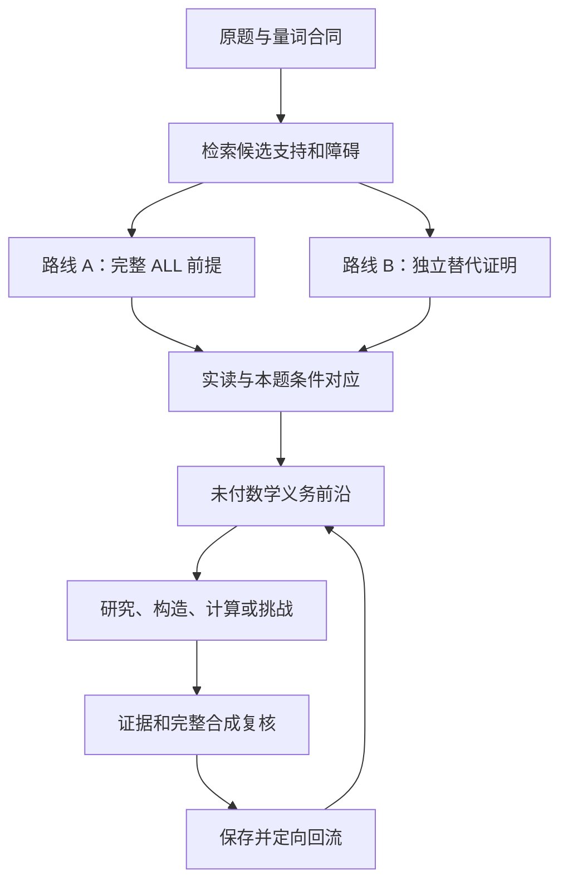

# 超边怎样变成下一步数学：完整执行流程

本流程用于 Work 原生 Main/子代理与 GitHub 文件协作。仓库、分支和对象版本以 [开题合同](spec-template.json)为准；本文基线为 rebuild/research-v2@7dc4245。本流程不假定原题一定已登记，不假定必须使用已有成果，更不把图上可达当成证明。

## 1. 先分清三个东西

| 层 | 实物 | 何时足以使用 |
| --- | --- | --- |
| 数学对象 | registry 的稳定 ID、version、完整 statement/body/evidence | 实读完整陈述与必要证明，确认其状态、条件和本题的适用性 |
| 全局关系 | 一个 edge 的全部 sources、targets、conditions、roles、explanation 与 evidence | 论证确实支持 whole_result，或只使用 contribution.result；全部条件和源前提仍须付款 |
| 本题应用 | RUN 中该 edge 对该原题、该变量映射、该版本的具体使用记录 | 逐项证明条件吻合、共同前提可用、结论覆盖本题所需步骤；记录剩余与复核等级 |

同一已证引理可以在一个模型里可用、在另一个模型里不适用。新发现旧引理某个使用方式失败，先撤用那次应用；旧引理本体是否假是另一问题。上游 PACE 的适用性重审与 Euler 的 closing implication 都指向这个区别。

## 2. 从原题反向找路线，从已付前提正向核路线



这不是固定轮次流水线。三条研究线异步推进，Main 持续做数学；某项成熟即可接回。图未找到有用路线时，从原题直接证明或构造，不把检索当作研究准入。

## 3. 开题与版本锁定

核对 Git 当前分支、origin、HEAD 和工作树。开题合同保存 expected_remote、expected_branch、base_commit；另保存 spec、registry 和本次选择的边/对象指纹。分支名必须显式给出：本仓 main 与 rebuild/research-v2 的材料结构不同。HEAD 以后前进是正常增量，依据 pin 判断哪些具体使用需要重审；不是要求永远停在开题提交。

原题合同保完整模型、定义域、量词顺序、成功标准和允许的反例；例如“每一份完整历史依赖纯 SPE”不能变成某条冻结策略，“同一个查询分布”不能在不同前提各选一个。原题暂未登记时，写完整 problem.md/definitions.md，不为了图节点身份改题。

工作区最小结构：

```text
research/workspaces/<RUN>/problem.md
research/workspaces/<RUN>/definitions.md
research/workspaces/<RUN>/main.md
research/workspaces/<RUN>/independent.md
research/workspaces/<RUN>/informed-a.md
research/workspaces/<RUN>/informed-b.md
research/workspaces/<RUN>/applications/<application-id>.md
research/workspaces/<RUN>/reviews/<review-id>.md
research/runs/<RUN>/run.json、不可变输入 packet 与 events（现有程序生成）
```

这里是路径清单，实际数学连续留在笔记中，不为每个普通算式造新工单。开题时填写 spec-template，保其中 math_spec 为现有 packet 的兼容 JSON；外层合同单独保存工程与输入约束。

## 4. 候选检索与完整取证

按当前缺失推导找结论、假设、反例和模型桥，不按最高度节点选 seed。现有真实入口：

```sh
python work.py research search '实际缺失步骤的词及同义词' --model '实际模型'
python work.py research show OBJECT-ID --body
python work.py research context TARGET-ID --edge EDGE-ID --hops 0
python work.py research frontier TARGET-ID --edge EDGE-ID --expect-branch rebuild/research-v2
```

`context` 返回当前目标的候选支持选项；每选项内部 ALL，不同选项是 OR。选定某边时只优选同一个被展开目标的该支持，不是把全图简单过滤为一条边；其源前提的完整承重链仍须展开。`hops=0` 只限额外导航，不截断必要 ALL 闭包。候选邻接、引文、实现和有限检查只供定位与启发。

`show --body` 只展开对象的 body；必要 evidence 仍要按 path、完整文件 SHA 和精确唯一 section 打开。读过落地页不等于读完证明；大文件按同一义务连续分段，保存已读范围、未读段和承重关系。预算不足就分 pass，不静默丢前提。

refutes、corrects、supersedes 和 source errata 同时核对。反例只切断精确陈述、域或步骤；某条路线失败不自动否定原题。原始证明有独立 OR 支持时保留有效分支。

## 5. 每条超边究竟怎样使用

若全局边是 `{A,B} ⇒ T`，研究者须完成下表，再把它接到本题：

| 检查 | 实际要写的数学 |
| --- | --- |
| 目标吻合 | T 的原句是什么？本题需要整条 T 还是一个分支/阈值/算法部件？ |
| A 的作用 | A 给哪一步，变量怎样代入，其完整条件在哪里？ |
| B 的作用 | B 给合成/解码/存在性还是额外界？不能因为 A 已证就跳过 B |
| 共同环境 | 是否同一个模型、实例、完整策略、概率空间、参数和量词？存在量是否被错误交换？ |
| 条件付款 | 逐条件给证明/已读前提/适用边界，不能只写“满足conditions” |
| 联合推导 | 先固定哪些对象、再选哪些见证；按原证明顺序写如何得到实际结论 |
| 剩余 | B 若开放，留“B ⇒ 本题目标”的条件路线；缺的是联合论证本身则保候选 |

同一题的 application 笔记至少包括以下内容；这是数学记录模板，第一版没有声称有机器自动验证这些文字：

```json
{
  "application_id": "stable-local-id",
  "problem_spec_sha256": "actual hash",
  "edge_id": "actual edge",
  "edge_declaration_pin": "actual declaration_pin",
  "direction": "forward or reverse",
  "object_pins": {"each used endpoint": "actual registration_pin"},
  "source_to_target_mapping": "full variable/model/quantifier correspondence",
  "premise_bindings": [{"source_id": "each ALL premise", "source_pin": "actual pin", "local_statement": "exact instantiated premise", "state": "established-here / open-obligation / explicit-assumption", "evidence_or_obligation_ref": "exact proof or stable unpaid obligation ID"}],
  "bridge_obligation": {"state": "global-whole-argument-applies / new-bridge-established / open / gap", "statement": "ALL instantiated premises imply the exact local result", "evidence_or_obligation_ref": "exact applicable edge argument and application proof, or unpaid bridge ID"},
  "condition_discharge": [{"condition": "exact clause", "argument_or_ref": "proof and exact source"}],
  "depends_on_applications": ["actual upstream application IDs and their revision pins"],
  "inherited_unpaid_obligation_ids": ["all still-open premise, bridge and condition debts inherited from upstream"],
  "discharged_obligations": [{"obligation_id": "actual previously unpaid obligation", "proof_ref": "exact evidence that pays it"}],
  "actual_result": "what is actually established for this problem",
  "remaining": "unpaid obligations, or explicit empty if complete",
  "evidence_refs": [{"path": "actual file", "sha256": "actual full-file hash", "section": "optional unique heading"}],
  "review": {"kind": "unreviewed / internal-independent / formal / external", "report_ref": "exact reviewed version and scope"}
}
```

不要填占位 hash 后当实际收据；模板只供填真实数据。已核全局命题无需每次重证全部正文，复核本次应用新增的条件、范围和关键合成。主干有新疑点则定向独立挑战。

`premise_bindings` 必须逐项覆盖全部 ALL 前提，不能以“读过 A/B”代替“本题已付 A/B”。联合 closing implication 单独说明：精确既有 whole 论证适用时引用其论证及本题映射；合成/解码桥尚未证明时记 open/gap 并给稳定义务 ID，不能由两端分别成立默认合成成立。

条件结果向下游使用时，继承上游全部未付前提、条件和 bridge 义务，再并入本次新增债务。只有明确的 discharge 论证才能移除某一项；改名、摘要、换代理或换一条等价表述均不消债。应用之间保存实际依赖及 revision pin，更正时沿这些引用找到真正消费者。无有效 OR 替代的应用仍带原欠账；独立完整替代可以消除该分支依赖，但须给其完整证据。

### 必须保留的逻辑区别

- **ALL：** A 和 B 要共同用，只保一条联合应用；缺 B 就有具体 B 义务。
- **OR：** 两条独立完整证明各保一路。一路坏了先停用该路，检查另一路，不自动判目标为假。
- **等价：** `ALL(sources) ⇔ ALL(targets)` 的反向使用要全部 targets。两个 open 候选互相等价仍可能都未证；环不是起点。
- **conditional：** 推导完整但前提开放时，可作条件路线。`accepted` 不支付开放前提。conditions 自由文本仍需本题实读代入。
- **contribution：** 只用 result 已完成的实际步骤；remaining 进入前沿。需要把该步骤用作其它边的独立端点且确有复用价值时，给准确新对象；不拿整条目标冒充已证。
- **transfer：** 原结果与等价/解码桥共同为输入；输出是迁移后实际新保证。保全原机器/jobs、参数代价、量词和编码位长等承重条件。
- **finite/checks/context：** 精确有限反例能否定其相应全称主张；扫描、程序成功或启发性相似不形成一般蕴含。

## 6. 反向闭包与前向最小不动点怎样配合

新增 frontier 的结构算法从当前 binding 的 definition/proved 声明作起点，反复检查 accepted whole 正向/反向分支的全部前提；完整前提都在结构闭包时，才将结论加入“假设该边全部条件成立”的闭包。无外来已付支持的 open 等价环不自启动。它还列开放前提、当前字节不一致、legacy proof scope 待核、贡献 remaining 和每个条件应用义务。

**这个集合不等于本题已证集合。** 每个新增结论仍带 application 待核；原型不分析自然语言条件、不执行证明助手、不接纳 review 结果、不更新 truth_status。它解决的是防止丢前提、忽略部分结果、把环当证明及分支失效过度传播。完整语义采用由 Main/研究者实读并留下上述应用记录完成。

前沿不是“图中所有 open 节点”：只列当前路线真正缺的充分桥、联合付款、模型适用性和证明缺步。Main 优先处理能接回原题的承重缺口；共享前提有用但不能只因高引用就压过关键风险。无法展开既有图时也可提出新的直接证明。

## 7. 同题三线怎样派工

| 角色 | 输入 | 输出与反馈 |
| --- | --- | --- |
| Main | 原题、完整模型、三线实际成果与所需证据 | 自己做综合数学；选择真正未付桥；把具体问题回原研究者；串行 Git |
| independent | 相同原题、定义、预先允许的障碍；不含本库成果图/其它线草稿 | 独立推导、构造或真实反例，仍需满足原量词；不是审稿槽 |
| informed-a | 原题 + 对当前义务有用的一套完整支持 | 攻一个承重缺口，自主换方法，提交条件代入与完整推导 |
| informed-b | 原题 + 另一条路线或不同未付义务所需支持 | 研究不同机制或关键合成；不重复 A 的同一冻结计算 |

Work 的 fresh fork_turns:none 只隔离对话历史，不隔离共享文件系统。独立性是输入合同和实际读取记录，不是假称强权限沙箱。独立线不接 full 结果反馈；确需融合时记录转换时刻并重建输入，后续不再称独立。Main 知道三线结果不影响它自身综合，但不能把其总结暗中塞回 independent。

默认 gpt-6.1-sol/ultra，遵守实际工具可用的配置能力。启动用平台真实 spawn；线路反馈用原 agent 的 followup。`research init/save` 只记录真实输入和执行事实，不产生模型实例。数学线路有价值就保同一研究者，不每轮换 fresh；独立挑战/临时取证才 fresh。三槽满时先让可交付短任务交付，或保存可恢复线路后腾位，不能声称无限并行。

## 8. 研究、验证与反馈怎样闭环

每条线先写精确目标步骤，再做推导或判别性计算。计算须说明其成功/失败会改变哪项一般机制判断；有限点不是一般证明。成熟步骤保存完整数学及适用范围。

持续笔记可以继续编辑，交付给审查的成熟结果必须冻结准确字节：优先使用已推送 Git commit/path/SHA，或现有 save 的不可变笔记快照；交付列完整文件 hash。审查绑定这一 revision，不绑定一个不断变化的文件名。作者修复产生新 revision。Main 在发布时核将提交的索引字节与已审 hash 相同，再核实际提交中的字节；不同就保候选并重审变化部分，不能把“已审旧版”写成“已审发布版”。只为承重交付冻结，普通草稿仍连续保在现有笔记，不制造每轮复制。

新承重步骤和决定性计算交未参与其论证者挑战，临时借槽；Main 和作者可继续条件探索。采用 OSVerify 的分工思想：提出疑点者指出确切文本；验证者主动尝试推翻该疑点并核证据；有歧义或重大影响时再审查精确反馈。不要把三个角色机械变成每个普通步骤都要三轮审批。

反馈要给错误位置、原因、影响范围、仍成立部分、修复要求和准确未付义务。不能由“没找到错误”推出已核完。反馈交原作者修原推导；修改量词、条件或模型后，重新审实际受影响的应用与后继。保持未受影响的独立 OR 支持。

## 9. 保存、回流、恢复

有接续价值的候选/失败及时保存，不等全部审完。Main 按实际 paths 串行 checkpoint，只有真实 pushed 才报远端已保存。不得用保存成功提升数学状态。研究通信只发可复用数学、明确阻碍或影响消费者的更正；本设计不重建退役公屏。

可复用新数学经准确复核后，按现有流程写对应 archives 正文、必要证据、稳定 ID/version、登记增量与真实边；普通应用和中间算术继续留 RUN，不重复登记。原文勘误按原子版本刷新处理所有受影响引用；不可变旧证书保原字节。登记/图更新与研究草稿保存分开，但明确接手者与下一步，不笼统写以后处理。

恢复入口保：remote/branch、原题 spec 指纹、当前各线笔记、实际 agent 状态、未答反馈、应用与边版本、外部计算 job ID、未付义务及下一动作。旧 agent ID 是定位，不证明仍在线；不可恢复就从已推送实物新开 agent。相同数学且只换代码环境时保原研究线身份；输入改变则另建 spec 版本。

应用记录 schema、义务继承和已审字节核对是本版明确的执行合同；frontier 原型尚未自动强制这些字段或形成发布闸门。首次研究要保实际记录，再根据真实失败补机器校验，不声称已有自动证明接纳器。

## 10. 本仓两个必须通过的真实消费演练

1. **SUMmin 与 uniform 等价。** 读取 `boss3-uniform-summin-full-budget-equivalence-3313f41b4a46c9dc`。正反方向都须保全部 m、完整 σ、完整槽和同一 p。两端 open，最小不动点不得从该环生成已证预算。
2. **正编译输入族的全 SPE 贡献。** 读取 `boss5-all-spe-summin-budget-7383c8bf44f753cc`。全部共同前提和固定 K=6M+4 输入族均须保留；已付全部 σ 量词仍只是一般 SUMmin 的局部贡献，必须输出 remaining。不能以 accepted/unconditional 关闭一般 SUMmin，更不能关闭无条件六人 half。

第三个合成测试：两条 OR 路线中仅一条证据过时，报告该支需刷新，并保另一路；不能把所有后继判假。四个边界一起验证，才说明消费者开始尊重本仓特殊超边。

## 完成原题的判据

Main 必须拿到覆盖原题全域、全部量词和约束的完整合成证明，或满足全部原模型条件且确实否定原目标的见证。末端条件、重组、算法复杂度和模型桥均已付；承重证据对当前版本有效，独立复核范围明确。内部复核、形式化、外审与发表状态分别报告。若还缺任何一项，给精确可继续的前沿，不以图闭包、局部 closed、队列空、运行时长或多数同意宣称解题。
