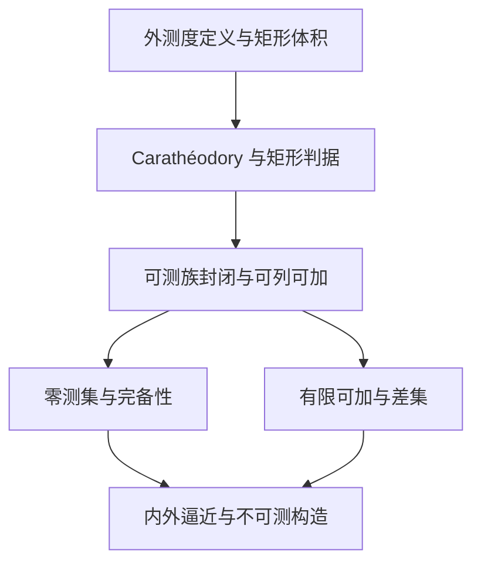

# RA07 作者候选与数学检验记录

本文件身份为 `/root/ra07_rebuild`，只记录作者识读、回图和数学恢复。它不冒充非作者的正式 `recoveries` 审核记录；ledger 中正式 recoveries 目前为空，由后续独立复核者建立。

## 四项未决

| 编号、源单元 | 候选及回图 | 数学检验与边界 | 当前处理 |
| --- | --- | --- | --- |
| Q001，P001-U013 | 句首曾误推为全幂集问题；实际回看 `p0001-question.png` 并参考 `/root` 的独立局部复读，改为更符合笔画的“无穷维”。中间仍近似量词样符号或“∧m” | 无限维可分赋范空间不存在非零局部有限平移不变 Borel 测度，Riesz 球列给出完整证明；有限维全幂集归一化测度不存在则是另一 Vitali 命题。两者前提不同，不能相互替代来证明原字 | 撤销全幂集黑色原题；保留中性量词疑字。两个补证分别蓝列 |
| Q002，P003-U009 | 覆盖对象候选“闭矩形”；“半开矩形”等对象在数学上也可能。实际查看 `p0003-rectangle.png`，字形尚不足以唯一确定 | 闭矩形、半开矩形都可通过逐项 ε/2^k 放大与收缩得到同一外测度，数学可行不能唯一排除读法 | 片段与裁图保留，闭矩形版本只作为候选补证，不断言原题已读清 |
| Q003，P010-U008 | `p0010-vitali.png` 中首动词与名字后的汉字，候选“将/取”“集于/在于”；Vatelli、[2,3]^c、可测集与2^c可读 | 邻行明确 Φ:2^[2,3]→2^R、A↦A∪V。取V⊂[0,1]可验证构造；不同汉字候选都与之相容，逆向不能选定原字 | 中性汉字片段保留，完整数学论证另蓝列 |
| Q004，P011-U008 | `p0011-bridge.png` 下部公式前三字，候选“待后有/随后有/结合有”等；两项相加公式本体清晰 | 不论衔接词是哪种，A可测均直接给 m*(T∩A)+m*(T∩A^c)=m*(T)。公式正确性不能反证某个衔接字 | 原公式保留，衔接字中性编号；四块补证完整 |

## 已用上下文恢复或原错核验

### 第 6 页定义行扫描右缘截断

候选末项为 $m^*(I\cap E)$ 或 $m^*(I\cap E^c)$。本页中部完整复写明确是后者。正向代入 $E=\mathbb R^n$、$I$ 为体积正的有限矩形：前者会要求 $m^*(I)=2m^*(I)$，不能作通用定义；后者给正确的 $m^*(I)=m^*(I)+0$。逆向回到同页完整式可见 $E^c$，所以采用补集版本，但正文仍注明是同页恢复，没有伪称扫描缺边可见。

### 第 9 页零测集证明末项

实际回图 `p0009-nullproof.png`，第二行末项是 $T\cap E$，未见补集 $c$。数学上它只是单调性真式，不能独自完成分割等式。转写保留 $E$；蓝色收尾改用 $T\cap E^c$，结合第一行已经证明 $m^*(T\cap E)=0$。这是补证与纠错，不能反过来说原字实际写了 $E^c$。

### 第 10 页两处差集方向

两处都能从原高清区域读出 $A\setminus V$。有限反例 $A=\varnothing,V=\{0\}$ 使原恒等式左右不等；正确式 $A\cup V=A\cup(V\setminus A)$ 在三点全集的 64 对子集穷举中全部成立。可测性正确等价式再用并、差封闭完整证明。原错误未删除。

### 第 11 页目标式补集括号

原末项缺少 $A\cup B$ 的成对括号，按字面读为 $(T\cap A)\cup B^c$ 与目标不符。由随后三块集合等式及三圆图，可恢复意图为 $T\cap(A\cup B)^c$。转写仍保留原写，学习稿以蓝色纠错后给四块等式证明。图中数字 1、2、3、4 真实可见，具体 $D_i$ 名称为编者新增。

### 第 2 页 Darboux 判据

原式是 $\sup U=\inf L\Rightarrow$ 可积。它作为充分条件过强，但箭头本身并非反例意义下的假命题；标准充要判据应为 $\inf U=\sup L$。在 $f(x)=x,[0,1]$ 上计算出单格 U=1、L=0，均匀 N 格之差为 1/N，说明标准可积函数未必满足原强条件。正文已作此区分。

## 有限检验与一般证明

实际执行脚本 `finite_checks.py`，输入输出存于 `finite-check-input-output.json`，6 组检验全部通过：Darboux 和、Cantor 有限阶段、差集式 64 对穷举、三圆分块 512 组三集合穷举、几何误差和、Riesz 球常数。

有限检验不能证明无限基数结论、一般测度定理或视觉识读。一般命题的完整蓝色证明都在学习稿，并按以下依赖编排：

