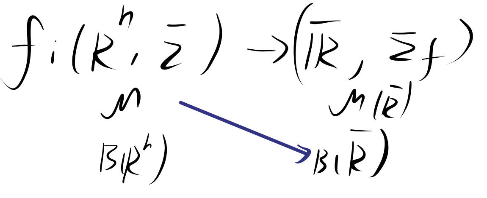

# 实分析 9：复习笔记

## 目录

1. **$G_\delta$、$F_\sigma$ 与 Borel 集**：定义与基本例子；无理数集不是 $F_\sigma$；度量空间中的开闭集表示。
   - 1.1 **Borel 集与 Lebesgue 可测集**：Borel 集族的基数；Cantor 零测集中的非 Borel 子集；Carathéodory 可测集族严格大于 Borel 族；边界分解。
2. **开集外逼近与闭集内逼近**：有限测度证明；无限测度的局部分解；取补得到内逼近。
   - 2.1 **相差零测集的 Borel 外壳与内核**：$G_\delta$ 外壳、$F_\sigma$ 内核及可测性逆向判别。
   - 2.2 **由开、闭集确定测度**：外正则、闭集内正则与有界集的内外测度判据。
   - 2.3 **边界零测的充分条件**。
3. **积分引入与逆像族**：分层草式；拓扑基判别；逆像的交并补恒等式；$\sigma$ 代数及最大目标拓扑。
4. **可测映射与生成族判别**：两端可测空间；生成族判别的必要性、充分性。
5. **扩展实数与迹 $\sigma$ 代数**。
   - 5.1 **序拓扑**：开区间、端点半直线、邻域与子基。
   - 5.2 **Borel 代数**：端点单点集；从 $\mathbb R$ 到 $\overline{\mathbb R}$；四种半直线；与 $[0,1]$ 的同胚。
   - 5.3 **限制（迹）$\sigma$ 代数**：任意定义域上的构造及可测定义域的简化。
6. **Lebesgue 可测函数**：上水平集定义；$\operatorname{MF}(E)$；Borel 逆像判别；原图中源、目标集合族的选择。
7. **四种可测性的比较与反例**：完整强弱关系；中间条件互不蕴含；有限区间不能区分正负无穷。
8. **可测函数的基本例子**。
   - 8.1 **常函数**：包括正负无穷常值。
   - 8.2 **示性函数**：水平集端点及可测性充要条件。
   - 8.3 **连续函数**：孤立点辨析与水平集直接证明。
   - 8.4 **连续蕴含可测的第二条路线**：相对拓扑、逆像族包含、生成 Borel 代数。
9. **原件终页说明**。

> **编排说明**
>
> 普通正文保留原稿内容；蓝色信息块分别标明补充解释、补充证明或纠错。原稿明确待填的位置用红色文字保存。中性编号表示尚待判读的字迹，不表示数学练习。原稿页序另见保真转写；这里把基础工具与相应证明排在一起，并保留重复表述、不同路线、旁注及原图。

## 1. $G_\delta$ 集、$F_\sigma$ 集与 Borel 集

**Def.** 若存在一列开集 $\{G_i\}$ 及闭集列 $\{F_i\}$，使得（拓扑下）：

$$
G=\bigcap_{i=1}^{\infty}G_i,\qquad F=\bigcup_{i=1}^{\infty}F_i,
$$
称 $G$ 为 $G_\delta$ 集，$F$ 为 $F_\sigma$ 集。

这是表示法。

1. 开集是 $G_\delta$，闭集是 $F_\sigma$。

2. $\mathbb Q$ 是 $F_\sigma$，$\mathbb Q^c$ 是 $G_\delta$。

3. $\{x\}=\displaystyle\bigcap_{n=1}^{\infty}B(x,1/n)$。单点是 $G_\delta$ 与 $F_\sigma$。

> **补充证明：定义中的基本例子**
>
> 若 $U$ 开，则 $U=\bigcap_{n\ge1}U$；若 $F$ 闭，则 $F=\bigcup_{n\ge1}F$。在度量空间中，单点闭且 $\{x\}=\bigcap_{n\ge1}B(x,1/n)$。把 $\mathbb Q$ 枚举为 $\{q_n:n\ge1\}$，便有 $\mathbb Q=\bigcup_{n\ge1}\{q_n\}$，从而其补集为 $G_\delta$。单点的球交表示用到了度量，不能据此断言任意拓扑空间中的单点均为 $G_\delta$。

4. $G_\delta$ 不一定是 $F_\sigma$。〔“不一定”按上下文恢复〕

> **【例子与证明补全】无理数集是 $G_\delta$，却不是 $F_\sigma$**
>
> 已知 $\mathbb Q$ 是 $F_\sigma$，故 $\mathbb R\setminus\mathbb Q$ 是 $G_\delta$。假设反过来它也是 $F_\sigma$，写成 $\mathbb R\setminus\mathbb Q=\bigcup_{n\ge1}F_n$，其中各 $F_n$ 在 $\mathbb R$ 中闭。由于 $F_n$ 不含有理数，而每个非空开区间都含有理数，$F_n$ 的内部为空。把有理数列成 $q_1,q_2,\ldots$，并交错排列闭集 $H_{2n-1}=F_n$、$H_{2n}=\{q_n\}$。这些 $H_k$ 都闭且内部为空，却覆盖了 $\mathbb R$。
>
> 以下直接证明这不可能，无需先引用 Baire 定理。取非退化闭区间 $I_0=[0,1]$。若 $I_{k-1}$ 已选定，$H_k$ 内部为空且闭，所以 $\operatorname{int}I_{k-1}\setminus H_k$ 是非空开集，可在其中选非退化闭区间 $I_k$，并使其长度小于 $2^{-k}$。于是 $I_k\subset\operatorname{int}I_{k-1}$、$I_k\cap H_k=\varnothing$。由实数闭区间套性质，$\bigcap_kI_k$ 有一点 $x$；对每个 $k$，$x\in I_k$，所以 $x\notin H_k$，与全部 $H_k$ 覆盖 $\mathbb R$ 矛盾。因此无理数集不是 $F_\sigma$。

5. 开集是否是 $F_\sigma$？闭集是否是 $G_\delta$？

右侧旁注：“会有〔疑字 001〕有反例”。

一般距离空间中成立。

设 $F\subset(X,d)$，令
$$
U_n=\{x\in X:d(x,F)<1/n\}.
$$

$$
d(x,F):X\longrightarrow[0,\infty).
$$

$$
F=\bigcap_n U_n.
$$
“开” $\longleftarrow [0,1/n)$ “开”。〔箭头表示以距离函数取逆像。〕

> **补充证明：度量空间中的闭集是 $G_\delta$**
>
> 此处 $F$ 必须为闭集。先设 $F\ne\varnothing$。三角不等式给出
> $$
> |d(x,F)-d(y,F)|\le d(x,y),
> $$
> 所以距离函数连续。$[0,1/n)$ 是 $[0,\infty)$ 的相对开集，因此 $U_n$ 开。又 $F\subset U_n$ 对每个 $n$ 成立；若 $x\notin F$，闭性给出 $r>0$ 使 $B(x,r)\cap F=\varnothing$，选 $1/n\le r$，便有 $x\notin U_n$。于是 $F=\bigcap_nU_n$。$F=\varnothing$ 时直接取 $U_n=\varnothing$。对闭集取补，得到每个开集都是 $F_\sigma$。
>
> 原页写“设 $F\subset(X,d)$”，未重写闭性；此处补明它来自上文“闭是否是 $G_\delta$”这一问题。

**Prop.** $F_\sigma$、$G_\delta$ 均为 Borel 集。

> **补充证明：Borel 性**
>
> Borel $\sigma$ 代数含开集，也含开集的补集即闭集，并对可数并、可数交封闭，因此含全部 $G_\delta$ 和 $F_\sigma$ 集。

**Prop.**
$$
\mathcal B(\mathbb R^n)\subsetneq\mathcal M(\mathbb R^n).
$$

### 1.1 Borel 集与 Lebesgue 可测集的严格区别

$$
\mathcal O(\mathbb R^n)\subset\mathcal M(\mathbb R^n).
$$
包含开集的最小 $\sigma$ 代数是 Borel 代数。

$$
\overline{\overline{\mathcal B(\mathbb R^n)}}=\mathfrak c.
$$

下界：单点集。〔该行左侧有勾。〕

上界：Borel 层级，用超限归纳。

> **补充证明：$|\mathcal B(\mathbb R^n)|=\mathfrak c$**
>
> 下界来自互不相同的单点 Borel 集：$x\mapsto\{x\}$ 给出 $\mathbb R^n$ 到 Borel 集族的单射。
>
> 上界按原稿提示采用 Borel 层级。$\mathbb R^n$ 有可数基，每个开集都是基元素的某个子族之并，所以开集族的基数不超过 $2^{\aleph_0}=\mathfrak c$。从开集出发，在每个可数序数阶段加入以前各阶段集合的补集和可数并。若已有集合族基数至多 $\mathfrak c$，其可数序列族基数至多 $\mathfrak c^{\aleph_0}=\mathfrak c$；可数极限阶段的并也至多为 $\mathfrak c$。超限归纳得每个可数阶段至多有 $\mathfrak c$ 个集合。全部可数阶段的并对补集和可数并封闭，因为可数个可数序数的上确界仍可数，因此它正是 Borel $\sigma$ 代数。又 $\aleph_1\le\mathfrak c$，全部阶段的集合数仍不超过 $\mathfrak c$，与下界合并即得等式。

Cantor 集也是 Borel 集，$\exists E\subset C$，但 $E\notin\mathcal B(\mathbb R)$。

反证法：
$$
\overline{\overline{\mathcal P(\mathrm{Cantor})}}
\le\overline{\overline{\mathrm{Borel}}},
$$
矛盾。

> **补充证明：严格包含**
>
> 取标准三分 Cantor 集 $C$。它闭、测度为零，且 $|C|=\mathfrak c$。若它的每个子集均为 Borel 集，就有 $|\mathcal P(C)|\le|\mathcal B(\mathbb R)|=\mathfrak c$；但 Cantor 定理给出 $|\mathcal P(C)|=2^{\mathfrak c}>\mathfrak c$，矛盾。因此有非 Borel 子集 $E\subset C$。Lebesgue 测度完备，故这个 $E$ 仍然 Lebesgue 可测且测度为零，于是 $\mathcal B(\mathbb R)\subsetneq\mathcal M(\mathbb R)$。在 $\mathbb R^n$ 中使用 $C\times\{0\}^{n-1}$ 得到相同结论。

不存在外测度 $\mu^*$，s.t. 由 Carathéodory 条件生成 Borel 代数。

> **【完整补证】Borel 代数不能恰为外测度的 Carathéodory 可测集族**
>
> 原断言在 $X=\mathbb R^n$、$n\ge1$ 时成立。下面先列所需的两个描述集合论工具，再证明原稿省略的全称结论。
>
> **工具一：解析集的普遍可测性。** Polish 空间（可分且可完全度量的拓扑空间）的解析集，可理解为 Polish 空间的连续像；每个解析集对任一有限 Borel 测度都属于其完备化。具体地，若 $A$ 解析、$\nu$ 是有限 Borel 测度，则有 Borel 集 $B\subset A\subset C$，满足 $\nu(C\setminus B)=0$。参见 Philipp Schlicht，[《Lecture Notes on Descriptive Set Theory》](https://www.math.uni-bonn.de/ag/logik/teaching/2013SS/advanced%20topics/Lecture%20notes%20on%20descriptive%20set%20theory.pdf)，2013 年，Proposition 3.26，PDF 第 16 页及其前面的 Lemmas 3.22–3.25。
>
> **工具二：存在解析非 Borel 集。** Justin Moore 的 [《MATH 7870: Descriptive Set Theory》](https://pi.math.cornell.edu/~justin/Limited2Cornell/DST_lecture_notes.pdf)，Lecture 6，Theorem 13 与 Corollary 5（PDF 第 14 页）给出 Baire 空间乘积中的普遍解析非 Borel 集。交错排列坐标把该乘积同胚到 Baire 空间，再用 Baire 空间与无理数集的同胚（同讲义 Lecture 2，第 4 页），可将它作为 $\mathbb R$ 中的解析非 Borel 集；若其像在 $\mathbb R$ 中是 Borel 集，连续逆像将迫使原集 Borel，矛盾。嵌入坐标直线可得到 $\mathbb R^n$ 中的例子。
>
> 现在设任意外测度 $\mu^*$ 的 Carathéodory 可测集族包含 $\mathcal B(X)$，取一个解析非 Borel 集 $A\subset X$。任取测试集 $T\subset X$，证明
> $$\mu^*(T)=\mu^*(T\cap A)+\mu^*(T\setminus A).$$
> 若 $\mu^*(T)=\infty$，外测度次可加性已给出 $\infty\le\mu^*(T\cap A)+\mu^*(T\setminus A)$，所以右边也是无穷，等式成立。
>
> 若 $\mu^*(T)<\infty$，对 Borel 集 $D$ 定义 $\nu_T(D)=\mu^*(T\cap D)$。这里 $T$ 不必可测。证明 $\nu_T$ 是有限 Borel 测度：对两两不交的 Borel 集 $D_i$，把各 $D_i$ 的 Carathéodory 分割性质逐次用于 $T\cap\bigcup_iD_i$，得到对每个 $N$，
> $$\mu^*\!\left(T\cap\bigcup_iD_i\right)\ge\sum_{i=1}^N\mu^*(T\cap D_i).$$
> 令 $N\to\infty$ 得到不小于整个级数；反向不等式由外测度可列次可加性给出。因此 $\nu_T$ 可列可加，且 $\nu_T(X)=\mu^*(T)<\infty$。
>
> 应用工具一，选 Borel 集 $B\subset A\subset C$ 使 $\nu_T(C\setminus B)=0$。有限测度的可加性给出 $\nu_T(B)=\nu_T(C)$，由单调性夹逼，
> $$\mu^*(T\cap A)=\nu_T(B)=\nu_T(C).$$
> 同样 $C^c\subset A^c\subset B^c$ 且 $\nu_T(B^c\setminus C^c)=0$，所以
> $$\mu^*(T\setminus A)=\nu_T(C^c)=\nu_T(B^c).$$
> 两式相加为 $\nu_T(B)+\nu_T(B^c)=\nu_T(X)=\mu^*(T)$。因为 $T$ 任意，$A$ 满足 Carathéodory 条件；但 $A$ 非 Borel，故该可测集族严格包含 $\mathcal B(X)$，不可能恰好等于它。
>
> 这个论证不假设原外测度局部有限或 $\sigma$ 有限，也没有使用无穷量相减。

可以理解：
$$
\mathrm{Lebesgue}\big|_{\text{Borel 集上}}=\text{Borel 测度}.
$$

> **术语澄清：这里的 Borel 测度**
>
> 把 Lebesgue 测度 $m$ 限制在 $\mathcal B(\mathbb R^n)$ 上，所得 $m|_{\mathcal B}$ 的定义域是 Borel $\sigma$ 代数，且继承可列可加性，所以是一种 Borel 测度。一般说“Borel 测度”只说明测度定义在 Borel 集上，并不唯一指定 Lebesgue 测度。此处按原稿的限制式理解。

Borel 集上，

$$
E=E^\circ\mathbin{\dot\cup}(E\cap\partial E).
$$

**Prop.**
$$
E\in\mathcal M\quad\Longleftrightarrow\quad E\cap\partial E\in\mathcal M.
$$

> **补充证明：只需检查边界上的部分**
>
> 对任意 $E\subset\mathbb R^n$，$E\setminus E^\circ=E\cap\partial E$，两部分不交。由于 $E^\circ$ 开、$\partial E$ 闭，二者都是 Borel 集。若 $E$ 可测，则 $E\cap\partial E$ 可测；反过来，若 $E\cap\partial E$ 可测，则由分解式及可数并封闭性，$E$ 也可测。此处 $\mathcal M$ 可取 Lebesgue 可测集族；同一论证也适用于 Borel 集族。

测度的完备化，局部逼近。开集〔疑字 002〕扩大逼近〔疑字 002〕。

**Lemma.** $E\in\mathcal M$，则下述性质成立。〔接第 3 页。〕

## 2. 可测集的开集外逼近与闭集内逼近

以下条件承接原稿引理：$E$ 为 Lebesgue 可测集。

(1) $\forall\varepsilon>0$，$\exists$ 开集 $G\supset E$，s.t.
$$
m(G\setminus E)<\varepsilon.
$$

(2) $\forall\varepsilon>0$，$\exists$ 闭集 $F\subset E$，s.t.
$$
m(E\setminus F)<\varepsilon.
$$

原稿提问：与外测度结论区别？

〔问号用蓝色椭圆圈出，原位置未写答。〕

> **补充解答：与外测度逼近结论的区别**
>
> 外测度定义可对任意集合 $A$ 给出开覆盖，其总体积接近 $m^*(A)$；有限外测度时可得到 $m(G)<m^*(A)+\varepsilon$。本引理以 **$E$ 可测** 为条件，结论直接控制新增部分 $G\setminus E$ 的测度。有限测度时，依靠可测性写成 $m(G\setminus E)=m(G)-m(E)$；无限测度时不能作 $\infty-\infty$ 的减法，需要下面的局部分解与可求和误差。闭集内逼近则由补集的外逼近得到。

**(1) 当 $m(E)<+\infty$。**

$\forall\varepsilon>0$，$\exists\{I_i\}\in\mathcal L_c(E)$，s.t.

$$
E\subset\bigcup_{i=1}^{\infty}I_i,
\qquad\sum_i|I_i|<m(E)+\varepsilon.
$$

$$
G=\bigcup_i I_i\quad\text{开},\qquad
m(G)\le\sum_i|I_i|<m(E)+\varepsilon.
$$

> **补充证明：有限测度情形的最后一步**
>
> $\mathcal L_c(E)$ 在此表示所用的可数开矩形（开区间）覆盖族；由原稿下一行 $G=\bigcup I_i$ 为开集可见，覆盖元素在本路线中取开。$E\subset G$ 且 $E$ 可测，故 $G=E\mathbin{\dot\cup}(G\setminus E)$。这里 $m(G)<\infty$，从而
> $$
> m(G\setminus E)=m(G)-m(E)<\varepsilon.
> $$

**$m(E)=+\infty$ 时。**

令
$$
B_i=\{x\in\mathbb R^n:|x|\le i\}.
$$

$$
E\cap B_i=E_i,\qquad m(E_i)<+\infty.
$$

$E$ 是 $\sigma$ 有限，再用 $\varepsilon/2^k$。〔此处原稿指数写 $k$，下文片段指标写 $i$。〕

右侧短注：$<i$，$(j>i)$。

$$
G=\bigcup_{i=1}^{\infty}G_i.
$$

$$
\begin{aligned}
G\setminus E
&=\left(\bigcup_{i=1}^{\infty}G_i\right)\cap
\left(\bigcap_{i=1}^{\infty}E_i^c\right)\\
&\subset\bigcup_i(G_i\cap E_i^c)
=\bigcup_{i=1}^{\infty}(G_i\setminus E_i).
\end{aligned}
$$

即可。

> **补充证明：可求和的局部误差**
>
> 因为 $E=\bigcup_{i\ge1}E_i$，对每个 $E_i$ 应用有限测度结论，选开集 $G_i\supset E_i$，使
> $$
> m(G_i\setminus E_i)<\frac{\varepsilon}{2^i}.
> $$
> 这里把原稿的占位指标 $k$ 统一成对应片段的 $i$。$G=\bigcup_iG_i$ 为包含 $E$ 的开集。原稿给出的集合包含关系与次可加性推出
> $$
> m(G\setminus E)\le\sum_{i=1}^{\infty}m(G_i\setminus E_i)
> <\sum_{i=1}^{\infty}\frac{\varepsilon}{2^i}=\varepsilon.
> $$
> 最后的严格小于成立：每一项的缺口均为正，至少第一项已有严格缺口，而其余项以给定上界估计即可。

**(2)** $E\in\mathcal M\Longleftrightarrow E^c\in\mathcal M$。

由 (1) 得，$\forall\varepsilon>0$，$\exists$ 开集 $G\supset E^c$，s.t.
$$
m(G\setminus E^c)<\varepsilon.
$$
〔接第 4 页。〕

> **补充证明：闭集内逼近的跨页收尾**
>
> 延续上页对 $E^c$ 的外逼近，令 $F=G^c$。则 $F$ 闭且 $F\subset E$，并且
> $$
> E\setminus F=E\cap G=G\setminus E^c.
> $$
> 所以 $m(E\setminus F)<\varepsilon$，完成闭集内逼近。原稿在上页写到对 $E^c$ 的估计后，本页直接进入下述推论；这里补出省略的取补步骤。

### 2.1 相差零测集的 Borel 外壳与内核

$E\in\mathcal M$。

(1) 存在 $G_\delta$ 集，s.t. $G\supset E$ 且
$$
m(G\setminus E)=0.
$$

(2) 存在 $F_\delta$ 集，……
$$
m(G\setminus E)=0.
$$
〔这里原稿确写 $F_\delta$，条件处用省略线，并重复上一项的 $G\setminus E$。〕

> **纠错：第二项应为 $F_\sigma$ 内核**
>
> 与闭集内逼近对应的正确结论是：存在 $F_\sigma$ 集 $F\subset E$，且 $m(E\setminus F)=0$。原稿第二项的 $F_\delta$ 和重复写出的 $m(G\setminus E)=0$ 已在上方保留；这里分别订正为 $F_\sigma$ 与 $m(E\setminus F)=0$。
>
> 证明：对每个 $k\ge1$，选开集 $G_k\supset E$ 使 $m(G_k\setminus E)<1/k$，令 $G=\bigcap_kG_k$，便有 $m(G\setminus E)\le1/k$ 对每个 $k$ 成立，所以为零。再选闭集 $F_k\subset E$ 使 $m(E\setminus F_k)<1/k$，令 $F=\bigcup_kF_k$；同理由 $E\setminus F\subset E\setminus F_k$ 得零测。

实际上，在外测度下，$E\in\mathcal M$ 是和上面的引理等价。

也得到一种判定可测集的方法。

> **补充证明：逼近条件反推可测性**
>
> 假设对每个 $k$ 有开集 $G_k\supset E$ 且 $m^*(G_k\setminus E)<1/k$。令 $G=\bigcap_kG_k$，则 $G$ 是 Borel 集，且 $m^*(G\setminus E)=0$。零外测度集可测，所以 $E=G\setminus(G\setminus E)$ 可测。由闭集形式也可同样取 $F=\bigcup_kF_k\subset E$，使 $m^*(E\setminus F)=0$，再以 $E=F\cup(E\setminus F)$ 得可测。因而原稿的“外测度下等价”应读作把逼近误差写成外测度后的判别。

### 2.2 由开集、闭集确定测度

**Th. (1)** 设 $E\in\mathcal M$，则

$$
\begin{aligned}
m(E)
&=\inf\{m(G):G\supset E,\ G\text{ 开}\}\\
&=\sup\{m(F):F\subset E,\ F\text{ 闭}\}.
\end{aligned}
$$

(1) pf：

原稿待填：此证明标记之后未写证明。

〔第 5 页直接转入边界零测与积分话题。〕

> **补充证明：外正则与闭集内正则**
>
> 单调性先给出 $m(E)\le\inf_{G\supset E,\,G\text{开}}m(G)$ 及 $\sup_{F\subset E,\,F\text{闭}}m(F)\le m(E)$。若 $m(E)<\infty$，开、闭逼近分别给出 $m(G)<m(E)+\varepsilon$ 与 $m(F)>m(E)-\varepsilon$，令 $\varepsilon\downarrow0$ 即得到两边等式。若 $m(E)=\infty$，任何超集 $G$ 都有无限测度，故外侧下确界为无限；取闭 $F\subset E$ 使 $m(E\setminus F)<1$，可加性迫使 $m(F)=\infty$，故内侧上确界也为无限。

(2) $E$ 有界，且 $m^*(E)=m_*(E)$，则 $E\in\mathcal M$。

> **补充证明：有界集的内外测度判据**
>
> 在此使用 $m_*(E)=\sup\{m(F):F\subset E,\ F\text{闭}\}$ 的内测度表述。设 $a=m^*(E)=m_*(E)$。有界性保证 $a<\infty$。对每个 $j$ 取闭集 $F_j\subset E$ 与开集 $G_j\supset E$，使 $m(F_j)>a-1/j$、$m(G_j)<a+1/j$。于是 $m(G_j\setminus F_j)<2/j$。令 $F=\bigcup_jF_j$、$G=\bigcap_jG_j$，则 $F\subset E\subset G$ 且 $m(G\setminus F)\le m(G_j\setminus F_j)<2/j$ 对每个 $j$ 成立。因而 $m(G\setminus F)=0$，$E$ 是 Borel 集 $F$ 与零测集子集的并，所以可测。

### 2.3 边界零测的充分条件

$$
m^*(\partial E)=0\quad\Longrightarrow\quad E\in\mathcal M.
$$

> **补充证明：边界零测的判据**
>
> $E=E^\circ\mathbin{\dot\cup}(E\cap\partial E)$。第一部分开而可测；第二部分包含于零外测度集 $\partial E$，所以也可测。这个条件是充分条件，并非任意可测集的必要条件。

## 3. 积分引入与逆像族

### 勒贝格积分

草式：$E[y_{i-1}\le f<y_i)$。

$f(\xi_i)m(E)$。〔$\xi_i$ 按取样点语境恢复，原形近似 $G_i$。〕

> **补充解释：由值域分层引出可测性**
>
> 这里的 $E[y_{i-1}\le f<y_i)$ 可展开为 $\{x\in E:y_{i-1}\le f(x)<y_i\}$。原稿只写了分层集和一个乘积草式，没有写完整积分定义；后面的可测映射理论保证这些分层集能取测度。若在每层选择样点 $\xi_i$，相应有限和写成 $\sum_i f(\xi_i)m(E_i)$，其中 $E_i$ 是该层原像；这只是解释草式的分片思路。

连续：对 $\delta$ 基，基的原像是开集。〔原稿记作“$\delta$ 基”，本页未另作定义。〕

$f^{-1}$ 又对交、并、补取等。

> **补充解释：基判别与逆像恒等式**
>
> 对通常拓扑，检验拓扑基中每个集合的原像为开集即可检验连续性，因为开集是基元素的并，而逆像保持任意并。原稿的“$\delta$ 基”称谓保持原样；这里仅说明通常拓扑基的结论。
> $$
> f^{-1}\!\left(\bigcup_\alpha B_\alpha\right)=\bigcup_\alpha f^{-1}(B_\alpha),\qquad
> f^{-1}\!\left(\bigcap_\alpha B_\alpha\right)=\bigcap_\alpha f^{-1}(B_\alpha),
> $$
> $$
> f^{-1}(Y\setminus B)=X\setminus f^{-1}(B).
> $$

**Prop.**
$$
f:(X,\Sigma\subset\mathcal P(X))\longrightarrow Y.
$$

$$
\Sigma_f=\{B\subset Y:f^{-1}(B)\in\Sigma\}.
$$

(1) $\Sigma$ 是 $f$ 上 $\sigma$ 拓扑，$\Sigma_f$ 是 $Y$ 上 $\sigma$ 拓扑。

〔第一个底空间位置原写形为 $f$。〕

(2) 若……$\sigma$ 代数，$\Sigma_f$ ……$\sigma$ 代数。

> **纠错与补充证明：逆像族继承封闭性质**
>
> 第一项的底空间按前面的映射定义应为 **$X$**。原稿“$\sigma$ 拓扑”的称谓在正文保留；本页没有重述这个课堂术语的定义。由逆像恒等式，$\Sigma$ 对哪些并、交封闭，$\Sigma_f$ 就对相同类型的并、交封闭，且 $\varnothing,Y$ 的原像分别为 $\varnothing,X$。
>
> 第二项的省略句补全为：若 $\Sigma$ 是 $X$ 上的 $\sigma$ 代数，则 $\Sigma_f$ 是 $Y$ 上的 $\sigma$ 代数。具体地，$Y\in\Sigma_f$；$B\in\Sigma_f$ 时，$f^{-1}(B^c)=f^{-1}(B)^c\in\Sigma$；$B_j\in\Sigma_f$ 时，$f^{-1}(\bigcup_jB_j)=\bigcup_jf^{-1}(B_j)\in\Sigma$。三条公理逐项成立。

设 $f:(X,\tau_X)\longrightarrow Y$。

(1) $\Sigma_f$ 是 $Y$ 上 $\sigma$ 拓扑。

(2) $\Sigma_f$ 是 s.t. $f$ 连续的最大拓扑。

> **补充证明：使映射连续的最大目标拓扑**
>
> 这一段取 $\Sigma=\tau_X$。由于 $\tau_X$ 对任意并、有限交封闭，$\Sigma_f$ 实际上是通常意义的拓扑。按它的定义，$f:(X,\tau_X)\to(Y,\Sigma_f)$ 连续。若 $\tau$ 是 $Y$ 上另一个使 $f$ 连续的拓扑，则每个 $V\in\tau$ 都满足 $f^{-1}(V)\in\tau_X$，所以 $V\in\Sigma_f$，即 $\tau\subset\Sigma_f$。这证明“最大”的方向。

## 4. 可测映射与生成族判别

### 可测

**定义** $f:(X,\Sigma_X)\to(Y,\Sigma_Y)$。

若 $\forall U\in\Sigma_Y$，有 $f^{-1}(U)\in\Sigma_X$，则 $f$ 是 $(\Sigma_X,\Sigma_Y)$ 可测映射。

> **【条件补充】此处的可测空间**
>
> $\Sigma_X$、$\Sigma_Y$ 均取相应底集上的 $\sigma$ 代数。可测性由两端的集合族共同决定；同一个点映射改变目标 $\sigma$ 代数后，可测性的要求也会改变。沿用前页记号 $\Sigma_f=\{B\subset Y:f^{-1}(B)\in\Sigma_X\}$，可测性等价于 $\Sigma_Y\subset\Sigma_f$。

**引理** 若存在 $\mathcal D\subset\Sigma_Y$，使 $\sigma(\mathcal D)=\Sigma_Y$，

则 $f$ 是 $(\Sigma_X,\Sigma_Y)$ 可测 $\Longleftrightarrow\mathcal D\subset\Sigma_f$。

仅证 $\Longleftarrow$。$\Sigma_f$ 是〔疑字003〕$\sigma$ 代数。

$\Sigma_Y\subset\Sigma_f$。〔右侧有证明结束小记号。〕

> **【证明补全】生成族判别的两个方向**
>
> 必要性：若 $f$ 可测，则 $\Sigma_Y\subset\Sigma_f$，所以 $\mathcal D\subset\Sigma_f$。
>
> 充分性：假设 $\mathcal D\subset\Sigma_f$。前页已逐项证明：逆像保持全集、补和可列并，因此 $\Sigma_f$ 是 $Y$ 上的 $\sigma$ 代数。由生成 $\sigma$ 代数的最小性，$\Sigma_Y=\sigma(\mathcal D)\subset\Sigma_f$，这正是 $f$ 可测。

$\Sigma_Y$ 变动，有不同的……〔原行止于“的”。〕

## 5. 扩展实数与迹 $\sigma$ 代数

### 5.1 广义 $\overline{\mathbb R}$ 上的拓扑

（1）定义开区间。

（2）半直线。

只要邻域，〔疑字004〕（1）（2）线序拓扑。

> **【定义补全】扩展实数及其序拓扑**
>
> 记 $\overline{\mathbb R}=[-\infty,+\infty]$，按 $-\infty<x<+\infty$（$x\in\mathbb R$）排序。原稿列“开区间”“半直线”两种说明方式，可具体写成以下拓扑基：有限端点的 $(a,b)$，以及包含端点的 $[-\infty,b)$、$(a,+\infty]$，其中 $a,b\in\mathbb R$、$a<b$。任意并组成序拓扑。
>
> 等价地，取两类开半直线 $[-\infty,b)$ 和 $(a,+\infty]$ 为子基；它们的有限交给出上述基区间。这些基覆盖全空间，两个基区间交集中每一点仍有更小基区间，故确实确定拓扑。有限点的邻域含某个 $(a,b)$；$+\infty$ 的邻域含某个 $(a,+\infty]$；$-\infty$ 的邻域含某个 $[-\infty,b)$。

### 5.2 扩展实数的 Borel 代数

可以证明 $\{-\infty\}$、$\{+\infty\}$ 是闭集，

则 $\{a\}\in\mathcal B(\overline{\mathbb R})$，$\forall a\in\overline{\mathbb R}$。

> **【证明补全】单点集**
>
> 对有限 $a$，其补集为 $[-\infty,a)\cup(a,+\infty]$，是开集。$\{+\infty\}$ 的补集 $[-\infty,+\infty)=\bigcup_n[-\infty,n)$ 开；$\{-\infty\}$ 的补集 $(-\infty,+\infty]=\bigcup_n(-n,+\infty]$ 开。因此每个单点闭，故为 Borel 集。

令由开集生成的 $\sigma$ 代数。

（1）$\mathcal B(O(\mathbb R))=\mathcal B(\mathbb R,\{-\infty\},\{+\infty\})$。

$=$ 〔原稿等号后留空，待填。〕

$\mathbb R\longrightarrow\overline{\mathbb R}$。

Borel 集 $\longrightarrow\mathcal B(\overline{\mathbb R})$，扩充了。

> **【记号澄清与待填补全】扩展实数上的 Borel 集**
>
> 本段对象是 $\overline{\mathbb R}$ 的序拓扑；首式的 $O(\mathbb R)$ 未画上横线，右侧 $\mathcal B(\mathbb R,\{-\infty\},\{+\infty\})$ 是简记。严格写法为
> $$\mathcal B(\overline{\mathbb R})=\sigma\bigl(\mathcal B(\mathbb R)\cup\{\{-\infty\},\{+\infty\}\}\bigr)=\{B\cup S:B\in\mathcal B(\mathbb R),\ S\subset\{-\infty,+\infty\}\}.$$
> 证明：右侧集合族是 $\overline{\mathbb R}$ 上的 $\sigma$ 代数。任意开集 $U\subset\overline{\mathbb R}$ 的 $U\cap\mathbb R$ 在 $\mathbb R$ 中开，所以 $U=(U\cap\mathbb R)\cup(U\cap\{-\infty,+\infty\})$ 属于右侧，得到左侧包含于右侧。反过来，$\mathbb R$ 是 $\overline{\mathbb R}$ 中的开子空间，且其每个开集在 $\overline{\mathbb R}$ 中也开；因而普通 Borel 集作为扩展实数的子集仍为 Borel。两个无穷端点的单点集闭，加入它们仍为 Borel，得到反向包含。以上第二个等号给出原稿空白处的一种完整续写，属于补充而非识读。

（2）$\mathcal B(\overline{\mathbb R})=\sigma\{[a,+\infty]:a\in\mathbb R\}$。

＝四种广义半直线，在广义 $\mathbb R$ 上。

> **【证明补全】四种半直线各自都生成同一个 Borel 代数**
>
> 四族分别为 $[a,+\infty]$、$(a,+\infty]$、$[-\infty,a)$、$[-\infty,a]$（$a\in\mathbb R$）。每个成员都是开集或闭集，因此各族生成的 $\sigma$ 代数都包含于 $\mathcal B(\overline{\mathbb R})$。
>
> 以原稿的 $[a,+\infty]$ 为起点，利用
> $$(a,+\infty]=\bigcup_{n=1}^\infty[a+1/n,+\infty],\qquad[-\infty,a)=[a,+\infty]^c,$$
> $$[-\infty,a]=\bigcap_{n=1}^\infty[-\infty,a+1/n),\qquad(a,b)=(a,+\infty]\cap[-\infty,b)$$
> 得到所有基区间。该序拓扑有可数基：有限端点可取有理数，连同两个方向的有理端点半直线；因此每个开集是这些基区间的可列并，属于所生成的 $\sigma$ 代数。
>
> 其余三族都能反过来得到原族：$[a,+\infty]=\bigcap_n(a-1/n,+\infty]$；由 $[-\infty,a)$ 直接取补得到 $[a,+\infty]$；由 $[-\infty,a]$ 取补得到 $(a,+\infty]$，再用刚才的交式。故四者等价。端点没有遗漏：$\{+\infty\}=\bigcap_n[n,+\infty]$，$\{-\infty\}=\overline{\mathbb R}\setminus\bigcup_n[-n,+\infty]$。

$\overline{\mathbb R}$ 与 $[0,1]$ 同胚。

> **【证明补全】一个具体同胚**
>
> 对有限 $x$，令 $h(x)=\tfrac12+\tfrac1\pi\arctan x$，并令 $h(-\infty)=0$、$h(+\infty)=1$。这是严格递增双射。有限点处 $h$ 及逆映射 $h^{-1}(t)=\tan(\pi(t-\tfrac12))$ 连续；当 $x\to+\infty$ 或 $x\to-\infty$ 时，$h(x)\to1$ 或 $0$。按前页的端点邻域定义，$h$ 在端点连续，逆映射在 $0,1$ 也连续，故为同胚。

### 5.3 限制 $\Sigma$ 代数

$E\subset\mathbb R^n$，$\mathcal M$ 是 Lebesgue $\sigma$。

$\Sigma_E=\{E\cap F:F\in\mathcal M\}$。

称 trace $\sigma$ 代数。

特别的，若 $E$ 可测，则 $\Sigma_E=\{F\in\mathcal M:F\subset E\}$。

> **【定义与证明补全】限制（迹）$\sigma$ 代数**
>
> $\mathcal M$ 指 $\mathbb R^n$ 上的 Lebesgue 可测集族。任意 $E\subset\mathbb R^n$ 都可定义 $\mathcal M|_E=\Sigma_E$，无需先假设 $E$ 可测。它是以 $E$ 为底空间的 $\sigma$ 代数：$E=E\cap\mathbb R^n$ 属于其中；若 $A=E\cap F$，则其相对补 $E\setminus A=E\cap F^c$ 仍在其中；若 $A_k=E\cap F_k$，则 $\bigcup_kA_k=E\cap\bigcup_kF_k$ 也在其中。
>
> 若进一步 $E\in\mathcal M$，则每个 $E\cap F$ 都是环境中的 Lebesgue 可测集且包含于 $E$；反过来，若 $F\in\mathcal M$、$F\subset E$，则 $F=E\cap F\in\Sigma_E$。这证明原稿最后的等式。

## 6. Lebesgue 可测函数与 Borel 逆像判别

$B\subset E$，则

$B\in\Sigma_E\Longleftrightarrow B\in\mathcal M$。

> **【条件补充】承接上页的 $E\in\mathcal M$**
>
> 本页开头仍以 $E$ Lebesgue 可测为前提。若 $B\subset E$，前页已经证明 $\Sigma_E=\{F\in\mathcal M:F\subset E\}$，故上述等价成立。若去掉 $E\in\mathcal M$，则 $E\in\Sigma_E$ 总成立而 $E$ 本身可能不可测，等价式便不能保留。

**定义** $E\in\mathcal M$，称 $f:E\to\overline{\mathbb R}$ 可测：

$\forall a\in\mathbb R$，有 $E[f>a]=\{x\in E:f(x)>a\}\in\mathcal M$。

$E$ 上所有 Lebesgue 可测函数集合为 $\operatorname{MF}(E)$。

**Th** 设 $E\in\mathcal M$，则 $f\in\operatorname{MF}(E)$。〔原稿先如此起笔，下一行另起 “Th”。〕

> **【表述补足】重复起笔不能单独当作定理**
>
> 仅有 $E\in\mathcal M$ 并不能推出任意 $f$ 可测。上行保留的是原稿未写出判别条件的第一次起笔；紧随其后的重述才给出完整等价条件。

**Th** $E\in\mathcal M$。令 $\mathrm E_f=\{B\subset\overline{\mathbb R}:f^{-1}(B)\in\Sigma_E\}$。〔首符号字形近 $\mathrm E_f$，本行后续及以下均记为 $\Sigma_f$。〕

则 $f\in\operatorname{MF}(E)\Longleftrightarrow\mathcal B(\overline{\mathbb R})\subset\Sigma_f$。

$\Longleftarrow$ 显然。

$\Longrightarrow$ 用生成〔疑字005〕。

$\mathcal D=\{(a,+\infty)\}$。

$\mathcal D\subset\mathcal B(\overline{\mathbb R})$。

> **【端点纠正与证明补全】扩展实数的上射线包含 $+\infty$**
>
> 为对应 $E[f>a]$，这里必须使用 $\mathcal D=\{(a,+\infty]:a\in\mathbb R\}$。原稿右括号写成圆括号，黑色转写保留；学习时以含 $+\infty$ 的版本为准。
>
> 若 $\mathcal B(\overline{\mathbb R})\subset\Sigma_f$，则每个 $(a,+\infty]$ 的逆像属于 $\Sigma_E$；由 $E$ 可测，逆像也是环境中的 Lebesgue 可测集，故 $f\in\operatorname{MF}(E)$。反过来，若 $f$ 可测，则 $\mathcal D\subset\Sigma_f$；$\Sigma_f$ 是 $\sigma$ 代数，而前页证明了 $\sigma(\mathcal D)=\mathcal B(\overline{\mathbb R})$，故得到所需包含。
>
> 若真把 $\mathcal D$ 取为不含无穷端点的 $(a,+\infty)$，其每个成员都同时排除 $-\infty,+\infty$，经补和可列并之后仍不能把这两个点分开。因此它不能生成 $\mathcal B(\overline{\mathbb R})$；下一页的正负无穷反例正显示这个缺口。

$f:(\mathbb R^n,\Sigma)\longrightarrow(\overline{\mathbb R},\Sigma_f)$。

原图下方左列为 $\mathcal M$、$\mathcal B(\mathbb R^n)$，右列为 $\mathcal M(\overline{\mathbb R})$、$\mathcal B(\overline{\mathbb R})$。蓝色斜箭头从左上 $\mathcal M$ 指向右下 $\mathcal B(\overline{\mathbb R})$。

$\mathcal B(\overline{\mathbb R})\subset\mathcal M(\overline{\mathbb R})\subset\Sigma_f$。

> **【条件澄清】图中的蓝箭头与旁边的较强包含链**
>
> 蓝箭头对应通常的 Lebesgue 可测：源端用 Lebesgue $\sigma$ 代数，目标端用 Borel $\sigma$ 代数。若另外要求目标端所有 Lebesgue 可测集的逆像也可测，就是更强的 $(\mathcal M,\mathcal M)$ 可测性；原稿右边的完整包含链应在这个更强条件下理解，不能由 $f\in\operatorname{MF}(E)$ 自动推出。这里可约定 $\mathcal M(\overline{\mathbb R})=\{A\cup S:A\in\mathcal M(\mathbb R),\ S\subset\{-\infty,+\infty\}\}$。
>
> 改变源端、目标端的集合族是两件不同的事：源端可测集增多会放宽要求；目标端可测集增多会加强要求。下一页“比较四个组合”的原题将逐一落实这些关系。

## 7. 四种可测性的强弱与无穷端点反例

$(\mathcal M\to\mathcal B)$，Leb。

$(\mathcal M\to\mathcal M)$。

请比较 4 个组合的可测的强弱。

> **【练习解答】四个组合的完整比较**
>
> 以 $f:\mathbb R^n\to\overline{\mathbb R}$ 为例，箭头左侧指定源端 $\sigma$ 代数，右侧指定目标端 $\sigma$ 代数。分别记条件为 $C_{BB}$、$C_{BM}$、$C_{MB}$、$C_{MM}$；例如 $C_{BM}$ 要求每个目标 Lebesgue 可测集的逆像都是源端 Borel 集，而 $C_{MB}$ 就是本讲定义的 Lebesgue 可测。
>
> | 条件 | 检验的目标集合 | 要求其逆像属于 |
> | --- | --- | --- |
> | $C_{BM}$ | 全部 Lebesgue 可测集 | Borel 代数 |
> | $C_{BB}$ | 全部 Borel 集 | Borel 代数 |
> | $C_{MM}$ | 全部 Lebesgue 可测集 | Lebesgue 代数 |
> | $C_{MB}$ | 全部 Borel 集 | Lebesgue 代数 |
>
> 由 $\mathcal B\subset\mathcal M$ 逐项可得
> $$C_{BM}\Longrightarrow C_{BB}\Longrightarrow C_{MB},\qquad C_{BM}\Longrightarrow C_{MM}\Longrightarrow C_{MB}.$$
> 第一条链先减少要检验的目标集合，再放宽逆像所属的集合族；第二条链先放宽源端要求，再减少目标检验集。中间的 $C_{BB}$ 与 $C_{MM}$ 一般互不蕴含。以下在 $n=1$ 给出反例，证明图中每条箭头都不能一般反向使用。
>
> **$C_{MM}$ 不推出 $C_{BB}$。** 取第 1.1 节已经构造的 Lebesgue 可测但非 Borel 集 $A$，令 $f=\mathbf1_A$。任意目标集合的逆像只可能是 $\varnothing,A,A^c,\mathbb R$，所以 $f$ 满足 $C_{MM}$；但 $f^{-1}(\{1\})=A$ 不是 Borel，故不满足 $C_{BB}$。
>
> **$C_{BB}$ 不推出 $C_{MM}$。** 在 $[0,1)$ 用下列 floor 公式取二进制数位；对有两种展开的二进制有理数选终止型：$b_k(x)=\lfloor2^kx\rfloor-2\lfloor2^{k-1}x\rfloor\in\{0,1\}$，定义 $h(x)=\sum_{k\ge1}2b_k(x)3^{-k}$；在 $\mathbb R\setminus[0,1)$ 令 $h=-\infty$。各部分和 $h_N$ 是 Borel 阶梯函数，且在 $[0,1)$ 上单调增加到 $h$；于是对有限 $a$，$\{h>a\}=[0,1)\cap\bigcup_N\{h_N>a\}$ 是 Borel，故按生成族判别，$h$ 满足 $C_{BB}$。其在 $[0,1)$ 上的像包含于零测 Cantor 集 $C$，并且是单射：若两数字列首次在第 $k$ 位不同，相应三进制和的差的绝对值至少 $2\cdot3^{-k}-\sum_{j>k}2\cdot3^{-j}=3^{-k}>0$。
>
> 取一个 Lebesgue 不可测集 $V\subset[0,1)$（本页原例也以不可测集的存在为前提）。$N=h(V)\subset C$ 是目标端的 Lebesgue 可测零测集，但由单射性及区间外值为 $-\infty$，$h^{-1}(N)=V$ 不可测。因此 $h$ 不满足 $C_{MM}$。这个例子也说明前页的 $\mathcal M(\overline{\mathbb R})\subset\Sigma_f$ 不能仅从通常的 Lebesgue 可测性推出。
>
> **即使两个中间条件同时成立，也未必得到最强条件。** 恒等映射 $x\mapsto x$ 同时满足 $C_{BB}$ 和 $C_{MM}$；取 Lebesgue 可测非 Borel 集 $A$，其逆像仍为 $A$，所以恒等映射不满足 $C_{BM}$。

$E[a\le f<b]\in\mathcal M$，$\forall a,b\in\mathbb R$，

$\not\Longrightarrow f\in\operatorname{MF}(E)$。

$\sigma(\mathcal I)=B\cup\{+\infty,-\infty\}$，$B\in\mathcal B(\mathbb R)$。

> **【生成族纠正与证明】有限区间无法分开两个无穷端点**
>
> 这里 $\mathcal I$ 指有限端点区间族，可取 $\{[a,b):a,b\in\mathbb R,\ a<b\}$。原稿表达式只列出了“加上两个无穷端点”的形式；完整集合族还应包含不加端点的 Borel 集：
> $$\sigma_{\overline{\mathbb R}}(\mathcal I)=\{B:B\in\mathcal B(\mathbb R)\}\ \cup\ \{B\cup\{-\infty,+\infty\}:B\in\mathcal B(\mathbb R)\}.$$
> 证明：右侧是 $\overline{\mathbb R}$ 上的 $\sigma$ 代数且含 $\mathcal I$，所以左侧包含于右侧。反过来，$\mathbb R=\bigcup_n[-n,n)$ 属于左侧；有限开区间可用半开区间作可列并，再由有理端点可数基得到全部 $\mathbb R$ 上开集。因此左侧含全部普通 Borel 集，以及它们在 $\overline{\mathbb R}$ 中的补集，从而含右侧。
>
> 此族中的集合要么同时包含 $-\infty,+\infty$，要么同时不含，不能得到某一个无穷端点的单点集，所以严格小于 $\mathcal B(\overline{\mathbb R})$。检验所有有限区间的逆像，尚不足以检验扩展实值函数可测。

**例** $E$ 是 $\mathbb R^n$ 上不可测集。

令 $f(x)=\begin{cases}+\infty,&x\in E,\\-\infty,&x\notin E.\end{cases}$

$E[a\le f<b]=\varnothing$。

$E[f=\{-\infty,+\infty\}]=\mathbb R^n\in\mathcal M$。

$E\{f\ge a\}=E$，不可测。

> **【记号澄清与例题补全】保留原分层反例**
>
> 此例函数的定义域是整个 $\mathbb R^n$，$E$ 专指其中的不可测集合。原稿仍沿用 $E[\cdots]$ 作水平集符号，并以 $f=\{-\infty,+\infty\}$ 简写“函数值属于这两个点”；严格的集合写法为
> $$\{x\in\mathbb R^n:a\le f(x)<b\}=\varnothing,\qquad f^{-1}(\{-\infty,+\infty\})=\mathbb R^n.$$
> 但对每个有限 $a$，$\{f\ge a\}=\{f>a\}=E\notin\mathcal M$。故所有有限区间逆像及整个无穷值部分都可测，函数仍不可测。真正缺少的是分别控制 $f^{-1}(\{+\infty\})$ 与 $f^{-1}(\{-\infty\})$。
>
> 若额外知道函数只取有限实值，则有限区间的检验足够：对每个 $a$，$\{f>a\}$ 可写成可列个 $\{a+1/k\le f<m\}$ 的并（$k,m\in\mathbb N$），由可列并封闭性可测。该论证在允许 $+\infty$ 时会漏掉它的逆像。

## 8. 可测函数的基本例子

### 8.1 常函数

**例** $E\in\mathcal M$，

$f(x)=C$ 可测。

> **【例题证明】常函数**
>
> 对任意常数 $C\in\overline{\mathbb R}$ 与有限阈值 $a$，$E[f>a]$ 在 $C>a$ 时等于 $E$，其余情形等于 $\varnothing$，二者均可测。因此有限常值及正负无穷常值函数都属于 $\operatorname{MF}(E)$。

### 8.2 示性函数

$A\subset E\in\mathcal M$，$\chi_A:E\to\overline{\mathbb R}$。

$\chi_A(x)=\begin{cases}1,&x\in A,\\0,&x\notin A.\end{cases}$

$\chi_A\in\operatorname{MF}(E)$ iff $A\in\mathcal M$。

**proof** 原稿把 $E[f>a]$ 分成以下三段：

$E[f>a]=E$，$a<0$。

$E[f>a]=A$，$0<a$。

$E[f>a]=\varnothing$，$a>1$。

> **【端点纠正与证明补全】示性函数的正确三段**
>
> 此处 $f=\chi_A$。原稿第二段只写了 $0<a$，第三段为 $a>1$，既漏掉 $a=0,1$，又使第二、三段重叠。正确分段为
> $$E[\chi_A>a]=\begin{cases}E,&a<0,\\A,&0\le a<1,\\\varnothing,&a\ge1.\end{cases}$$
> 若 $A\in\mathcal M$，这三种集合全可测，所以 $\chi_A$ 可测。反过来，若 $\chi_A$ 可测，取 $a=1/2$，得到 $A=E[\chi_A>1/2]\in\mathcal M$。定义域中的“$x\notin A$”始终指 $x\in E\setminus A$。

### 8.3 连续

孤立点本无法定义连续。

> **【概念辨析】孤立点与连续性**
>
> 按本段后续使用的相对拓扑连续性，函数在定义域的每个孤立点处自动连续。若 $x_0\in E$ 孤立，可取 $r>0$ 使 $B(x_0,r)\cap E=\{x_0\}$；给定任意 $\varepsilon>0$，取 $\delta=r$，那么 $x\in E$ 且 $|x-x_0|<\delta$ 时只有 $x=x_0$，于是 $|f(x)-f(x_0)|=0<\varepsilon$。
>
> 若课程在孤立点不定义“去心极限”，原旁注可以理解为那个极限定义不适用；不能据此否定拓扑或上述 $\varepsilon$–$\delta$ 意义下的连续性。本稿保留原句，同时按相对拓扑解释后面的连续函数定理。

$f:E\to\mathbb R$，在 $E$ 上连续，$E\in\mathcal M(\mathbb R^n)$，

则 $\mathcal M f\in\operatorname{MF}(E)$。〔原稿在 $f$ 前另有 $\mathcal M$ 形符号。〕

> **【记号澄清与直接证明】连续函数可测**
>
> 结合命题条件与后续证明，结论是 $f\in\operatorname{MF}(E)$；原稿前置的 $\mathcal M$ 形符号未定义为数或函数，不能据此理解为一个新的乘积 $\mathcal M f$。
>
> 直接从水平集证明：任意有限 $a$，连续性使 $\{x\in E:f(x)>a\}$ 在 $E$ 的相对拓扑中开，故存在 $\mathbb R^n$ 中开集 $G_a$，使其等于 $E\cap G_a$。由于 $E$ 可测、$G_a$ 为 Borel 集，这个交集可测，因此 $f$ 可测。此证明并不要求 $E$ 在环境中开。原稿另用 $\tau_f$ 与 $\Sigma_f$ 给出的生成族路线在下一页继续，仍单独保留。

$\Sigma_f$。

$\tau_f$。

### 8.4 连续蕴含可测：第二条证明路线

$f$ 连续 $\Longleftrightarrow\tau_{\mathbb R/E}\subset\tau_f$。

〔原稿下标写作 $R/E$，中间为斜线状分隔笔画。〕

> **纠错：区分定义域拓扑与值域拓扑**
>
> 延续前页 $f:E\to\mathbb R$、$E\in\mathcal M(\mathbb R^n)$ 的条件，令 $\tau_E=\{E\cap U:U\subset\mathbb R^n\text{ 开}\}$ 为定义域的相对拓扑，$\tau_{\mathbb R}$ 为值域的通常拓扑，并令
> $$\tau_f=\{B\subset\mathbb R:f^{-1}(B)\in\tau_E\},\qquad\Sigma_f=\{B\subset\mathbb R:f^{-1}(B)\in\Sigma_E\}.$$
> 此时连续性的正确判据是 $f\text{ 连续}\Longleftrightarrow\tau_{\mathbb R}\subset\tau_f$。左边必须是值域 $\mathbb R$ 的拓扑。若原稿 $\tau_{\mathbb R/E}$ 意在表示 $E$ 上的相对拓扑，它就不能放在这个包含式的左侧：$\tau_E$ 的元素是 $E$ 的子集，而 $\tau_f$ 的元素是 $\mathbb R$ 的子集。原稿没有解释该下标，故保留原写法，并用上面的明确定义完成论证。

只证 $\tau_f\subset\Sigma_f$。

原稿待证：此句之后未写推导；下一物理页为空白。

> **补充证明：沿原稿的拓扑包含路线逐步完成**
>
> **第一步，定义域的相对开集可测。** 任取 $V\in\tau_E$，有开集 $U\subset\mathbb R^n$ 使 $V=E\cap U$。开集是 Borel 集，从而 Lebesgue 可测；$E$ 也可测，所以 $V\in\mathcal M$ 且 $V\subset E$。由前述迹 $\sigma$ 代数的表达式，$V\in\Sigma_E$。因此 $\tau_E\subset\Sigma_E$。
>
> **第二步，证明原稿留下的包含式。** 任取 $B\in\tau_f$，由定义 $f^{-1}(B)\in\tau_E$，再由第一步 $f^{-1}(B)\in\Sigma_E$，故 $B\in\Sigma_f$。这就证明了 $\tau_f\subset\Sigma_f$。此步只使用定义域的可测性，无须先假定 $f$ 连续。
>
> **第三步，使用连续性。** 对每个值域开集 $U\in\tau_{\mathbb R}$，连续性给出 $f^{-1}(U)\in\tau_E$，即 $\tau_{\mathbb R}\subset\tau_f$。与第二步合并，得 $\tau_{\mathbb R}\subset\Sigma_f$。
>
> **第四步，从开集推进到 Borel 集。** 前文已证明 $\Sigma_f$ 是 $\mathbb R$ 上的 $\sigma$ 代数；它包含所有开集，故按生成 $\sigma$ 代数的最小性，$\mathcal B(\mathbb R)=\sigma(\tau_{\mathbb R})\subset\Sigma_f$。于是每个 Borel 集 $B\subset\mathbb R$ 的原像 $f^{-1}(B)$ 都在 $\Sigma_E$ 中。
>
> **第五步，回到本课的水平集定义。** 对任意有限实数 $a$，$(a,+\infty)$ 是 $\mathbb R$ 中的 Borel 集，故 $E[f>a]=f^{-1}((a,+\infty))\in\Sigma_E\subset\mathcal M$。因此 $f\in\operatorname{MF}(E)$。这是原稿所提示的“拓扑包含—生成 $\sigma$ 代数”路线；前页直接验证水平集的路线也完整保留。

## 9. 原件终页说明

〔物理第 12 页为空白页。上一节已保留第 11 页的最后两行及其补充证明。〕
