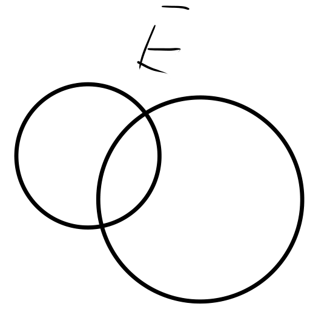

<!-- unit: N-INTRO -->
# 实分析 7：测度与 Lebesgue 外测度

## 阅读约定

普通正文保留原稿内容与原有路线。蓝色 `info` 块按“补充”“补证”“纠错”说明新增内容；红色只标原稿明确未答位置。中性疑字编号见独立疑点表。

## 目录

1. [测度公理、例子与 Jordan 观点](#measure-basics)
2. [Jordan 判据、稠密覆盖引理与 Lebesgue 覆盖](#jordan-and-coverings)
3. [覆盖族、外测度定义及其初步性质](#outer-measure-definition)
4. [可列次可加性及零外测度例子](#subadditivity-and-null-sets)
5. [区间体积、内测度与可测性的引入](#inner-measure-introduction)
6. [Carathéodory 条件与选择公理旁注](#caratheodory-and-choice)

<!-- unit: N-P001-HEAD -->

## 测度公理、例子与 Jordan 观点

<!-- unit: N-P001-001 -->
$σ$ 代数。

<!-- unit: N-P001-002 -->
$$\Sigma\subseteq\mathcal P(X).$$

<!-- unit: N-P001-002-S1 -->
> [!info] 补充：$σ$ 代数的定义
> 这里标题所指的是：$X\in\Sigma$；若 $A\in\Sigma$，则 $X\setminus A\in\Sigma$；若 $A_1,A_2,\ldots\in\Sigma$，则 $\bigcup_{i=1}^{\infty}A_i\in\Sigma$。原稿本页只写了 $\Sigma\subseteq\mathcal P(X)$，没有逐项重列这些封闭条件。

<!-- unit: N-P001-003 -->
$$m:\Sigma\longrightarrow\mathbb R^+.$$

<!-- unit: N-P001-003-S1 -->
> [!info] 补充：值域约定
> 为同时容纳本页的计数测度、后文的无穷外测度以及空集的零值，后续完整论证把值域解释为 $[0,+\infty]$。原稿写的是 $\mathbb R^+$；不能把它未经说明地理解为仅含严格正的有限实数。

<!-- unit: N-P001-004 -->
（1）$m(\varnothing)=0$。

<!-- unit: N-P001-005 -->
（2）$$m\!\left(\bigcup_{i=1}^{\infty}A_i\right)=\sum_i m(A_i).$$

<!-- unit: N-P001-006 -->
旁写条件：$A_i\cap A_j=\varnothing$。

<!-- unit: N-P001-006-S1 -->
> [!info] 补充：量词
> 上式要求 $A_i\in\Sigma$，且当 $i\ne j$ 时 $A_i\cap A_j=\varnothing$。原稿省略了 $i\ne j$；若也取 $i=j$，条件将错误地强制每个 $A_i$ 为空。

<!-- unit: N-P001-007 -->
Lebesgue：平移不变、正规性。

<!-- unit: N-P001-007-S1 -->
> [!info] 补充：术语范围
> 保留课堂用语“正规性”。本页没有给出该词定义，因此不把它静默替换成“归一化”或“正则性”的某一个特定版本。通常 Lebesgue 测度还满足单位方体体积为 $1$，并可由开集从外、紧集从内逼近；这些是不同性质。

<!-- unit: N-P001-008 -->
例：counting 测度。
$$E\longmapsto m(E)=|E|.$$

<!-- unit: N-P001-008-S1 -->
> [!info] 补充：计数的无穷值
> 当 $E$ 有限时 $m(E)$ 是元素个数；当 $E$ 无限时，实值测度记号下取 $m(E)=+\infty$，而不取某个无穷基数。若可列个集合互不相交，有限情形由计数相加得到；若并集无限，要么某一项已经无限，要么有无穷多个非空项，右侧均为 $+\infty$。

<!-- unit: N-P001-009 -->
Dirac 测度。
$$\delta:2^X\longrightarrow\mathbb R^+.$$

<!-- unit: N-P001-010 -->
$$\delta_x(E)=\begin{cases}1,&x\in E,\\0,&x\notin E.\end{cases}$$

<!-- unit: N-P001-010-S1 -->
> [!info] 补证：Dirac 测度的可列可加性
> 固定 $x\in X$。对互不相交的 $A_i$，$x$ 至多属于其中一个集合。若不属于任何一个集合，则并集及各项的 Dirac 测度全为 $0$；若属于某个 $A_k$，则并集的测度为 $1$，右侧恰有第 $k$ 项为 $1$。因此定义确实给出测度。

<!-- unit: N-P001-011 -->
任意：$$2^{\mathbb R^n}\longrightarrow\mathbb R^+.$$

<!-- unit: N-P001-012 -->
$$\mathfrak c^{2^{\mathfrak c}}=(2^{\aleph_0})^{2^{\mathfrak c}}=2^{2^{\mathfrak c}}.$$

<!-- unit: N-P001-012-S1 -->
> [!info] 补充：基数算式说明
> 对有限的正整数 $n$，$|\mathbb R^n|=\mathfrak c$，故其幂集大小为 $2^{\mathfrak c}$。到一个大小为 $\mathfrak c$ 的值域的所有函数共有 $\mathfrak c^{2^{\mathfrak c}}$ 个。利用 $(\kappa^\lambda)^\mu=\kappa^{\lambda\mu}$ 以及 $\aleph_0\cdot2^{\mathfrak c}=2^{\mathfrak c}$，得到原式。此处只计算所有集合函数的数量，并没有断言这些函数全是测度。

<!-- unit: N-P001-013 -->
原稿问题：“无穷维，不存在〔疑字 RA07-Q001：量词样符号〕平移正规性、非平凡测度，？”

原稿明确留问号，未在此处作答。

<!-- unit: N-P001-013-S1 -->
> [!info] 补充与补证：无限维空间中的平移测度（协调编辑补充，作者核验）
> 原稿句首经回图比较更接近“无穷维”；中间量词样符号尚未唯一恢复。下面明确给出一个适用范围，不把补入前提冒充原字迹：**无限维可分赋范空间上，非零、平移不变的 Borel 测度不可能局部有限。**
>
> 先证明所需的 Riesz 引理：若 $Y$ 是赋范空间中的真闭线性子空间，$0<\theta<1$，取 $z\notin Y$，令 $d=d(z,Y)>0$；由距离下确界定义，选 $y_0\in Y$ 使 $\|z-y_0\|<d/\theta$。则单位向量 $u=(z-y_0)/\|z-y_0\|$ 满足 $d(u,Y)=d/\|z-y_0\|>\theta$。
>
> 假设这样的测度 $\mu$ 局部有限。取 $R>0$ 使 $\mu(B(0,R))<\infty$。有限维线性子空间是闭的，逐次对已选向量的线性包应用 Riesz 引理（$\theta=1/2$），得到两两距离大于 $1/2$ 的单位向量列 $u_k$。令 $x_k=(R/2)u_k$，则 $B(x_k,R/8)$ 两两不相交，并全在 $B(0,R)$ 内。由平移不变性，每个小球测度同为 $c=\mu(B(0,R/8))$；故任意 $N$ 都有 $Nc\le\mu(B(0,R))<\infty$，从而 $c=0$。可分性保证全空间能由可列个半径 $R/8$ 的球覆盖，于是 $\mu(X)=0$，矛盾。
>
> 命题范围已由 [USC 大学讲义《Wiener Measure》](https://dornsife.usc.edu/sergey-lototsky/wp-content/uploads/sites/211/2023/06/Week8-ByDiogo.pdf) 中的无限维说明核验；上面的固定半径详证由协调编辑提供并在本稿核算。仅“平移不变、非平凡”仍允许计数测度，局部有限性不能省略。

<!-- unit: N-P001-013-S2 -->
> [!info] 补充与补证：一个精确的相关命题
> 下面是另一个可独立验证的相关命题，讨论有限维实直线的全幂集；它不是前面无限维原问题的答案，也不是其逐字恢复。在选择公理下，不存在定义于 $\mathcal P(\mathbb R)$、可列可加、平移不变、且满足 $m([0,1))=1$ 的测度。
>
> 在 $[0,1)$ 上按 $x\sim y\iff x-y\in\mathbb Q$ 分成等价类，每类选一个代表，组成 $V$。令 $Q=\mathbb Q\cap(-1,1)$。各 $V+q$（$q\in Q$）互不相交：若 $v+q=w+r$，则 $v-w\in\mathbb Q$，代表唯一性给出 $v=w$，进而 $q=r$。同时 $[0,1)\subseteq\bigcup_{q\in Q}(V+q)\subseteq(-1,2)$。
>
> 由平移不变性和可列可加性，并集测度是可列无穷个相同的 $m(V)$ 之和。若 $m(V)=0$，则并集测度为 $0$，与包含 $[0,1)$ 矛盾；若 $m(V)>0$（包括无穷），则该和为 $+\infty$，与并集包含于 $(-1,2)$ 且 $m((-1,2))\le3$ 矛盾。
>
> “非平凡、平移不变”本身不足以得到不存在性：计数测度就是定义在全部子集上的反例。必须保留归一化或适当局部有限性的条件；本页“正规性”的确切课堂定义仍需后续复核。

<!-- unit: N-P001-014 -->
Jordan 测度。（有限覆盖）

<!-- unit: N-P001-015 -->
$$U(f,P)=\sum_i\sup f\,\Delta x_i.$$

<!-- unit: N-P001-015-S1 -->
> [!info] 补充：上和的完整记号
> 对分割 $P:a=x_0<x_1<\cdots<x_N=b$，令 $I_i=[x_{i-1},x_i]$、$\Delta x_i=x_i-x_{i-1}$，则 $U(f,P)=\sum_{i=1}^N(\sup_{I_i}f)\Delta x_i$。原稿的 $\sup f$ 未在本行标出取上确界的区间。

<!-- unit: N-P001-016 -->
$$L(f,P)=\sum_i\inf f\,\Delta x_i.$$

<!-- unit: N-P001-016-S1 -->
> [!info] 补充：下和与 Jordan 内容
> 同一分割下 $L(f,P)=\sum_{i=1}^N(\inf_{I_i}f)\Delta x_i$。对有界集合的示性函数，上下和对应有限网格中外包与内含区间的总体积；Jordan 理论使用有限分割，后文 Lebesgue 外测度则允许可列覆盖。

<!-- unit: N-P002-HEAD -->

## Jordan 判据、稠密覆盖引理与 Lebesgue 覆盖

<!-- unit: N-P002-001 -->
$$\sup_P U(f,P)=\inf_P L(f,P)\quad\Rightarrow\quad\text{Rm 可积}. $$

<!-- unit: N-P002-001-S1 -->
> [!info] 纠错：Darboux 判据中的上下确界
> 原稿把标准判据的 $\inf$ 与 $\sup$ 对调了。对于闭区间上的有界函数，正确的充要条件是
> $$\inf_P U(f,P)=\sup_P L(f,P).$$
> 左侧是上积分，右侧是下积分。对任意两个分割 $P,Q$，取共同加细 $R$ 得 $L(f,P)\le L(f,R)\le U(f,R)\le U(f,Q)$，故下积分不大于上积分；若相等，则可选分割分别使上、下和离共同值小于 $\varepsilon/2$，再共同加细，得到 $U-L<\varepsilon$。反过来，存在任意小的上、下和差时，二者的差只能为零。
>
> 原写的等式是过强的条件，仍能推出可积，但不能用作一般可积函数的判据。例如 $f(x)=x$ 在 $[0,1]$ 上可积，而单区间分割给出 $U=1,L=0$，所以 $\sup_PU=1\ne0=\inf_PL$。

<!-- unit: N-P002-002 -->
可以对应：内外测度。

<!-- unit: N-P002-003 -->
$E\subset\mathbb R^n$，则
$$E\text{ Jordan 可测}\iff m_J^*(\partial E)=0.$$

<!-- unit: N-P002-003-S1 -->
> [!info] 补充：有界性与判据说明
> Jordan 可测通常限定在有界集合。精确命题是：有界 $E\subset\mathbb R^n$ Jordan 可测，当且仅当其边界 $\partial E$ 的 Jordan 外内容为零。
>
> 取包含 $\overline E$ 的闭长方体 $R$。$E$ 的 Jordan 可测性等价于 $1_E$ 的上、下 Darboux 积分相等。网格中同时接触 $E$ 与 $E^c$ 的小长方体使 $1_E$ 的振幅为 $1$，其他小长方体使振幅为 $0$，因而上、下和之差就是这些混合小长方体体积的和。
>
> 若边界可被总体积任意小的有限个开长方体覆盖，由 $\partial E$ 的紧致性，可以选择足够细的网格，使每个接触边界的小长方体都留在这些开长方体的并中。混合小长方体必接触边界，故上、下和差任意小。
>
> 反过来，若上、下和差任意小，则混合小长方体覆盖除网格分割面外的全部边界。有限个网格分割面可用总体积任意小的薄长方体覆盖；再把混合小长方体略微扩大成开长方体，总体积仍可任意小。因此 $m_J^*(\partial E)=0$。

<!-- unit: N-P002-004 -->
原稿另写提示：$m_J^*:\ \displaystyle\int_a^b f(x)$。

<!-- unit: N-P002-004-S1 -->
> [!info] 补充：提示的规范含义
> 对有界 $E\subset[a,b]$，Jordan 外内容对应示性函数的上 Darboux 积分 $\overline{\int_a^b}1_E(x)\,dx$；内内容对应下积分。原稿此行未写被积函数应取 $1_E$、上下积分标记及 $dx$，这里补明对应关系。

<!-- unit: N-P002-005 -->
**Lemma.** 若 $S$ 在 $[0,1]$ 中稠密，且
$$S\cap[0,1]\subset\bigcup_{i=1}^{n}(a_i,b_i),$$

<!-- unit: N-P002-006 -->
则
$$[0,1]\subset\bigcup_{i=1}^{n}[a_i,b_i].$$

<!-- unit: N-P002-007 -->
Proof：内逼外包。

<!-- unit: N-P002-007-S1 -->
> [!info] 补证：有限性的作用
> 因为 $S\cap[0,1]$ 在 $[0,1]$ 中稠密，$[0,1]\subseteq\overline{S\cap[0,1]}$。有限个闭区间的并是闭集，而
> $$S\cap[0,1]\subseteq\bigcup_{i=1}^n(a_i,b_i)\subseteq\bigcup_{i=1}^n[a_i,b_i].$$
> 对包含关系取闭包即可得到结论。这里不能把有限并未经检验换成可列并，因为可列个闭集的并不必闭。

<!-- unit: N-P002-008 -->
对无限集定义求和（网）。

<!-- unit: N-P002-008-S1 -->
> [!info] 补充：非负族的求和
> 对任意指标集 $I$ 上的非负数族 $(a_i)$，定义 $\sum_{i\in I}a_i=\sup\{\sum_{i\in F}a_i:F\subset I\text{ 有限}\}$。有限子集按包含关系构成有向集，这些有限部分和构成递增网。此说明只补足“网”的含义，不给原稿额外附加一个未写出的定理。

<!-- unit: N-P002-009 -->
**Def（1）** $E\subset\mathbb R^n$，有开区间 $(I_k)$，使得
$$E\subset\bigcup_{k=1}^{\infty}I_k,$$
则称一个 Lebesgue 覆盖。

<!-- unit: N-P002-009-S1 -->
> [!info] 补充：高维区间和覆盖族
> 在 $\mathbb R^n$ 中，“开区间”指有界开长方体 $I=\prod_{j=1}^n(a_j,b_j)$，$a_j<b_j$。将 $E$ 的全部可列此类覆盖组成的族记作 $LC(E)$；一个族中的元素本身是一列开长方体。

<!-- unit: N-P002-010 -->
1. $LC(E)\ne\varnothing$，$\forall E\subset\mathbb R^n$。

<!-- unit: N-P002-011 -->
$$I_\alpha=(a_1,b_1)\cdots(a_n,b_n),\qquad a_i,b_i\in\mathbb Z.$$

<!-- unit: N-P002-011-S1 -->
> [!info] 补充：可列性
> 只取 $a_i<b_i$。每个长方体由一个整数 $2n$ 元组确定，而 $\mathbb Z^{2n}$ 可列，因此全部这类开长方体可列。原稿的并集下标仅为简记，这里用 $\alpha$ 表示枚举指标。

<!-- unit: N-P002-012 -->
$$\mathbb R^n=\bigcup_\alpha I_\alpha.$$

<!-- unit: N-P002-013 -->
$\forall x=(x_1,\ldots,x_n)$，
$$x\in\prod\bigl([x_1]-1,\ldots,[x_n]+1\bigr).$$
（此处保留原稿压缩的乘积记号。）

<!-- unit: N-P002-013-S1 -->
> [!info] 补全记号：逐坐标选取开区间
> $[x_j]$ 表示取整 $\lfloor x_j\rfloor$。准确地说，
> $$x\in\prod_{j=1}^{n}\bigl(\lfloor x_j\rfloor-1,\lfloor x_j\rfloor+1\bigr).$$
> 因为 $\lfloor x_j\rfloor\le x_j<\lfloor x_j\rfloor+1$，每个坐标都严格落在所选开区间内。所选端点为整数，故该长方体属于上述可列族。这样证明了它们覆盖 $\mathbb R^n$，也就覆盖任意 $E\subset\mathbb R^n$。

<!-- unit: N-P003-HEAD -->

## 覆盖族、外测度定义及其初步性质

<!-- unit: N-P003-001 -->
或：$\mathbb R^n$ 是 Lindelöf，有遗传性。导出相应区间放大，来证明。

<!-- unit: N-P003-001-S1 -->
> [!info] 补证：保留的第二条覆盖路线
> 欧氏空间有可数拓扑基：端点为有理数的开长方体。任意子空间 $E\subset\mathbb R^n$ 也有由这些基元素与 $E$ 的交组成的可数基，所以 $E$ 的任意相对开覆盖有可列子覆盖。证明是：对每个包含于某个覆盖成员的基元素，选一个这样的覆盖成员；最多选可列多个，且覆盖全部 $E$。
>
> 对每个 $x\in E$ 先选一个包含 $x$ 的有界开长方体；上述性质给出可列子覆盖，于是 $LC(E)\ne\varnothing$。若从相对开集出发，可将它们写成环境开集与 $E$ 的交，再在环境开集中选小开长方体。这补全原稿的“相应区间”提示。
>
> 这里遗传性来自欧氏空间的第二可数性；一般 Lindelöf 空间的任意子空间未必 Lindelöf。

<!-- unit: N-P003-002 -->
2. $LC(E)$：所有覆盖的族，记为 $LC_E$。

<!-- unit: N-P003-003 -->
$\mathcal I=$“$\mathbb R^n$ 中全体开区间”，原稿简记其大小为 $\mathfrak c$，并写
$$\longrightarrow (\mathfrak c\times\cdots\times\mathfrak c),\qquad \mathfrak c^{\mathbb N}.$$

<!-- unit: N-P003-003-S1 -->
> [!info] 补充：基数与对象区分
> 一个开长方体由 $2n$ 个实数端点编码，因此 $|\mathcal I|\le\mathfrak c^{2n}=\mathfrak c$；仅改变一条边的一个端点已给出连续统多个不同长方体，故 $|\mathcal I|=\mathfrak c$。覆盖族 $LC(E)$ 是可列开长方体序列空间 $\mathcal I^{\mathbb N}$ 的子族。原稿用族本身代写基数，以下加绝对值以分清两者。

<!-- unit: N-P003-004 -->
$$\mathcal I^{\mathbb N}=\mathfrak c^{\mathbb N}=(2^{\aleph_0})^{\aleph_0}=\mathfrak c.$$

<!-- unit: N-P003-004-S1 -->
> [!info] 补充：规范算式
> 上式按基数理解为 $|\mathcal I^{\mathbb N}|=\mathfrak c^{\aleph_0}=2^{\aleph_0\cdot\aleph_0}=\mathfrak c$。因此全部可列覆盖构成一个集合，并且其基数不超过连续统。

<!-- unit: N-P003-005 -->
由（1）可取 $\{I_k\}\in LC(E)$。

<!-- unit: N-P003-006 -->
$\{I_k\}$ 可覆盖。

**Def（2）** 定义
$$m^*:2^{\mathbb R^n}\longrightarrow[0,+\infty].$$

<!-- unit: N-P003-007 -->
$$E\longmapsto\inf\sum_{k=1}^{\infty}|I_k|,\qquad I_k\in LC_E.$$
约为外测度。

<!-- unit: N-P003-007-S1 -->
> [!info] 补全记号：Lebesgue 外测度
> $$m^*(E)=\inf_{(I_k)\in LC(E)}\sum_{k=1}^{\infty}|I_k|,\qquad |I_k|=\prod_{j=1}^n(b_{kj}-a_{kj}).$$
> 下确界遍历整个覆盖序列 $(I_k)$；原稿 $I_k\in LC_E$ 是省略族括号的写法。每项体积非负，允许总和为 $+\infty$。因为覆盖族非空，该定义给出 $[0,+\infty]$ 中的确定数值。

<!-- unit: N-P003-008 -->
**Remark**

（1）$I_n$ 可为 $\varnothing$。

<!-- unit: N-P003-008-S1 -->
> [!info] 补充：空项约定
> 约定 $|\varnothing|=0$，允许用空集补齐有限覆盖，使其成为可列序列。这里不要求每一个编号都对应非空长方体。

<!-- unit: N-P003-009 -->
（2）$I_n$ 是否可为〔疑字 RA07-Q002：字形候选“闭矩形”〕，可证明。Proof：

<!-- unit: N-P003-010 -->
$\forall\varepsilon$，$\forall\{B_i\}\in\overline{\mathcal B}$，
$$I\subset\bigcup_iB_i.$$

<!-- unit: N-P003-011 -->
$$\sum_i|B_i|<|I|+\varepsilon.$$

<!-- unit: N-P003-011-S1 -->
> [!info] 补证：以闭长方体替代开长方体的版本
> 原问题中形状的逐字读法尚待复核。以下完成候选“闭矩形”对应的命题，并保留上面的覆盖与体积控制路线。
>
> 记 $m_o^*$ 为开长方体覆盖定义的外测度，$m_c^*$ 为闭长方体覆盖定义的数值。任一开长方体可用自己的闭包覆盖，体积不变，所以 $m_c^*(E)\le m_o^*(E)$。反方向，给定闭长方体覆盖 $(B_i)$ 和 $\varepsilon>0$，逐个把边向外扩大，得到开长方体 $J_i\supset B_i$，并使 $|J_i|<|B_i|+\varepsilon2^{-i}$；这由有限乘积对边长的连续性保证。于是 $E\subset\bigcup_iJ_i$ 且 $\sum_i|J_i|\le\sum_i|B_i|+\varepsilon$，故 $m_o^*(E)\le m_c^*(E)+\varepsilon$。令 $\varepsilon\downarrow0$，得两种定义相同；若相应下确界为无穷，按上述不等式直接处理。
>
> 更一般地，只要两类基本覆盖对象能按原稿所示方式互相覆盖，并把总体积误差分配成 $\varepsilon2^{-i}$，就能以同一比较论证证明定义相同。

<!-- unit: N-P003-012 -->
### 外测度性质

（1）$m^*(\varnothing)=0$。

<!-- unit: N-P003-013 -->
（2）$E\subset F\ \Rightarrow\ m^*(E)\le m^*(F)$。

<!-- unit: N-P004-HEAD -->

## 可列次可加性及零外测度例子

<!-- unit: N-P004-001 -->
（3）$\{E_k\}$：
$$m^*\!\left(\bigcup_kE_k\right)\le\sum_km^*(E_k).$$

<!-- unit: N-P004-002 -->
Proof：$\forall\varepsilon>0$，$\exists\{I_{k,j}\}\in LC(E_k)$（有限时）。

<!-- unit: N-P004-002-S1 -->
> [!info] 补充：有限与无穷分支
> 先补上两个初步性质的证明。空集可由全为空集的序列覆盖，总体积为零，故 $m^*(\varnothing)=0$。若 $E\subset F$，每个 $F$ 的覆盖也是 $E$ 的覆盖，即 $LC(F)\subseteq LC(E)$，下确界遂满足 $m^*(E)\le m^*(F)$。
>
> 对次可加性，若 $\sum_km^*(E_k)=+\infty$，待证不等式直接成立。否则每个 $m^*(E_k)<\infty$，因此能按下确界的定义选择下面的近最优覆盖。“有限时”应在这个总和有限的分支使用。

<!-- unit: N-P004-003 -->
$$E_k\subset\bigcup_{j=1}^{\infty}I_{k,j}.$$

<!-- unit: N-P004-004 -->
$$\sum_{j=1}^{\infty}|I_{k,j}|<m^*(E_k)+\frac{\varepsilon}{2^k}\qquad\text{（下确界）}.$$

<!-- unit: N-P004-005 -->
$$\bigcup_kE_k\subset\bigcup_{k=1}^{\infty}\bigcup_{j=1}^{\infty}I_{k,j}.$$

<!-- unit: N-P004-005-S1 -->
> [!info] 补充：可列覆盖仍合法
> $\mathbb N\times\mathbb N$ 是可列集，所以全部 $I_{k,j}$ 可以排成一个序列；这个序列属于 $LC(\bigcup_kE_k)$。此处只使用开长方体覆盖的定义，没有预先假设可列次可加性。

<!-- unit: N-P004-006 -->
$$m^*\!\left(\bigcup_{k=1}^{\infty}E_k\right)\le\sum_{(k,j)}|I_{k,j}|.$$
首个不等式下旁注：“下界”。

<!-- unit: N-P004-007 -->
$$\sum_{(k,j)}|I_{k,j}|<\sum_km^*(E_k)+\sum_{k=1}^{\infty}\frac{\varepsilon}{2^k}.$$

<!-- unit: N-P004-008 -->
Tonelli：可交换顺序。

$\varepsilon\to0$，取“$\le$”。

<!-- unit: N-P004-008-S1 -->
> [!info] 补证：非负双重和的换序及结论
> 对 $a_{k,j}=|I_{k,j}|\ge0$，把总和定义为所有有限指标子集部分和的上确界，则
> $$\sum_{(k,j)}a_{k,j}=\sum_k\sum_ja_{k,j}.$$
> 一方面每个有限指标子集只涉及有限个 $k$，其和不超过右侧；另一方面，任取有限个 $k$，各行和都可用有限部分和从下逼近，故这些行和的总和不超过左侧，再对有限个 $k$ 取上确界。这个初等非负求和论证就是此处调用 Tonelli 的具体内容。
>
> 因为 $\sum_{k=1}^{\infty}2^{-k}=1$，可得 $m^*(\bigcup_kE_k)\le\sum_km^*(E_k)+\varepsilon$。对任意 $\varepsilon>0$ 成立，遂得所列性质（3）。

<!-- unit: N-P004-009 -->
**Prop.** $\{x_k\}\subset\mathbb R^n$，$m^*(\{x_k\})=0$。

<!-- unit: N-P004-009-S1 -->
> [!info] 补证：单点与可列点集
> 固定 $x\in\mathbb R^n$，用以 $x$ 为中心、边长 $2r$ 的开立方体覆盖它，得 $0\le m^*(\{x\})\le(2r)^n$。令 $r\downarrow0$ 得单点外测度为零。然后用可列次可加性：
> $$0\le m^*(\{x_k:k\ge1\})\le\sum_{k=1}^{\infty}m^*(\{x_k\})=0.$$

<!-- unit: N-P004-010 -->
**Cor.** $m^*(\mathbb Q\cap[0,1])=0$。

<!-- unit: N-P004-011 -->
Cantor：$C\subset[0,1]$。
$$C=\bigcap_{n=0}^{\infty}C_n.$$

<!-- unit: N-P004-011-S1 -->
> [!info] 补充：Cantor 构造与所需体积上界
> $C_0=[0,1]$，每一步从保留的每个闭区间中删去中间三分之一开区间。于是 $C_n$ 由 $2^n$ 个长度为 $3^{-n}$ 的闭区间组成。对任何有限个闭区间，可把它们略微扩大为开区间，总长度只增加任意给定的 $\eta>0$；因此其并的外测度不超过原总长度。此上界可直接从定义得到，先于后文的“区间外测度等于长度”定理使用，不发生依赖循环。

<!-- unit: N-P004-012 -->
$$m^*(C)\le m^*(C_n)=\left(\frac23\right)^n.$$

<!-- unit: N-P004-012-S1 -->
> [!info] 补充：此处只需不等式
> 原稿写了 $m^*(C_n)=(2/3)^n$，该等式将在区间测度与有限可加性建立后成立。当前证明只需已说明的 $m^*(C_n)\le 2^n3^{-n}$。故对每个 $n$，$0\le m^*(C)\le(2/3)^n$；让 $n\to\infty$ 即得结论。

<!-- unit: N-P004-013 -->
$$m^*(C)=0.$$
旁注：“势是多少？”答：$\mathfrak c$。

<!-- unit: N-P004-013-S1 -->
> [!info] 补证：零外测度不等于可数
> 每个二进制序列 $(a_j)_{j\ge1}\in\{0,1\}^{\mathbb N}$ 给出 Cantor 点 $x=\sum_{j=1}^{\infty}2a_j3^{-j}$，因为其每一步都落在保留的闭区间中。若两个序列首次在第 $j$ 位不同，则主项差为 $2\cdot3^{-j}$，其后尾和差的绝对值至多 $3^{-j}$，所以所得两点不同。这给出 $\{0,1\}^{\mathbb N}$ 到 $C$ 的单射，故 $|C|\ge2^{\aleph_0}=\mathfrak c$；又 $C\subset\mathbb R$，故 $|C|=\mathfrak c$。

<!-- unit: N-P005-HEAD -->

## 区间体积、内测度与可测性的引入

<!-- unit: N-P005-001 -->
$I\subset\mathbb R^n$ 是有界区间，则 $m^*(I)=|I|$。

<!-- unit: N-P005-002 -->
若 $I$ 闭，则 $\forall\varepsilon>0$，$\exists I'$ 开，s.t.
$$|I'|<|I|+\varepsilon.$$

<!-- unit: N-P005-002-S1 -->
> [!info] 补证：有界长方体的外测度公式
> 上界：将 $\overline I$ 的每条边稍向外扩大，得到 $I'\supseteq I$，且体积小于 $|I|+\varepsilon$。故 $m^*(I)\le|I|$。原稿省写了包含关系，补为 $I\subset I'$。
>
> 下界先对闭长方体 $K$ 证明。任取可列开长方体覆盖 $(J_k)$，紧致性给出有限子覆盖 $J_{k_1},\ldots,J_{k_N}$。有限覆盖的体积满足 $|K|\le\sum_{r=1}^N|J_{k_r}|$：用 $K$ 和这些长方体的所有坐标端点作共同网格，每个落在 $K$ 内的小格内部均落在至少一个覆盖成员内，按格子体积相加即可；有限个分割面不贡献体积。于是 $|K|\le\sum_k|J_k|$，对覆盖取下确界得 $|K|\le m^*(K)$。
>
> 对任意开、闭或半开有界长方体 $I$，若体积为零，上界已经给出结论；若体积为正，在其内部取边长逐渐增大的闭长方体 $K_r$，使 $|K_r|\to|I|$。单调性给出 $m^*(I)\ge m^*(K_r)=|K_r|$，再令 $r\to\infty$。两侧合并，$m^*(I)=|I|$。

<!-- unit: N-P005-003 -->
任意测度 $>0$ 的〔集〕存在不可测子集。

<!-- unit: N-P005-003-S1 -->
> [!info] 补充：旁注的精确范围
> 这是关于 Lebesgue 测度（在选择公理下）的陈述，不能把“任意测度”误读为任意测度空间中的任意测度。例如定义在全部子集上的计数测度不存在不可测子集。完整构造在复习稿后面的“不可测子集”补证中给出；原稿此处只有这一行旁注。

<!-- unit: N-P005-004 -->
### 可测集

引入：$E\subset\mathbb R^n$。

<!-- unit: N-P005-005 -->
取 $G$ 开，$G\supset I\setminus E$。

<!-- unit: N-P005-006 -->
$I\setminus G\subset E$ 中紧集。

<!-- unit: N-P005-006-S1 -->
> [!info] 补充：紧性所需条件
> 此处应先假设 $E$ 有界，并取包含 $E$ 的闭有界长方体 $I$。因为 $G$ 开，$I\setminus G$ 是紧集；由 $G\supset I\setminus E$ 得 $I\setminus G\subset E$。原稿在引入行没有重新写这些条件。

<!-- unit: N-P005-007 -->
旁写：$|I|-|G|$。

<!-- unit: N-P005-007-S1 -->
> [!info] 补充：开集不一定包含于I
> 若 $G$ 是环境空间中的开集，未必有 $G\subset I$；对应紧集的精确体积关系为 $m(I\setminus G)=|I|-m(I\cap G)$。而 $|I|-m(G)$ 可作下界。此处原稿用“差体积”提示从外逼近补集以得到内逼近，并未写完限定条件。

<!-- unit: N-P005-008 -->
令 $$m_*(E)=|I|-m^*(I\setminus E).$$

<!-- unit: N-P005-009 -->
若 $m_*(E)=m^*(E)$，则 $E$ 可测。

<!-- unit: N-P005-010 -->
$$|I|=m^*(I\cap E^c)+m^*(E).$$

<!-- unit: N-P005-011 -->
$$|I|=m^*(I\cap E^c)+m^*(E\cap I).$$

<!-- unit: N-P005-012 -->
$\forall I$ 均成立。

<!-- unit: N-P005-012-S1 -->
> [!info] 补充：两行恒等式的量词
> 当 $E\subset I$ 时，$E\cap I=E$，所以上面的两种写法相同。对于不一定包含 $E$ 的测试长方体 $I$，应使用第二种写法：$|I|=m^*(I\cap E)+m^*(I\cap E^c)$。下一节把这推广为对任意测试集合 $A$ 的分割条件。

<!-- unit: N-P005-013 -->
$E$ 有界：$m^*(E)=m_*(E)$。

<!-- unit: N-P005-014 -->
无界：$E\cap I$ 可测。

<!-- unit: N-P005-014-S1 -->
> [!info] 补充：无界时的量词与定义
> 对无界集合，原稿的局部说法应理解为：对每个有界长方体 $I$，$E\cap I$ 可测。也可以只检查一列覆盖全空间的有界闭长方体 $[-N,N]^n$。这样避免在 $m_*(E)$ 中使用没有定义的 $+\infty-(+\infty)$。等价的统一定义是下一节的 Carathéodory 条件。

<!-- unit: N-P006-HEAD -->

## Carathéodory 条件与选择公理旁注

<!-- unit: N-P006-001 -->
Carathéodory。

<!-- unit: N-P006-002 -->
**Carathéodory 条件。** 设 $E\subset\mathbb R^n$。若对每个测试集合 $I\subset\mathbb R^n$，都有
$$m^*(I)=m^*(I\cap E)+m^*(I\cap E^c),$$
则称 $E$ 为 Lebesgue 可测集。

（定义行末项由本页后面的完整复写恢复。）

<!-- unit: N-P006-002-S1 -->
> [!info] 补充：测试集不限于区间
> 此处原稿继续沿用字母 $I$，但量词写的是任意子集 $I\subset\mathbb R^n$，不能只把它理解为前一节的长方体。为避免混淆，后面的补证也用 $A$ 表示任意测试集合。由于 $A=(A\cap E)\cup(A\cap E^c)$，次可加性总给出“$\le$”；验证可测性时只须证明反向“$\ge$”。

<!-- unit: N-P006-003 -->
则称 $E$ Lebesgue 可测，记 $m^*(E)=m_L(E)$。

〔下标按本行“Lebesgue”语境整理为 $L$；详见记号局部图。〕

<!-- unit: N-P006-003-S1 -->
> [!info] 补充：限制外测度
> 对可测集定义 $m(E)=m^*(E)$，得到 Lebesgue 测度；这里也保留原稿的 $m_L$ 记号。$mathcal M$ 上的可列可加性将在后续可测集性质中证明，而不是由“定义”一词直接获得。

<!-- unit: N-P006-004 -->
记全体为 $\mathcal M$。

<!-- unit: N-P006-005 -->
原图：左上较小圆与右下较大圆相交，圆上方写 $E$；右下圆未写名称，没有阴影或箭头。

<!-- unit: N-P006-005-S1 -->
> [!info] 补充：图与公式的对应
> 这幅图用于提示“一个测试集被 $E$ 切成内外两部分”。可以把另一圆视为测试集 $I$，其位于 $E$ 内的部分是 $I\cap E$，位于外面的部分是 $I\cap E^c$；这个名称对应是编者解释，原图没有给另一圆标字。

<!-- unit: N-P006-006 -->
一般：
$$m^*(I)=m^*(I\cap E)+m^*(I\cap E^c).$$

<!-- unit: N-P006-007 -->
不可测集存在：
$$AC+ZF\ \longrightarrow\ P\text{ 成立}. $$

<!-- unit: N-P006-007-S1 -->
> [!info] 补充：命题P的含义
> 此处 $P$ 指“存在非 Lebesgue 可测的实数集”。$AC$ 是选择公理，$ZF+AC=ZFC$。选择公理用于从有理差等价类中选代表，Vitali 构造说明 $ZFC\vdash P$。

<!-- unit: N-P006-008 -->
设 $T$ 是一个公理体系。

（1）存在一个 model，s.t. $T+P$。

<!-- unit: N-P006-009 -->
（2）存在另一个 model，s.t. $T+\neg P$。

<!-- unit: N-P006-010 -->
则 $P$ 独立于公理体系。

<!-- unit: N-P006-010-S1 -->
> [!info] 补证：模型与不可证明性
> 若有模型 $M_+\models T+P$ 和 $M_-\models T+\neg P$，则 $T$ 不能证明 $P$，否则由逻辑可靠性 $M_-$ 也应满足 $P$；同理，$T$ 不能证明 $\neg P$，否则 $M_+$ 矛盾。因此 $T\nvdash P$ 且 $T\nvdash\neg P$。原稿这里的 $T+P$ 表示模型满足合并后的全部公理。

<!-- unit: N-P006-011 -->
$P$ 在“存在一个不可达基数”情况下：

<!-- unit: N-P006-012 -->
$$ZF\nvdash P,\qquad ZF\nvdash\neg P.$$

<!-- unit: N-P006-012-S1 -->
> [!info] 补充：相对一致性前提须写清
> 这里是模型存在性下的结论。Solovay 的原论文 Theorem 1 以“存在 $ZFC+$存在不可达基数的传递模型”为假设，构造满足 $ZF+DC$ 且所有实数集 Lebesgue 可测的传递模型；$DC$ 是依赖选择。该模型满足 $\neg P$，而一个 $ZFC$ 模型通过 Vitali 构造满足 $P$。因此在上述模型存在假设下，$P$ 对 $ZF$ 独立。
>
> 来源：[Robert M. Solovay, *A Model of Set-Theory in Which Every Set of Reals is Lebesgue Measurable* (1970), Theorem 1](https://www.liutianren.com/discrete/ref/Logic%20and%20Set%20Theory/Solovay-ModelSetTheoryEvery-1970.pdf)，以及[期刊原始书目](https://annals.math.princeton.edu/1970/92-1/p01)。原稿并未给出 forcing 构造；这里补的是准确假设和结论，不把深层模型定理伪装成课堂已证。

<!-- unit: N-P006-013 -->
若 $ZF\to P$，
$$ZFC\to P.$$

<!-- unit: N-P006-013-S1 -->
> [!info] 纠错：这两行没有导出矛盾
> 因为 $ZFC$ 包含 $ZF$，这个推导本身成立；但 $ZFC\vdash P$ 原本就是已知结论，所以不能据此证明 $ZF\nvdash P$。要排除 $ZF\vdash P$，应使用满足 $ZF+\neg P$ 的 Solovay 模型。要排除 $ZF\vdash\neg P$，则可反设它成立，推出 $ZFC\vdash\neg P$，与一致的 $ZFC$ 中 $P$ 的证明冲突。原稿的正负号原样保留于上方。
