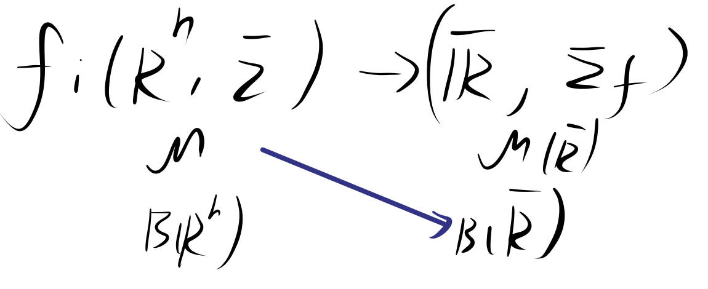

<!-- unit: T-title -->
# 实分析 9：保真转写

按原 PDF 的物理页序整理。原稿明确可读的内容以普通正文保存；上下文恢复与疑字采用中性标识。数学订正放在学习稿的蓝色信息块中。本稿没有旧稿对照材料。

<!-- unit: T-P001-head -->
## 物理第 1 页

<!-- unit: T-P001-U001 -->
**Def.** 若存在一列开集 $\{G_i\}$ 及闭集列 $\{F_i\}$，使得（拓扑下）：

<!-- unit: T-P001-U002 -->
$$
G=\bigcap_{i=1}^{\infty}G_i,\qquad F=\bigcup_{i=1}^{\infty}F_i,
$$
称 $G$ 为 $G_\delta$ 集，$F$ 为 $F_\sigma$ 集。

<!-- unit: T-P001-U003 -->
这是表示法。

<!-- unit: T-P001-U004 -->
1. 开集是 $G_\delta$，闭集是 $F_\sigma$。

<!-- unit: T-P001-U005 -->
2. $G_\delta$ 不一定是 $F_\sigma$。〔“不一定”按上下文恢复〕

<!-- unit: T-P001-U006 -->
3. $\mathbb Q$ 是 $F_\sigma$，$\mathbb Q^c$ 是 $G_\delta$。

<!-- unit: T-P001-U007 -->
4. $\{x\}=\displaystyle\bigcap_{n=1}^{\infty}B(x,1/n)$。单点是 $G_\delta$ 与 $F_\sigma$。

<!-- unit: T-P001-U008 -->
5. 开集是否是 $F_\sigma$？闭集是否是 $G_\delta$？

右侧旁注：“会有〔疑字 001〕有反例”。

<!-- unit: T-P001-U009 -->
一般距离空间中成立。

<!-- unit: T-P001-U010 -->
设 $F\subset(X,d)$，令
$$
U_n=\{x\in X:d(x,F)<1/n\}.
$$

<!-- unit: T-P001-U011 -->
$$
d(x,F):X\longrightarrow[0,\infty).
$$

<!-- unit: T-P001-U012 -->
$$
F=\bigcap_n U_n.
$$
“开” $\longleftarrow [0,1/n)$ “开”。〔箭头表示以距离函数取逆像。〕

<!-- unit: T-P001-U013 -->
**Prop.** $F_\sigma$、$G_\delta$ 均为 Borel 集。

<!-- unit: T-P001-U014 -->
**Prop.**
$$
\mathcal B(\mathbb R^n)\subsetneq\mathcal M(\mathbb R^n).
$$

<!-- unit: T-P002-head -->
## 物理第 2 页

<!-- unit: T-P002-U001 -->
$$
\mathcal O(\mathbb R^n)\subset\mathcal M(\mathbb R^n).
$$
包含开集的最小 $\sigma$ 代数是 Borel 代数。

<!-- unit: T-P002-U002 -->
$$
\overline{\overline{\mathcal B(\mathbb R^n)}}=\mathfrak c.
$$

<!-- unit: T-P002-U003 -->
下界：单点集。〔该行左侧有勾。〕

<!-- unit: T-P002-U004 -->
上界：Borel 层级，用超限归纳。

<!-- unit: T-P002-U005 -->
Cantor 集也是 Borel 集，$\exists E\subset C$，但 $E\notin\mathcal B(\mathbb R)$。

<!-- unit: T-P002-U006 -->
反证法：
$$
\overline{\overline{\mathcal P(\mathrm{Cantor})}}
\le\overline{\overline{\mathrm{Borel}}},
$$
矛盾。

<!-- unit: T-P002-U007 -->
不存在外测度 $\mu^*$，s.t. 由 Carathéodory 条件生成 Borel 代数。

<!-- unit: T-P002-U008 -->
可以理解：
$$
\mathrm{Lebesgue}\big|_{\text{Borel 集上}}=\text{Borel 测度}.
$$

<!-- unit: T-P002-U009 -->
Borel 集上，

<!-- unit: T-P002-U010 -->
$$
E=E^\circ\mathbin{\dot\cup}(E\cap\partial E).
$$

<!-- unit: T-P002-U011 -->
**Prop.**
$$
E\in\mathcal M\quad\Longleftrightarrow\quad E\cap\partial E\in\mathcal M.
$$

<!-- unit: T-P002-U012 -->
测度的完备化，局部逼近。开集〔疑字 002〕扩大逼近〔疑字 002〕。

<!-- unit: T-P002-U013 -->
**Lemma.** $E\in\mathcal M$，则下述性质成立。〔接第 3 页。〕

<!-- unit: T-P003-head -->
## 物理第 3 页

<!-- unit: T-P003-U001 -->
(1) $\forall\varepsilon>0$，$\exists$ 开集 $G\supset E$，s.t.
$$
m(G\setminus E)<\varepsilon.
$$

<!-- unit: T-P003-U002 -->
(2) $\forall\varepsilon>0$，$\exists$ 闭集 $F\subset E$，s.t.
$$
m(E\setminus F)<\varepsilon.
$$

<!-- unit: T-P003-U003 -->
原稿提问：与外测度结论区别？

〔问号用蓝色椭圆圈出，原位置未写答。〕

<!-- unit: T-P003-U004 -->
**(1) 当 $m(E)<+\infty$。**

<!-- unit: T-P003-U005 -->
$\forall\varepsilon>0$，$\exists\{I_i\}\in\mathcal L_c(E)$，s.t.

<!-- unit: T-P003-U006 -->
$$
E\subset\bigcup_{i=1}^{\infty}I_i,
\qquad\sum_i|I_i|<m(E)+\varepsilon.
$$

<!-- unit: T-P003-U007 -->
$$
G=\bigcup_i I_i\quad\text{开},\qquad
m(G)\le\sum_i|I_i|<m(E)+\varepsilon.
$$

<!-- unit: T-P003-U008 -->
**$m(E)=+\infty$ 时。**

<!-- unit: T-P003-U009 -->
令
$$
B_i=\{x\in\mathbb R^n:|x|\le i\}.
$$

<!-- unit: T-P003-U010 -->
$$
E\cap B_i=E_i,\qquad m(E_i)<+\infty.
$$

<!-- unit: T-P003-U011 -->
$E$ 是 $\sigma$ 有限，再用 $\varepsilon/2^k$。〔此处原稿指数写 $k$，下文片段指标写 $i$。〕

<!-- unit: T-P003-U012 -->
右侧短注：$<i$，$(j>i)$。

<!-- unit: T-P003-U013 -->
$$
G=\bigcup_{i=1}^{\infty}G_i.
$$

<!-- unit: T-P003-U014 -->
$$
\begin{aligned}
G\setminus E
&=\left(\bigcup_{i=1}^{\infty}G_i\right)\cap
\left(\bigcap_{i=1}^{\infty}E_i^c\right)\\
&\subset\bigcup_i(G_i\cap E_i^c)
=\bigcup_{i=1}^{\infty}(G_i\setminus E_i).
\end{aligned}
$$

<!-- unit: T-P003-U015 -->
即可。

<!-- unit: T-P003-U016 -->
**(2)** $E\in\mathcal M\Longleftrightarrow E^c\in\mathcal M$。

<!-- unit: T-P003-U017 -->
由 (1) 得，$\forall\varepsilon>0$，$\exists$ 开集 $G\supset E^c$，s.t.
$$
m(G\setminus E^c)<\varepsilon.
$$
〔接第 4 页。〕

<!-- unit: T-P004-head -->
## 物理第 4 页

<!-- unit: T-P004-U001 -->
$E\in\mathcal M$。

<!-- unit: T-P004-U002 -->
(1) 存在 $G_\delta$ 集，s.t. $G\supset E$ 且
$$
m(G\setminus E)=0.
$$

<!-- unit: T-P004-U003 -->
(2) 存在 $F_\delta$ 集，……
$$
m(G\setminus E)=0.
$$
〔这里原稿确写 $F_\delta$，条件处用省略线，并重复上一项的 $G\setminus E$。〕

<!-- unit: T-P004-U004 -->
实际上，在外测度下，$E\in\mathcal M$ 是和上面的引理等价。

<!-- unit: T-P004-U005 -->
也得到一种判定可测集的方法。

<!-- unit: T-P004-U006 -->
**Th. (1)** 设 $E\in\mathcal M$，则

<!-- unit: T-P004-U007 -->
$$
\begin{aligned}
m(E)
&=\inf\{m(G):G\supset E,\ G\text{ 开}\}\\
&=\sup\{m(F):F\subset E,\ F\text{ 闭}\}.
\end{aligned}
$$

<!-- unit: T-P004-U008 -->
(2) $E$ 有界，且 $m^*(E)=m_*(E)$，则 $E\in\mathcal M$。

<!-- unit: T-P004-U009 -->
(1) pf：

原稿待填：此证明标记之后未写证明。

〔第 5 页直接转入边界零测与积分话题。〕

<!-- unit: T-P005-head -->
## 物理第 5 页

<!-- unit: T-P005-U001 -->
$$
m^*(\partial E)=0\quad\Longrightarrow\quad E\in\mathcal M.
$$

<!-- unit: T-P005-U002 -->
## 勒贝格积分

<!-- unit: T-P005-U003 -->
草式：$E[y_{i-1}\le f<y_i)$。

<!-- unit: T-P005-U004 -->
$f(\xi_i)m(E)$。〔$\xi_i$ 按取样点语境恢复，原形近似 $G_i$。〕

<!-- unit: T-P005-U005 -->
连续：对 $\delta$ 基，基的原像是开集。〔原稿记作“$\delta$ 基”，本页未另作定义。〕

<!-- unit: T-P005-U006 -->
$f^{-1}$ 又对交、并、补取等。

<!-- unit: T-P005-U007 -->
**Prop.**
$$
f:(X,\Sigma\subset\mathcal P(X))\longrightarrow Y.
$$

<!-- unit: T-P005-U008 -->
$$
\Sigma_f=\{B\subset Y:f^{-1}(B)\in\Sigma\}.
$$

<!-- unit: T-P005-U009 -->
(1) $\Sigma$ 是 $f$ 上 $\sigma$ 拓扑，$\Sigma_f$ 是 $Y$ 上 $\sigma$ 拓扑。

〔第一个底空间位置原写形为 $f$。〕

<!-- unit: T-P005-U010 -->
(2) 若……$\sigma$ 代数，$\Sigma_f$ ……$\sigma$ 代数。

<!-- unit: T-P005-U011 -->
设 $f:(X,\tau_X)\longrightarrow Y$。

<!-- unit: T-P005-U012 -->
(1) $\Sigma_f$ 是 $Y$ 上 $\sigma$ 拓扑。

<!-- unit: T-P005-U013 -->
(2) $\Sigma_f$ 是 s.t. $f$ 连续的最大拓扑。

<!-- unit: T-P006-H -->
## 物理第 6 页

<!-- unit: T-P006-U001 -->
### 可测

<!-- unit: T-P006-U002 -->
**定义** $f:(X,\Sigma_X)\to(Y,\Sigma_Y)$。

<!-- unit: T-P006-U003 -->
若 $\forall U\in\Sigma_Y$，有 $f^{-1}(U)\in\Sigma_X$，则 $f$ 是 $(\Sigma_X,\Sigma_Y)$ 可测映射。

<!-- unit: T-P006-U004 -->
**引理** 若存在 $\mathcal D\subset\Sigma_Y$，使 $\sigma(\mathcal D)=\Sigma_Y$，

<!-- unit: T-P006-U005 -->
则 $f$ 是 $(\Sigma_X,\Sigma_Y)$ 可测 $\Longleftrightarrow\mathcal D\subset\Sigma_f$。

<!-- unit: T-P006-U006 -->
仅证 $\Longleftarrow$。$\Sigma_f$ 是〔疑字003〕$\sigma$ 代数。

<!-- unit: T-P006-U007 -->
$\Sigma_Y\subset\Sigma_f$。〔右侧有证明结束小记号。〕

<!-- unit: T-P006-U008 -->
$\Sigma_Y$ 变动，有不同的……〔原行止于“的”。〕

<!-- unit: T-P006-U009 -->
### 广义 $\overline{\mathbb R}$ 上的拓扑

<!-- unit: T-P006-U010 -->
（1）定义开区间。

<!-- unit: T-P006-U011 -->
（2）半直线。

<!-- unit: T-P006-U012 -->
只要邻域，〔疑字004〕（1）（2）线序拓扑。

<!-- unit: T-P007-H -->
## 物理第 7 页

<!-- unit: T-P007-U001 -->
令由开集生成的 $\sigma$ 代数。

<!-- unit: T-P007-U002 -->
（1）$\mathcal B(O(\mathbb R))=\mathcal B(\mathbb R,\{-\infty\},\{+\infty\})$。

<!-- unit: T-P007-U003 -->
$=$ 〔原稿等号后留空，待填。〕

<!-- unit: T-P007-U004 -->
$\mathbb R\longrightarrow\overline{\mathbb R}$。

<!-- unit: T-P007-U005 -->
Borel 集 $\longrightarrow\mathcal B(\overline{\mathbb R})$，扩充了。

<!-- unit: T-P007-U006 -->
（2）$\mathcal B(\overline{\mathbb R})=\sigma\{[a,+\infty]:a\in\mathbb R\}$。

<!-- unit: T-P007-U007 -->
＝四种广义半直线，在广义 $\mathbb R$ 上。

<!-- unit: T-P007-U008 -->
$\overline{\mathbb R}$ 与 $[0,1]$ 同胚。

<!-- unit: T-P007-U009 -->
可以证明 $\{-\infty\}$、$\{+\infty\}$ 是闭集，

<!-- unit: T-P007-U010 -->
则 $\{a\}\in\mathcal B(\overline{\mathbb R})$，$\forall a\in\overline{\mathbb R}$。

<!-- unit: T-P007-U011 -->
### 限制 $\Sigma$ 代数

<!-- unit: T-P007-U012 -->
$E\subset\mathbb R^n$，$\mathcal M$ 是 Lebesgue $\sigma$。

<!-- unit: T-P007-U013 -->
$\Sigma_E=\{E\cap F:F\in\mathcal M\}$。

<!-- unit: T-P007-U014 -->
称 trace $\sigma$ 代数。

<!-- unit: T-P007-U015 -->
特别的，若 $E$ 可测，则 $\Sigma_E=\{F\in\mathcal M:F\subset E\}$。

<!-- unit: T-P008-H -->
## 物理第 8 页

<!-- unit: T-P008-U001 -->
$B\subset E$，则

<!-- unit: T-P008-U002 -->
$B\in\Sigma_E\Longleftrightarrow B\in\mathcal M$。

<!-- unit: T-P008-U003 -->
**定义** $E\in\mathcal M$，称 $f:E\to\overline{\mathbb R}$ 可测：

<!-- unit: T-P008-U004 -->
$\forall a\in\mathbb R$，有 $E[f>a]=\{x\in E:f(x)>a\}\in\mathcal M$。

<!-- unit: T-P008-U005 -->
$E$ 上所有 Lebesgue 可测函数集合为 $\operatorname{MF}(E)$。

<!-- unit: T-P008-U006 -->
**Th** 设 $E\in\mathcal M$，则 $f\in\operatorname{MF}(E)$。〔原稿先如此起笔，下一行另起 “Th”。〕

<!-- unit: T-P008-U007 -->
**Th** $E\in\mathcal M$。令 $\mathrm E_f=\{B\subset\overline{\mathbb R}:f^{-1}(B)\in\Sigma_E\}$。〔首符号字形近 $\mathrm E_f$，本行后续及以下均记为 $\Sigma_f$。〕

<!-- unit: T-P008-U008 -->
则 $f\in\operatorname{MF}(E)\Longleftrightarrow\mathcal B(\overline{\mathbb R})\subset\Sigma_f$。

<!-- unit: T-P008-U009 -->
$\Longleftarrow$ 显然。

<!-- unit: T-P008-U010 -->
$\Longrightarrow$ 用生成〔疑字005〕。

<!-- unit: T-P008-U011 -->
$\mathcal D=\{(a,+\infty)\}$。

<!-- unit: T-P008-U012 -->
$\mathcal D\subset\mathcal B(\overline{\mathbb R})$。

<!-- unit: T-P008-U013 -->
$f:(\mathbb R^n,\Sigma)\longrightarrow(\overline{\mathbb R},\Sigma_f)$。

<!-- unit: T-P008-U014 -->
原图下方左列为 $\mathcal M$、$\mathcal B(\mathbb R^n)$，右列为 $\mathcal M(\overline{\mathbb R})$、$\mathcal B(\overline{\mathbb R})$。蓝色斜箭头从左上 $\mathcal M$ 指向右下 $\mathcal B(\overline{\mathbb R})$。

<!-- unit: T-P008-U015 -->
$\mathcal B(\overline{\mathbb R})\subset\mathcal M(\overline{\mathbb R})\subset\Sigma_f$。

<!-- unit: T-P009-H -->
## 物理第 9 页

<!-- unit: T-P009-U001 -->
$(\mathcal M\to\mathcal B)$，Leb。

<!-- unit: T-P009-U002 -->
$(\mathcal M\to\mathcal M)$。

<!-- unit: T-P009-U003 -->
请比较 4 个组合的可测的强弱。

<!-- unit: T-P009-U004 -->
$E[a\le f<b]\in\mathcal M$，$\forall a,b\in\mathbb R$，

<!-- unit: T-P009-U005 -->
$\not\Longrightarrow f\in\operatorname{MF}(E)$。

<!-- unit: T-P009-U006 -->
$\sigma(\mathcal I)=B\cup\{+\infty,-\infty\}$，$B\in\mathcal B(\mathbb R)$。

<!-- unit: T-P009-U007 -->
**例** $E$ 是 $\mathbb R^n$ 上不可测集。

<!-- unit: T-P009-U008 -->
令 $f(x)=\begin{cases}+\infty,&x\in E,\\-\infty,&x\notin E.\end{cases}$

<!-- unit: T-P009-U009 -->
$E[a\le f<b]=\varnothing$。

<!-- unit: T-P009-U010 -->
$E[f=\{-\infty,+\infty\}]=\mathbb R^n\in\mathcal M$。

<!-- unit: T-P009-U011 -->
$E\{f\ge a\}=E$，不可测。

<!-- unit: T-P009-U012 -->
**例** $E\in\mathcal M$，

<!-- unit: T-P009-U013 -->
$f(x)=C$ 可测。

<!-- unit: T-P010-H -->
## 物理第 10 页

<!-- unit: T-P010-U001 -->
$A\subset E\in\mathcal M$，$\chi_A:E\to\overline{\mathbb R}$。

<!-- unit: T-P010-U002 -->
$\chi_A(x)=\begin{cases}1,&x\in A,\\0,&x\notin A.\end{cases}$

<!-- unit: T-P010-U003 -->
$\chi_A\in\operatorname{MF}(E)$ iff $A\in\mathcal M$。

<!-- unit: T-P010-U004 -->
**proof** 原稿把 $E[f>a]$ 分成以下三段：

<!-- unit: T-P010-U005 -->
$E[f>a]=E$，$a<0$。

<!-- unit: T-P010-U006 -->
$E[f>a]=A$，$0<a$。

<!-- unit: T-P010-U007 -->
$E[f>a]=\varnothing$，$a>1$。

<!-- unit: T-P010-U008 -->
### 连续

<!-- unit: T-P010-U009 -->
孤立点本无法定义连续。

<!-- unit: T-P010-U010 -->
$f:E\to\mathbb R$，在 $E$ 上连续，$E\in\mathcal M(\mathbb R^n)$，

<!-- unit: T-P010-U011 -->
则 $\mathcal M f\in\operatorname{MF}(E)$。〔原稿在 $f$ 前另有 $\mathcal M$ 形符号。〕

<!-- unit: T-P010-U012 -->
$\Sigma_f$。

<!-- unit: T-P010-U013 -->
$\tau_f$。
